# Plan zajęć — wybór jak na stronie uczelni, kilka grup w jednym planie

Fork dla harmonogramów DSW (<https://harmonogramy.ideis.pl>) w **interfejsie
natywnej aplikacji** (`public/` to port widoku z `android/`): dzień, tydzień,
miesiąc i semestr, materiały do zajęć, 20 stylów (m.in. fiolet, róż i połączony)
— a nie stary web z siatką, motywami szkła i eksportami.

Wybór planu ma kolejność **jak w wyszukiwarce planów** — od wymiaru, który
zawęża cały zbiór — i dzieje się **na jednym ekranie**, krok po kroku:

| Krok | Co wybiera | Przykład |
| --- | --- | --- |
| **1. Rocznik** | rok, w którym zaczynałeś studia; tylko roczniki, które mają grupy w katalogu, z podpisem roku studiów | 2024/2025 · 3. rok |
| **2. Kierunek** | tylko kierunki z grupami **w tym roczniku**; przy dłuższej liście pole „Szukaj kierunku” (wpisz kilka liter — „inz” znajduje „Inżynierię…”) | Informatyka |
| **3. Specjalność** | tylko specjalności z grupami w tym roczniku; pierwszy wiersz to **„Pomiń specjalność”** | Prawo w biznesie i administracji |
| **4. Tryb studiów** | tylko tryby z grupami w tym wyborze | niestacjonarne |
| **Plan** | grupa wykładowa z bieżącego semestru (gdy wybór pasuje do kilku — lista) | PGK 1st 5sem Wyk |

Na starcie widać **wyłącznie rocznik**. Po wybraniu krok zwija się do jednego
wiersza („Rocznik · 2024/2025 ›”), a pod nim pojawia się następny — dotknięcie
wiersza otwiera wybrany krok ponownie. Nie ma paska kroków ani arkusza: ten sam
ekran wyboru jest na starcie aplikacji i w **Opcjach → Wybór planu**.

Rocznik jest **pierwszy**, bo indeksuje cały zbiór: po jego wybraniu lista
kierunków zawiera wyłącznie te, które mają plan w tym roku (19 z 29 dla
rocznika 2024, 27 dla 2026), a specjalność i tryb są liczone z tego samego
zbioru — każda opcja ma co najmniej jedną grupę.

Kroki, w których nie ma czego wybrać, **przechodzą same**: rocznik bez
specjalności (typowy 1. rok) pomija krok specjalności, a wybór z jednym trybem
od razu wczytuje plan. Pod listami nie ma opisów — tylko nazwy, rok studiów
przy roczniku i link „Zacznij od nowa”, który czyści wybór. Numer grupy można
wpisać ręcznie po rozwinięciu linku „Mam numer grupy”.

Wydział jest **stały**: Wydział Studiów Stosowanych we Wrocławiu (id 5453).
Pozostałe wydziały to studia podyplomowe i filie — mają inny układ planów
i na razie nie są obsługiwane.

Listy kierunków i specjalności są pobierane **z formularza uczelni** przy każdym
wyborze (`/api/ideis/kierunki`, `/api/ideis/specjalnosci`) i cache'owane 12 h;
specjalność z formularza tłumaczymy na wartość katalogu (skróty typu „IAiSC”,
dopiski w nawiasach). **Dostępność** każdej listy liczy serwer
(`server/ideis-options.js`): rocznik musi mieć grupę z pasującym rokiem studiów
i nie może pochodzić z zakończonego toku, a specjalność i tryb — grupę w tym
roczniku. Rok studiów i semestr **wynikają** z rocznika i dzisiejszej daty
(X–II = semestr zimowy, III–IX = letni), więc nie ma ich w formularzu —
semestr jest filtrem, nie polem.

Po wybraniu czterech kroków wczytuje się plan bazowy (grupa wykładowa). Potem
**„Dodaj grupy do planu”** pozwala dołożyć **własną grupę ćwiczeniową,
laboratoria i lektorat**: plan jest sumą wybranych grup
(`?groups=21613,21614&ay=2026`), a zajęcia cudzych grup są odsiewane na serwerze
(`server/merge.js`). **Wykłady są wliczone automatycznie**, a przy dodawaniu
grup wybierasz tylko ćwiczenia, laby i lektorat. Grupy można podejrzeć i usunąć
w **Opcjach → Plan** („Grupy w planie”). Zaznaczenie widać w kółku przy opcji,
a pasek „Dodaj” jest przyklejony do dołu arkusza — przy kilkudziesięciu grupach
nie trzeba przewijać listy do końca.

Wybór jest zapamiętywany w przeglądarce (`localStorage`), a link niesie
`?group=…` albo `?groups=…` i `?ay=…`, więc otwiera dokładnie ten sam plan.

**Wygląd** (Opcje → Wygląd) to ten sam katalog co w APK — **20 stylów plus
motyw „Własny”**:
Liquid Glass 1–3, visionOS (w tym „Wydajny”), klasyczne (Apple, Auto, Jasny,
Ciemny) i **Kolorowe**: Fiolet, Róż oraz Połączony (fiolet przechodzący w róż),
każdy w wersji ciemnej i jasnej. Palety leżą w `public/styles.js` w tej samej
postaci ARGB co `StyleCatalog.kt`, a `scripts/self-test.js` porównuje oba
katalogi, żeby rozjazd wyszedł w testach. Zmiana działa od razu, bez
przeładowania.

**Motyw „Własny”** (ostatnia grupa na liście) to dwa kolory wybrane przez
użytkownika: **kolor główny** (akcent) i **kolor tła**. Reszta palety — tekst,
panele, krawędzie, gradient i plamy tła — jest z nich wyliczana, więc para
zawsze daje spójny motyw: jasność motywu wynika z tła, a zbyt jasny akcent jest
przyciemniany do czytelnego kontrastu (WCAG ≥ 4,0). Ten sam wybór obowiązuje
w natywnej aplikacji **i w widżetach na pulpicie**. W webie kolory wybiera się
natywnym wybierakiem, w APK — suwakami barwy, nasycenia i jasności.

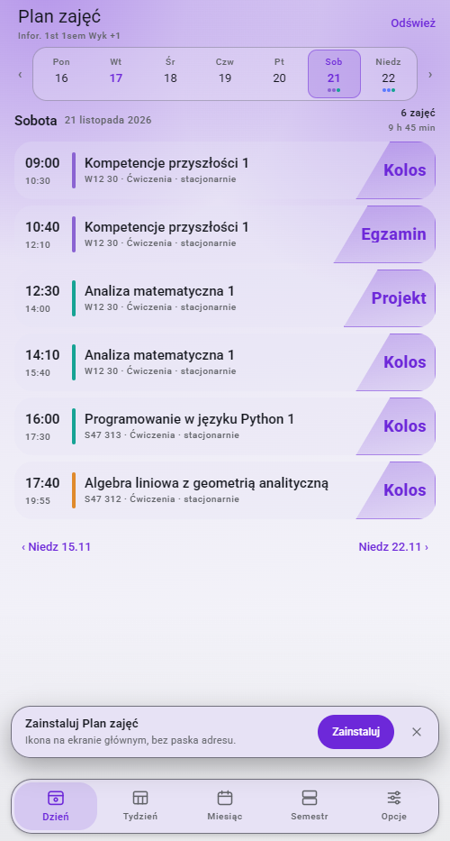

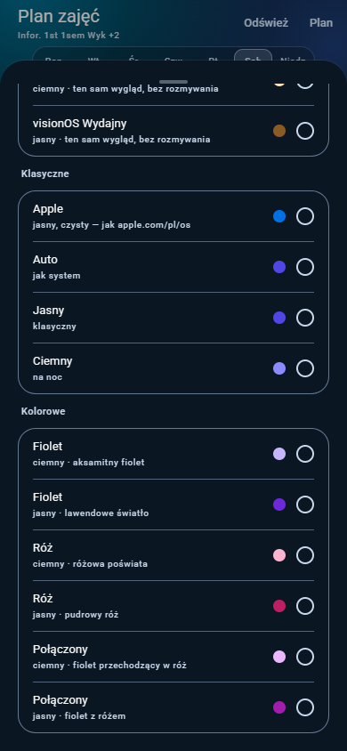

Licznik wejść (przeglądarka, PWA i aplikacja Android) jest pod **`/licznik`**
(`/wejscia` to stary adres). Pokazuje sumę i podział na źródła, a od wdrożenia
także **rozbicie na dni i godziny** (strefa Europe/Warsaw): ostatnie 14 dni,
godziny doby, dni tygodnia i szczyty. Rozbicie liczy się od pierwszego wejścia
po wdrożeniu (`since`) — starsze wejścia znamy tylko jako sumę, więc nikt ich nie
odtworzy; dzienne rozbicie trzyma 180 dni. Te same dane są w JSON pod
`/api/visits`. Zgłoszenia błędów i propozycje są w Opcjach i pod
**`/propozycje`**.

**Aplikacja Android (APK)** jest częścią tego samego forka — patrz
[„Aplikacja Android”](#aplikacja-android-apk): instaluje się obok wersji
z `plany.mati-it.pl` (inny `applicationId`), ma ten sam kreator wyboru i plany
wielogrupowe, a aktualizacje pobiera właśnie z ideis.

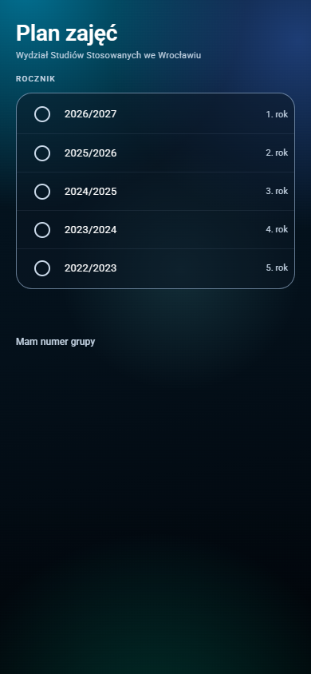

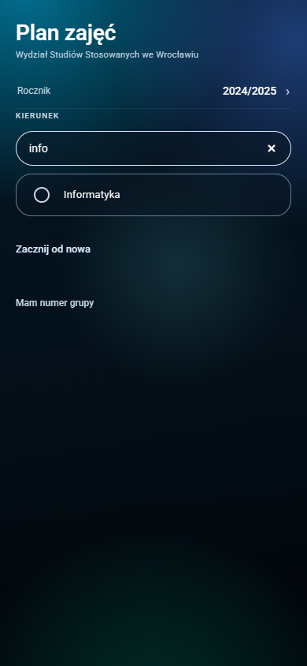

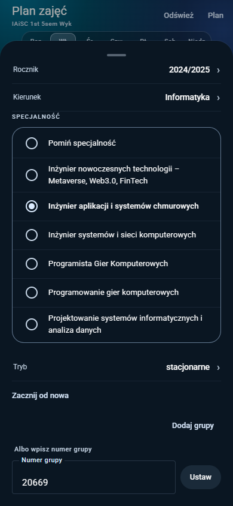

**Działa na:** <https://ideis.mati-it.pl> (VPS `olga322`, Docker + tunel
Cloudflare). Wersja z jednym zakresem nadal działa pod
<https://plany.mati-it.pl>.

## Instalacja na telefonie (PWA i APK)

Strona jest instalowalna jako **PWA** — po instalacji otwiera się bez paska
adresu, z ikoną na ekranie głównym i działa offline (service worker).

| Przeglądarka | Co robi aplikacja |
| --- | --- |
| Chrome / Edge / Opera (Android, desktop) | przeglądarka wysyła `beforeinstallprompt`; zatrzymujemy je i pokazujemy **własny pasek „Zainstaluj Plan zajęć”** nad dolnymi kafelkami — klik otwiera systemowe okno instalacji |
| Safari (iPhone, iPad) | Safari nie ma takiego zdarzenia, więc pokazujemy instrukcję: **Udostępnij → Dodaj do ekranu początkowego → Dodaj** |
| Firefox i inne | brak zdarzenia instalacji — zostaje instrukcja z Opcji |

Przy **pierwszym wejściu** (po wyborze planu) pojawia się okno „Zainstaluj
aplikację” z instrukcją dopasowaną do platformy: jednolinijkowy **skrót**
kliknięć i najwyżej **trzy kroki** na drogę instalacji (PWA, a na Androidzie
dodatkowo natywna aplikacja **APK z widżetami** — wersja web widżetów nie
obsługuje — z przyciskiem pobierania `/api/app/apk`, który przekierowuje na
najnowsze wydanie). Okno pokazuje się raz — później ta sama instrukcja jest
zawsze w **Opcjach → „Zainstaluj aplikację”**, a w trybie standalone (już
zainstalowana) aplikacja nie zawraca głowy.

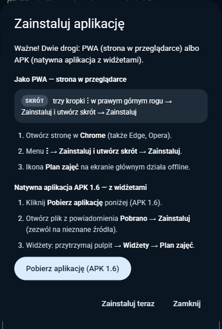

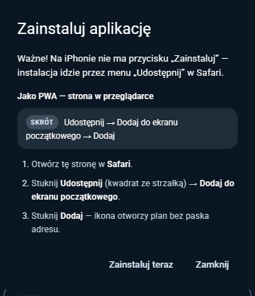

*(Zrzuty z emulacji: na prawdziwym iPhonie nie ma przycisku „Zainstaluj teraz” —
Safari nie wysyła zdarzenia instalacji, więc zostaje sama instrukcja. Na
Androidzie przycisk pojawia się tylko wtedy, gdy przeglądarka wysłała
`beforeinstallprompt`.)*
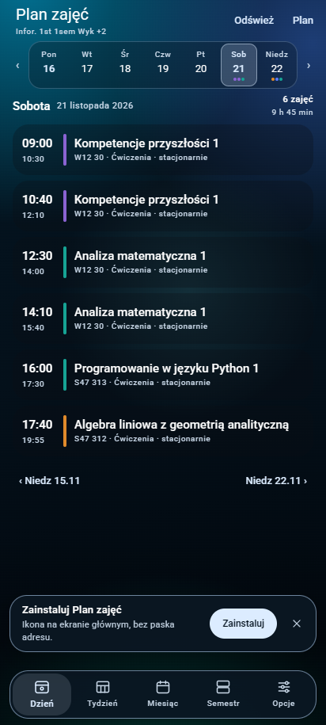

Wdrożone na produkcję 16.11.2026 (powłoka **v39**): `deploy/push.sh` przebudował
kontener, `GET https://ideis.mati-it.pl/` serwuje `?v=39`, `/api/app/apk`
przekierowuje na **APK 1.10**, a okno instalacji działa na Androidzie (sekcja APK)
i iPhonie (instrukcja Safari). Wpisy „Co nowego” v33 (instalacja), v34 (nowe
motywy) i v35 (notatki na kafelkach) opisują te zmiany. W nagłówku planu jest już
tylko „Odśwież” — plan zmienia się wyłącznie z Opcji (Plan → „Wybór planu”), tak
samo w APK.

## Aplikacja Android (APK)

Fork ma też własne wydanie natywnej aplikacji: `android/` to kopia aplikacji
bazowej z trzema zmianami — API wskazuje na
`https://ideis.mati-it.pl`, `applicationId` to `pl.matiit.planzajec.ideis`
(instaluje się obok aplikacji z `plany.mati-it.pl`), a ekran powitalny ma ten
sam wybór planu co web, plany wielogrupowe i licznik wejść. Karta wyboru
i kafelki list są **te same co w webie** (kółko przy zaznaczonej opcji),
a kroki otwierają się w arkuszu. Dzięki temu APK pokazuje cały katalog uczelni
i plany wszystkich roczników, a nie jeden zaszyty zakres.

**Różnica na teraz:** web (v34) prowadzi wybór **na jednym ekranie** — po
roczniku kolejne kroki pojawiają się same, a wybrane zwijają się do wiersza.
APK 1.8 ma **ten sam panel** (ten sam układ, kolejność i teksty), więc oba
klienty pokazują ten sam katalog w tej samej kolejności.

Co z webowych zmian trzeba przenieść do aplikacji natywnej, z opisem „jak”
i kryteriami akceptacji: [docs/ZMIANY-DO-APK.md](docs/ZMIANY-DO-APK.md).

**Zrobione w tym repozytorium (16.11.2026):** punkty 4–7 i 13 z tego dokumentu
są już w `android/` — sprawdzanie planu przy powrocie (`planChanged()`),
wspólna kotwica dnia/tygodnia/miesiąca, pusty plan z podpowiedzią i skrótem,
szkic pickera oddzielony od wyboru planu, stopka i domeny `ideis.mati-it.pl`.
Przy testach na emulatorze wyszły i zostały naprawione jeszcze: pusta lista
kierunków po restarcie aplikacji (Opcje → Wybór planu) i krok „Tryb studiów”
bez trybów, gdy wybór pochodzi z domyślnych serwera. Szczegóły w sekcji 17
dokumentu. Testy: `:app:testDebugUnitTest` (242) i `:app:lintDebug`. Wydanie
**1.9 (15)** dodało notatki na kafelkach, a **1.10 (16)** zmienia ich kształt na
ścięty lewy brzeg (sekcja 22). Poprzednie: **1.8 (14)** —
w nagłówku planu tylko „Odśwież” (plan zmienia się wyłącznie z Opcji), a wcześniej
panel wyboru i zarządzania planem 1:1 z PWA, jednolity kolor tekstu na starcie
i wybór motywu z kółkami jak w webie — sekcje 18, 19, 19a i 21 dokumentu;
1.7 (13) — panel jak w PWA; 1.6 (12) — widżety w motywie aplikacji, trzy nowe
motywy (Fiolet, Róż, Połączony).

### Notatki na kafelkach zajęć

Do każdych zajęć można dopisać krótką notatkę („Kolos”, „Egzamin”, własny tekst
do 15 znaków). Notatka stoi na kafelku jako **przezroczysta** plakietka w kolorze
wybranego motywu (delikatne podbarwienie akcentem i cienka krawędź zamiast litego
prostokąta): pełna wysokość karty, **ścięty ukośny lewy brzeg** (chorągiewka przy
prawej krawędzi), maksymalnie **35% szerokości** kafelka, a rozmiar tekstu
dopasowuje się sam (20 → 9 px w webie, 22 → 9 sp w APK) — nazwa przedmiotu
nigdy nie chowa się pod plakietką.

Notatka jest **wspólna**: przypisana do konkretnych zajęć (data i godzina),
zapisana na serwerze, więc dopisana w APK jest od razu w webie i odwrotnie —
i każdy może ją zmienić albo usunąć. Dodaje się ją w szczegółach zajęć:
dotknij kafelka, wybierz chip albo wpisz własny tekst. **Widżety** (dzień
i tydzień) pokazują ją na wierszu zajęć jako pigułkę w kolorze motywu; czyta się
ją z kopii na dysku, więc działa też bez internetu i po restarcie telefonu.

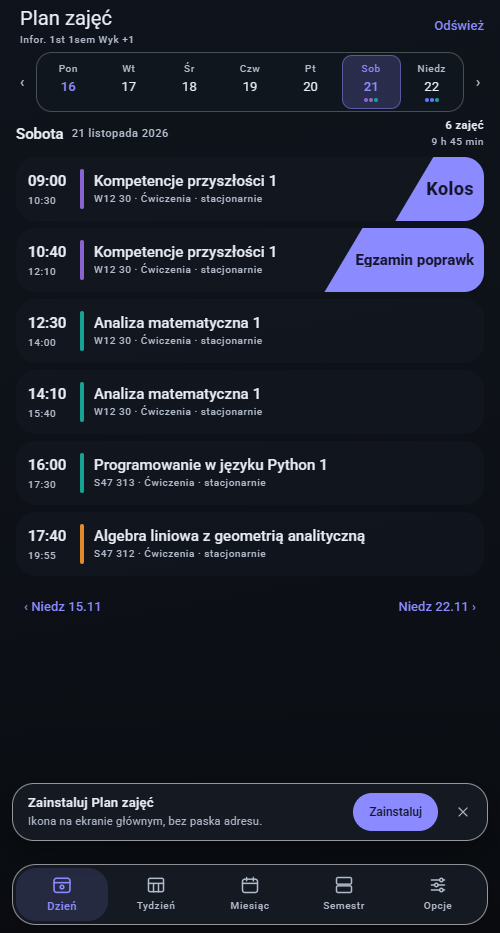

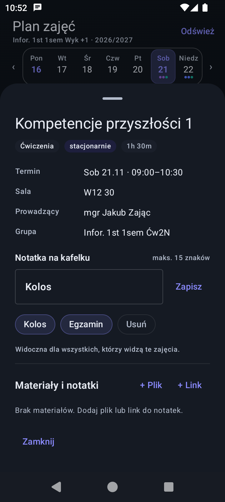

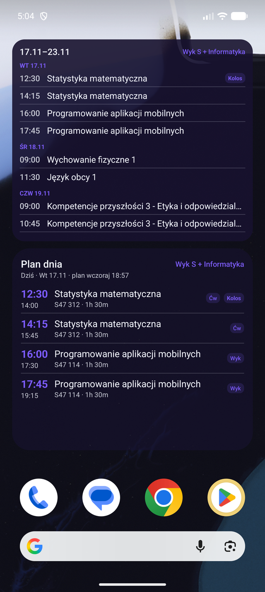


Aplikacja nie jest w żadnym sklepie, więc sama pyta serwer o nową wersję:

| Endpoint | Opis |
| --- | --- |
| `GET /api/app/latest?versionCode=N` | najnowsze wydanie (JSON) + `updateAvailable` |
| `GET /api/app/apk` | przekierowanie na plik z manifestu (stały adres do pobrania) |
| `GET /api/app/download/<plik>.apk` | plik instalacyjny (`Range` + `HEAD`, SHA-256 w nagłówku) |

Publikacja (z katalogu `plany-wybor`):

```powershell
.\scripts\publish-apk.ps1 -Bump -Notes "Co się zmieniło"     # build + releases/
.\scripts\publish-apk.ps1 -Bump -Upload                       # + wgranie na VPS
```

Manifest leży na wolumenie danych (`/opt/plany-wybor/data/releases`), więc
publikacja **nie** przebudowuje kontenera. Dwa kanały wydań się nie mieszają:
serwer odrzuca manifest opisujący inną aplikację niż `APP_ID`.

| Picker w APK — nabór, kierunek, specjalność, rok, typ, tryb | Plan starszego rocznika |
| --- | --- |
| 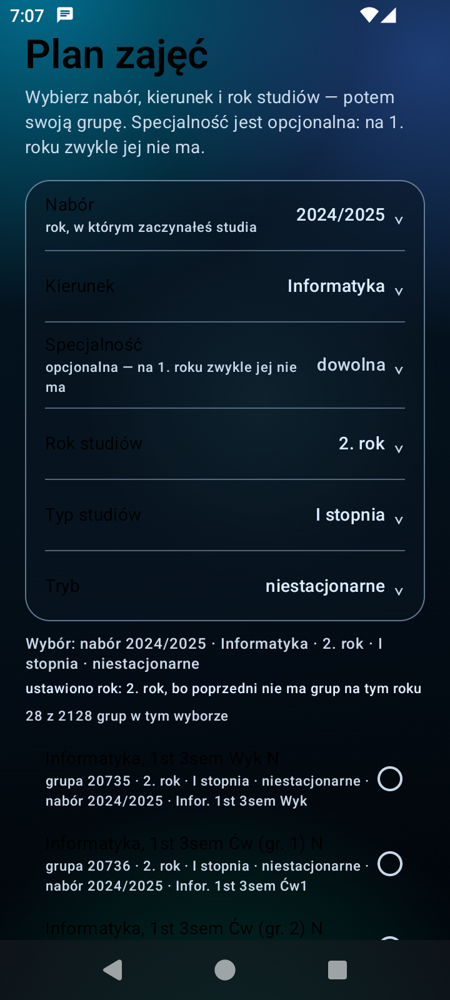 | 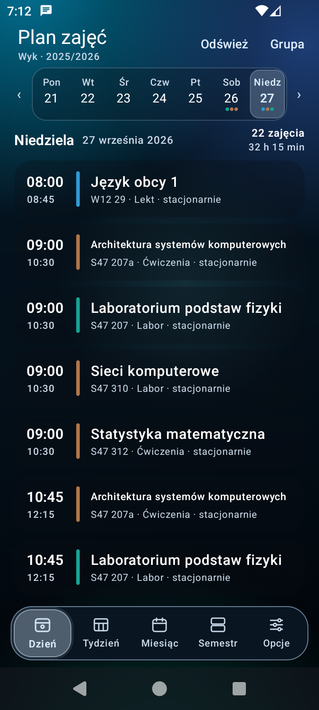 |

**Znane zachowanie:** starsze roczniki mają zwykle pusty plan — uczelnia
publikuje przy grupie tylko bieżący rok akademicki i podmienia go co roku
(patrz [„Znane zachowania”](#znane-zachowania)). Aplikacja pokazuje wtedy
„brak zajęć”, zamiast podstawiać plan innego rocznika.

## Skąd biorą się wymiary (to jest sedno forka)

Uczelnia **nie publikuje** roku, specjalności ani naboru jako osobnych pól.
Katalog „Znajdź grupę” ma tylko kod, nazwę, „Toki nauki”, kierunek i wydział —
resztę wyprowadza `server/dimensions.js` z nazwy grupy:

```text
kod:   Infor. 1st 3sem Lab1A
nazwa: Informatyka, 1st 3sem Lab (gr. 1A) N
toki:  Informatyka N lic. 3.50 2025/2026 Zima
```

| Wymiar | Reguła | Wynik dla przykładu |
| --- | --- | --- |
| rok studiów | `ceil(semestr / 2)` | 3sem → **2. rok** |
| nabór | rok akademicki toku − (rok studiów − 1) | 2025/2026 → **nabór 2024/2025** |
| specjalność | człon nazwy przed stopniem, o ile różni się od kierunku | brak („Informatyka” = kierunek) |
| typ studiów | stopień z nazwy (`1st`, `2st`, `Jmgr`, `Podypl.`, `Inż`) | I stopnia |
| tryb | ostatnia litera nazwy (`N`/`S`) | niestacjonarne |

Specjalność pojawia się w nazwie dopiero na starszych latach, np.
`Prawo w biznesie i administracji, 1st 3sem Wyk N` w kierunku `Administracja`.
Dlatego **wybór specjalności jest opcjonalny** — na 1. roku po prostu nie ma
czego wybierać i pole zostaje „dowolna”.

Trzy pułapki, które wymiary obsługują (wszystkie mają testy):

- `Infor.` i `Inforamtyka` to skrót i literówka kierunku `Informatyka` —
  nie osobna specjalność;
- `Kryminologia z kryminalistyką (BW)` — nawias to skrót kierunku macierzonego,
  trafia do pola `parent`, a nie do nazwy specjalności;
- `Psychologia kliniczna i zdrowia` w kierunku `Psychologia` **jest**
  specjalnością, mimo że zaczyna się od nazwy kierunku;
- `Inżynier aplikacji…` nie jest stopniem `inż` (polskie „ż” nie jest `\w`
  w JavaScripcie, więc granice słowa trzeba było zastąpić jawną klasą znaków).

**Gdy nazwa grupy milczy, wymiary biorą się z kolumny „Toki nauki”.** Część grup
nie ma w nazwie trybu ani stopnia („Administracja samorządowa 2st 3sem Wyk”),
ale tok uczelni podaje je wprost: `Administracja samorządowa N mgr 2.00
2025/2026 Zima` → tryb `N`, typ `2st`. Ta sama reguła obejmuje:

- `P` w nazwie (`Arteterapia P 1sem Cw2 N`) — studia podyplomowe, ten sam kod
  co `Podypl.`;
- litera trybu przed dopiskiem w nawiasie (`… Podypl. 1sem Wyk N (K)`).

Dzięki temu po pełnym katalogu zostaje **4 grupy bez trybu i 25 bez typu**
(wcześniej 57 i 75) — wszystkie to Erasmus+ i wpisy bez toków, gdzie uczelnia
naprawdę nic nie podaje. Sprzeczne toki nie dają zgadywanego wymiaru.

## Jak to działa

```
?group=21188 & ay=2026 ──> GroupRegistry ──> { VersionStore, PlanCache }
                             klucz wpisu: „21188” (rok bieżący)
                                          „21188@2025” (starszy nabór)
```

- **Rok akademicki planu** to `ay` = nabór + rok studiów − 1. Dla naboru
  2024 i 2. roku wychodzi 2025, czyli plan 2025/2026. Bez `ay` obowiązuje
  bieżący rok akademicki, więc stare linki `?group=21188` działają bez zmian.
- **`/api/groups` zwraca cały katalog** z gotowymi wymiarami (skrócone klucze,
  ~400 kB, cache 24 h). Reguła dopasowania grupy do wyboru
  (`public/selection.js`) jest **wspólna dla przeglądarki i serwera** — ten sam
  plik ładuje `<script>` i `require()`, więc nie ma dwóch implementacji filtra.
- **Wybór nie prowadzi w ślepą uliczkę.** Zmiana roku studiów dobiera nabór
  w obrębie oglądanego roku akademickiego; gdy wybór nie ma grup, picker sam
  przeskakuje na najbliższy rok/nabór, który je ma, albo luzuje pole, które
  wykluczyło kierunek (np. „I stopnia” dla Psychologii) — i pisze o tym pod
  polami. Ta sama reguła jest w APK (`SelectionAdjuster`).
- **Rozgrzewanie**: po starcie serwer dociąga w tle plany grup z początkowego
  wyboru (`DEFAULT_*`), żeby pierwsze wejście nie czekało na uczelnię.

## Uruchomienie lokalne

```powershell
node server/index.js
# w drugim oknie:
curl http://127.0.0.1:3000/health
curl "http://127.0.0.1:3000/api/groups"          # cały katalog z wymiarami
curl "http://127.0.0.1:3000/api/plan?group=21188"
curl "http://127.0.0.1:3000/api/plan?group=20735&ay=2025"   # starszy nabór
cmd /c "npm test"
```

Do testów nie zaśmiecaj produkcyjnego cache:

```powershell
$env:PORT="3111"; $env:CACHE_DIR="$env:TEMP\plany-wybor-cache"; node server/index.js
```

Testy: `node scripts/self-test.js` — 103 testy bez sieci. Katalog testowany na
wyimku prawdziwej strony (`tests/fixtures/znajdz-grupe.html`), który zawiera
wszystkie przypadki brzegowe wypisane wyżej. Zero zależności z npm.

Kontrola wymiarów na żywo (porównuje `ay`, sezon semestru i tryb z tokami,
które podaje sama uczelnia):

```powershell
node scripts/check-dimensions.js --groups=40
# ✓ rok akademicki, sezon semestru i tryb zgadzają się z tokami uczelni
```

## Endpointy

| Metoda | Ścieżka | Opis |
| --- | --- | --- |
| GET | `/` | aplikacja |
| GET | `/licznik` (i stare `/wejscia`) | licznik wejść: przeglądarka, PWA, aplikacja Android + rozbicie na dni i godziny |
| GET | `/api/ideis/kierunki[?ay=2026]` | kierunki z formularza uczelni (stały wydział) + tłumaczenie na katalog + **roczniki** z liczbą grup |
| GET | `/api/ideis/specjalnosci?kierunek=2333[&nabor=2024]` | specjalności kierunku **w roczniku**: oferta uczelni + wartości katalogu z licznikami grup |
| GET | `/api/ideis/tryby?kierunek=2333&nabor=2024[&spec=IAiSC]` | tryby studiów, które mają grupy w tym wyborze |
| GET | `/api/groups[?refresh=1]` | pełny katalog grup z wymiarami (cache 24 h) |
| GET | `/api/plan?group=21188[&ay=2025]` | plan grupy (JSON); `&version=N` — wybrana wersja |
| GET | `/api/plan?groups=21613,21614[&ay=2026]` | **scalony plan** wybranych grup (wykład + ćwiczenia/laby) |
| GET | `/api/version?group=21188` | lekki status wersji (także `?groups=…`): `currentFingerprint` = odcisk treści planu |
| GET | `/api/versions?group=21188` | historia wersji |
| GET | `/api/plan.ics?group=21188[&ay=2025]` | subskrypcja iCalendar |
| GET | `/api/plan.csv?group=21188[&ay=2025]` | CSV (Excel) |
| GET | `/api/attachments/index` | które zajęcia mają materiały (spinacz w widoku) |
| GET/POST | `/api/notes[?group=\|?groups=&ay=]` | notatki na kafelkach zajęć („Kolos”, „Egzamin”): mapa `identyfikator → tekst`, zapis maks. 15 znaków (puste usuwa); POST wymaga `group`/`groups` i sprawdza, czy zajęcia są w planie |
| GET/POST/DELETE | `/api/feedback[/:id]` | propozycje i błędy (anonimowo, limity na IP) |
| GET | `/propozycje` | strona zgłoszeń |
| GET | `/api/app/latest[?versionCode=N]` | najnowsze wydanie aplikacji Android |
| GET | `/api/app/apk` | przekierowanie na najnowszy plik APK |
| GET | `/api/app/download/<plik>.apk` | plik instalacyjny APK |
| GET/POST/DELETE | `/api/attachments…` | materiały do zajęć (jak w wersji bazowej) |
| GET | `/api` i `/api/openapi.json` | opis API i schemat OpenAPI 3.1 |
| POST | `/api/refresh?group=21188[&ay=2025]` | wymuszone sprawdzenie (także `?groups=…`) |
| POST | `/api/visit`, GET `/api/visits` | licznik wejść (`source`: `web`/`pwa`/`apk`) |
| GET | `/health` | stan, katalog, początkowy wybór, pamięć |

`ay` to cztery cyfry roku rozpoczęcia roku akademickiego; wartości spoza
zakresu (2000 – bieżący+2) zwracają `400`, podobnie jak zły numer grupy.
`groups` to 1–12 numerów grup po przecinku — pierwszy jest bazą planu
(wykład); serwer scala plany i zostawia tylko zajęcia przypisane do tych grup.

Kształt wpisu katalogu (`GET /api/groups`):

```json
{ "id": "21188", "c": "Infor. 1st 1sem Ćw2", "n": "Informatyka, 1st 1sem Ćw (gr. 2) N",
  "f": "Informatyka", "s": null, "d": "1st", "m": "N", "y": 1, "b": [2026], "sem": 1,
  "k": "Ćw", "num": "2" }
```

`f` kierunek, `s` specjalność (null = brak), `d` typ studiów, `m` tryb,
`y` rok studiów, `b` lista naborów, `sem` semestr, `k` forma zajęć, `num` numer grupy.

### Tożsamość wersji planu (`fingerprint`)

Numer `version.id` jest licznikiem **w pamięci procesu**: po restarcie serwera
`seed()` z pliku cache znowu daje `#1`. Klient porównujący tylko numer uznawał
swój stary plan za aktualny **na zawsze** — każda zmiana planu po wdrożeniu była
dla niego niewidoczna. Dlatego tożsamością wersji jest `fingerprint` (SHA-1
z treści zajęć: data, godziny, przedmiot, sala, prowadzący, uwagi, forma zajęć,
forma zaliczenia i przypisanie do grup), a `version.id` został wyłącznie
numerem do historii.

- `GET /api/version` → `currentFingerprint`,
- `GET /api/plan` → `version.fingerprint`,
- plan scalony (`?groups=`) → odcisk z odcisków poszczególnych grup,
- klient (web `samePlanVersion`, APK `samePlanVersion`) porównuje odcisk, potem
  `fetchedAt`, a numer wersji dopiero jako ostatnią deskę ratunku.

Regresja: `node scripts/check-restart-version.js --fixtures=%TEMP%\aprfix`
(zmiana planu → restart serwera → klient musi zauważyć różnicę).

## Konfiguracja

| Zmienna | Domyślnie | Znaczenie |
| --- | --- | --- |
| `PORT` / `HOST` | `3000` / `0.0.0.0` | nasłuch w kontenerze |
| `TZ` | `Europe/Warsaw` | strefa harmonogramu (weekend) |
| `GROUP_ID` | `21188` | grupa domyślna (plan startowy, `PINNED`) |
| `DEFAULT_NABOR` | bieżący rok | początkowy nabór w pickerze |
| `DEFAULT_FIELD` | `Informatyka` | początkowy kierunek |
| `DEFAULT_SPEC` | puste (dowolna) | początkowa specjalność |
| `DEFAULT_YEAR` | `1` | początkowy rok studiów |
| `DEFAULT_DEGREE` | `1st` | początkowy typ studiów |
| `DEFAULT_MODE` | `N` | początkowy tryb |
| `REFRESH_WEEKDAY_MIN` | `1440` | odświeżanie w dni robocze |
| `REFRESH_WEEKEND_MIN` | `60` | odświeżanie w weekendy |
| `CACHE_TTL_MIN` | `1440` | świeżość cache przy wejściu |
| `MAX_VERSIONS` / `MAX_ACTIVE_GROUPS` | `40` / `8` | historia i limit pamięci |
| `MAX_PLAN_GROUPS` | `12` | ile grup może mieć jeden scalony plan |
| `DEFAULT_FACULTY_ID` / `DEFAULT_FACULTY_LABEL` | `5453` / Wydział Studiów Stosowanych we Wrocławiu | stały wydział w formularzu uczelni |
| `IDEIS_COMBO_TTL_MIN` | `720` | cache list kierunków/specjalności (12 h) |
| `FEEDBACK_DIR` | `CACHE_DIR/feedback` | katalog zgłoszeń (`feedback.jsonl`) |
| `FEEDBACK_TOKEN` | puste | token moderacji (usuwanie zgłoszeń; puste = wyłączone) |
| `FEEDBACK_RATE_PER_MIN` | `10` | limit zgłoszeń na IP |
| `COUNTER_HOST` | puste | host, na którym `/` przekierowuje na `/licznik` |
| `APP_URL` | `https://ideis.mati-it.pl/` | link „otwórz plan” na stronie licznika |
| `APP_ID` | `pl.matiit.planzajec.ideis` | identyfikator aplikacji Android w manifeście wydania |
| `APP_RELEASE_DIR` | `CACHE_DIR/releases` | katalog z `latest.json` i plikami APK |
| `PLAN_RATE_PER_MIN` | `240` | limit odczytów planu na IP na minutę (`/api/plan`, `/api/version`, eksporty) |
| `FETCH_CONCURRENCY` | `2` | ile pobrań planu z uczelni może iść naraz |
| `NEGATIVE_CACHE_S` | `120` | po nieudanym pobraniu tyle sekund nie pytamy uczelni o tę samą grupę |
| `MAX_CONCURRENT_UPLOADS` / `UPLOAD_TIMEOUT_S` | `2` / `120` | ile uploadów naraz i po jakim czasie bezczynności ciało jest zrywane |
| `TRUST_PROXY` | `private` | komu ufać w `CF-Connecting-IP` / `X-Forwarded-For` (klucz limitów) |
| `CATALOG_TIMEOUT_MS` | `30000` | timeout pobrania katalogu grup z uczelni |
| `CACHE_DIR` | `./.cache` | cache planów, katalogu i załączników |

Pełna lista (załączniki, licznik, token odświeżania): [`.env.example`](.env.example).

### Limity i odporność

Publiczny serwer bez logowania musi sam się bronić — te mechanizmy są tanie
i działają na wszystkich endpointach:

| Mechanizm | Zachowanie |
| --- | --- |
| `Host` nagłówka nie używamy do routingu | `new URL(req.url, 'http://localhost')` w `try`; `Host: [` kończy się normalną odpowiedzią, nie `ERR_INVALID_URL` i nie śmiercią procesu |
| `POST` na endpointy tylko do odczytu | `/api/plan`, `/api/version`, `/api/versions`, `/api/groups`, `/api/plan.ics|.csv` → **405** z `Allow: GET, HEAD` |
| Limit rejestru już w `get()` | nowy numer grupy wypiera najdawniej używaną (LRU), a nie dopiero w tle w `checkAll()` |
| Sprzątanie cache na dysku | wypadająca grupa usuwa swój `plan-*.json`; przy starcie `sweepOrphans()` kasuje pliki grup spoza rejestru |
| Cache negatywny | po nieudanym pobraniu bez planu uczelnia nie jest pytana przez `NEGATIVE_CACHE_S`; przycisk „Odśwież” (`force`) omija go świadomie |
| Semafor pobrań | maks. `FETCH_CONCURRENCY` zapytań do harmonogramów naraz — enumeracja numerów nie zablokuje IP VPS |
| Limit tempa planu | `PLAN_RATE_PER_MIN` na IP dla **wszystkiego, co dotyka planu**: `/api/plan`, `/api/version`, `/api/versions`, eksporty, `/api/attachments*` (wołają `resolveClass`) i `/api/notes`; liczone po `remoteAddress`, gdy połączenie nie przyszło z zaufanego proxy |
| `?refresh=1` | na produkcji wymaga `REFRESH_TOKEN` (403 bez tokenu) — jedno żądanie to ~500 KB katalogu z uczelni i 20+ s pracy |
| Upload | typ pliku sprawdzany **przed** wczytaniem ciała, maks. `MAX_CONCURRENT_UPLOADS` buforów naraz, limit bezczynności ciała |
| Odświeżanie na produkcji | przy `NODE_ENV=production` `POST /api/refresh` wymaga `REFRESH_TOKEN`; bez niego → 503 |
| Zapis notatki | tylko dla zajęć, które są w planie (`group`/`groups` + `ay`) i z bieżącego roku akademickiego; błąd dysku → **503** i cofnięcie zmiany w pamięci |
| Nagłówki bezpieczeństwa | CSP (`script-src 'self'`, `frame-ancestors 'none'`), `X-Frame-Options: DENY`, `Referrer-Policy: no-referrer`, HSTS, `X-Content-Type-Options`, `Permissions-Policy` — na HTML, JSON, plikach i APK; inline `<script>` przeniesione do `theme-boot.js` i `propozycje.js` |
| ETag / 304 | pliki statyczne mają `ETag` z rozmiaru i mtime; powtórka z `If-None-Match` dostaje 304 bez ciała |

Testy warstwy HTTP (`node scripts/self-test.js`) uruchamiają prawdziwy serwer na
wolnym porcie i sprawdzają m.in. `Host: [`, `POST /api/plan` → 405, 304 oraz 429.

## Wdrożenie na VPS

```text
VPS:       root@olga322.mikrus.xyz -p 10322
Klucz:     ~/.ssh/mikrus_olga322
Katalog:   /opt/plany-wybor
Kontener:  plany-wybor (127.0.0.1:3002 -> 3000)
Tunel:     plan-zajec-tunnel (wspólny z plan.mati-it.pl i plany.mati-it.pl)
Domena:    ideis.mati-it.pl
```

Wgranie jednym poleceniem (Git Bash / WSL):

```bash
./deploy/push.sh
```

Albo ręcznie:

```bash
tar -czf src.tgz package.json Dockerfile .dockerignore docker-compose.yml \
  .env.example server public scripts deploy tests
scp -i ~/.ssh/mikrus_olga322 -P 10322 src.tgz root@olga322.mikrus.xyz:/tmp/
ssh -i ~/.ssh/mikrus_olga322 -p 10322 root@olga322.mikrus.xyz
cd /opt/plany-wybor && tar --no-same-owner -xzf /tmp/src.tgz && docker compose up -d --build
```

Po wdrożeniu:

```bash
curl https://ideis.mati-it.pl/health
curl "https://ideis.mati-it.pl/api/plan?group=21188"
curl "https://ideis.mati-it.pl/api/groups" | head -c 200
curl "https://ideis.mati-it.pl/api/app/latest?versionCode=0"
```

Publikacja samego APK (bez przebudowy kontenera, z katalogu `plany-wybor`):

```powershell
.\scripts\publish-apk.ps1 -Bump -Upload
```

### Cloudflare

Tunel `plan-zajec-tunnel` jest zarządzany tokenem, więc hostname dodaje się
przez API (nie przez drugi `cloudflared`):

1. `GET /accounts/<acc>/cfd_tunnel/<tunel>/configurations` — pobierz całą listę.
2. `PUT` tę samą listę z dopisaną regułą **przed** `http_status:404`:
   `{ "hostname": "ideis.mati-it.pl", "service": "http://127.0.0.1:3002" }`
3. `POST /zones/<zone>/dns_records` — CNAME `ideis` →
   `<tunel>.cfargotunnel.com`, `proxied: true`.

**Uwaga:** `PUT /configurations` nadpisuje całą listę — nie wysyłaj tylko nowej
reguły. Kontener tunelu ma `--network host`, więc widzi `127.0.0.1:3002`.

## Pliki

| Ścieżka | Rola |
| --- | --- |
| `server/dimensions.js` | **wymiary**: rok, specjalność, nabór, typ studiów (także z toków) |
| `server/groups.js` | katalog grup z uczelni + cache 24 h |
| `server/ideis-combos.js` | listy z formularza uczelni: kierunki i specjalności (cache 12 h) |
| `server/ideis-selection.js` | tłumaczenie nazw z formularza na wartości katalogu (skróty, nawiasy) |
| `server/ideis-options.js` | **dostępność** roczników, specjalności i trybów (rok studiów + świeżość toku) |
| `server/merge.js` | scalanie planów kilku grup + filtr „tylko moje zajęcia” |
| `server/feedback.js` | propozycje i błędy (`feedback.jsonl`, limity, moderacja tokenem) |
| `server/notes.js` | notatki na kafelkach zajęć (`notes.json`, limit 15 znaków, wspólne dla wszystkich) |
| `public/selection.js` | dopasowanie grupy do wyboru — wspólne dla przeglądarki i serwera |
| `public/wizard.js` | wybór planu: kroki wyboru, roczniki i kierunki rocznika, szukanie po literach, semestr, plan bazowy, grupy do dodania |
| `server/index.js` | routing, `ay`, `groups`, historia wersji, eksporty, załączniki, licznik |
| `server/scraper.js` | pobieranie planu dla wskazanego roku akademickiego |
| `server/registry.js` | rejestr wpisów grup (`21188`, `21188@2025`) |
| `public/native.css` | arkusz nowej powłoki (port z aplikacji natywnej) |
| `public/theme-boot.js` | ustawia motyw i tło przed pierwszym malowaniem (osobny plik, bo CSP nie dopuszcza inline `<script>`) |
| `public/propozycje.js` | logika strony `/propozycje` (wydzielona z HTML z tego samego powodu) |
| `public/app.js` | frontend (vanilla JS): ekran wyboru planu, plan wielogrupowy, widoki, arkusze |
| `public/schedule.js` | formatowanie i logika widoków — port `domain/*.kt` |
| `server/app-updates.js` | wydania APK: manifest, walidacja, `Range` |
| `scripts/publish-apk.ps1` | build + `releases/latest.json` + wgranie na VPS |
| `scripts/check-dimensions.js` | kontrola wymiarów na żywo (porównanie z tokami) |
| `scripts/check-ideis-selection.js` | pokrycie list z formularza uczelni (kierunki/specjalności) |
| `android/` | **fork aplikacji natywnej** (API ideis, kreator wyboru, plany wielogrupowe) |
| `android/app/src/main/java/…/domain/PlanSelection.kt` | port `public/selection.js` na Kotlin |
| `android/app/src/main/java/…/domain/PlanWizard.kt` | port `public/wizard.js` na Kotlin |
| `tests/fixtures/znajdz-grupe.html` | wyimek katalogu do testów offline |

## Znane zachowania

- Katalog to migawka: nowe grupy (i nowe toki nauki) pojawiają się po
  odświeżeniu katalogu, czyli najpóźniej po dobie.
- Lista specjalności w kreatorze to oferta z formularza uczelni. Specjalności,
  których uczelnia już nie wymienia (starsze roczniki, np. „KzK”), są na końcu
  listy jako „starsze nazwy z planów”; bez nich nie dałoby się dojść do grup
  sprzed zmiany nazwy. Jedna pozycja z formularza („Syracuse”) nie ma żadnej
  grupy w katalogu — wybór da pusty plan i podpowiedź, żeby wrócić.
- Semestr wylicza się z naboru i dzisiejszej daty (X–II zimowy, III–IX letni).
  Gdy uczelnia nie opublikowała jeszcze planu na bieżący rok, grupa pokaże
  tylko zaległe zajęcia (albo nic) — to nie błąd aplikacji, tylko brak danych
  u uczelni; `scripts/check-dimensions.js` wypisuje takie grupy jako „uwagi”.
- Grupy bez semestru w nazwie (np. Erasmus+, „25/26z”) nie mają roku ani
  naboru — widać je po wybraniu „dowolny” w tych polach.
- **Scalony plan** pokazuje tylko zajęcia przypisane do wybranych grup —
  cudze ćwiczenia i laboratoria są odsiewane po numerze grupy z komórki
  „Grupy”. Grupa wykładowa jest bazą planu, a **wykłady są wliczone
  automatycznie** — nie ma ich na liście dodawania.
- **Starsze roczniki mają zwykle pusty plan i to nie jest błąd aplikacji.**
  Uczelnia publikuje przy grupie tylko bieżący rok akademicki (na stronie są
  wyłącznie zakresy „Dzisiaj / Ten tydzień / Najbliższe zajęcia / Cały semestr”,
  bez wyboru roku), a plan podmienia co roku. Wybór starszego naboru działa,
  ale serwer uczelni zwróci wtedy co najwyżej terminy poprawkowe z września —
  dla jeszcze starszych lat zero zajęć. Aplikacja pokazuje wtedy „brak zajęć”,
  zamiast podstawiać plan innego rocznika.
- Wersja Android (`android/` w repozytorium bazowym) **nie jest** forkowana:
  korzysta z API starej aplikacji i nie zna parametru `ay`. Fork ideis ma własne
  wydanie w [`android/`](android/) i własny kanał aktualizacji
  (`pl.matiit.planzajec.ideis`).
- Nowy interfejs nie ma eksportów ICS/CSV ani wyszukiwarki grup z starego webu —
  jest jak aplikacja natywna. Endpointy `/api/plan.ics` i `/api/plan.csv` nadal
  działają, więc subskrypcję w kalendarzu można wpisać ręcznie.
- Załączniki, licznik wejść i PWA działają jak w wersji bazowej — opis w README
  projektu bazowego `plany.mati-it.pl`.
- **Notatki na kafelkach** przychodzą z serwera razem z planem, więc bez sieci
  plakietki znikają do najbliższego odświeżenia (plan z pamięci zostaje). Notatka
  przypisana jest do **konkretnego terminu** zajęć, a nie do przedmiotu — kolokwium
  jest jednego dnia, więc nie świeci na wszystkich tygodniach.
- Na produkcji przycisk **„Odśwież”** nie wymusza pobrania z uczelni: bez
  `REFRESH_TOKEN` serwer odmawia (503), a web schodzi do zwykłego `GET /api/plan`.
  Wymuszone sprawdzenie robi harmonogram w tle albo cron z tokenem
  (`POST /api/refresh?group=21188` + nagłówek `X-Refresh-Token`).
- Arkusze i dialogi trzymają fokus w środku (`Tab` krąży w obrębie okna, tło jest
  `inert`), a po zamknięciu fokus wraca na element, który je otworzył.
- **Notatkę można dopisać tylko do zajęć, które są w planie** (web i APK wysyłają
  `group`/`groups` + `ay`). Notatka do wymyślonego identyfikatora kończy się 404,
  a data spoza roku akademickiego — 400. Wcześniej wystarczył poprawny format.

## Licencja

MIT.
