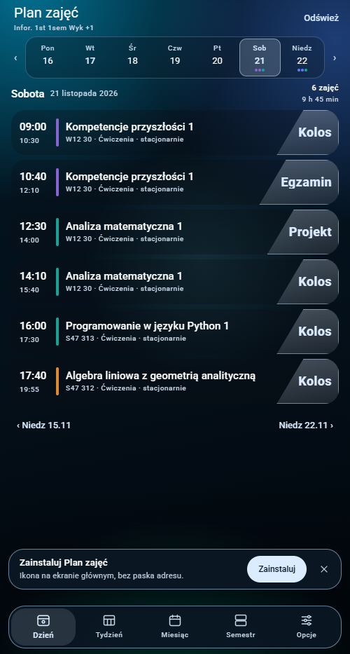
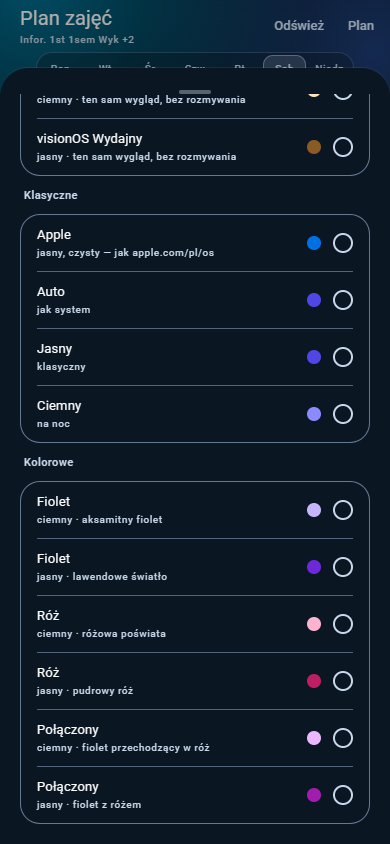
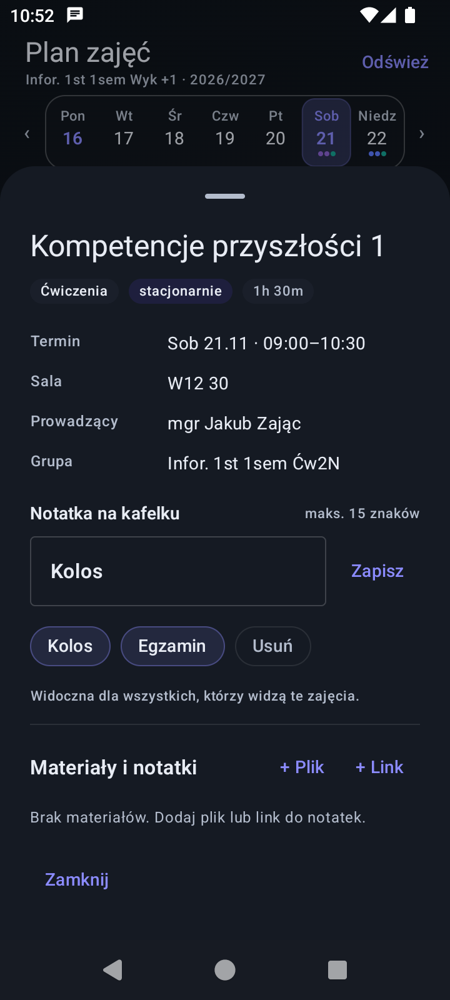
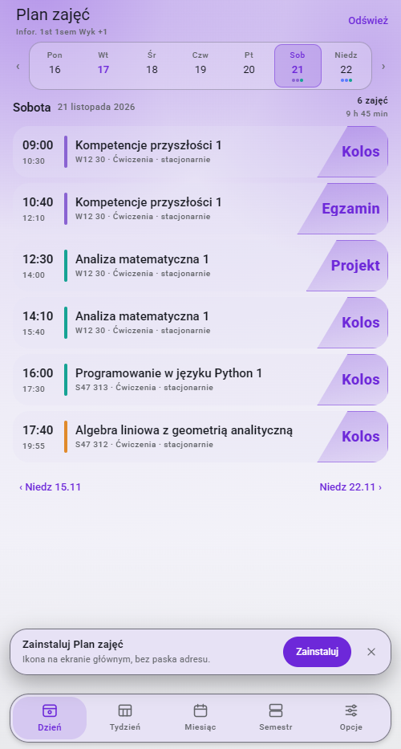
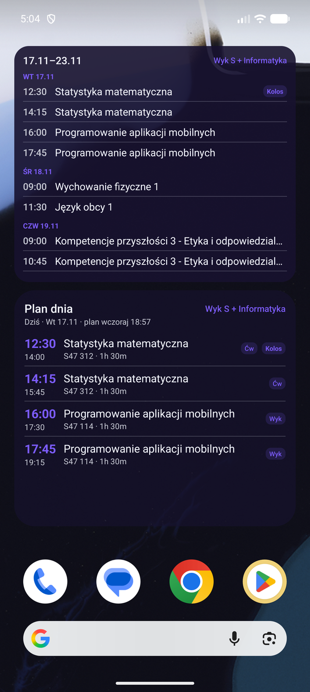

# Plan zajęć — ideis

[](LICENSE)
[](package.json)
[](scripts/self-test.js)
[-3DDC84.svg?logo=android&logoColor=white)](android/version.properties)

**Plan zajęć DSW w interfejsie natywnej aplikacji.** Przeglądarka (PWA) i telefon
(APK) pokazują ten sam ekran — dzień, tydzień, miesiąc i semestr — a plan pobiera
własny serwer Node.js, który sam obsługuje całą uczelnię: **bez logowania, bez
bazy danych i bez ani jednej zależności z npm**.

[**Otwórz aplikację →**](https://ideis.mati-it.pl/) · [**Pobierz APK →**](https://ideis.mati-it.pl/api/app/apk) · [Pełna dokumentacja](README-szczegolowy.md)



## Co potrafi

- **Wybór planu krok po kroku** — rocznik → kierunek → specjalność → tryb, jak
  w wyszukiwarce planów uczelni. Kroki bez wyboru przechodzą same, a lista
  pokazuje tylko to, co naprawdę ma grupy (rocznik 2026: 27 kierunków).
- **Kilka grup w jednym planie** — wykład bazowy plus własne ćwiczenia,
  laboratoria i lektorat. Zajęcia cudzych grup są odsiewane na serwerze.
  **Wykłady są wliczone automatycznie** — dodajesz tylko resztę.
- **Cztery widoki** — dzień, tydzień, miesiąc i semestr; gest w bok, tydzień
  z numeracją, kafelek dnia otwiera ten dzień.
- **Materiały do zajęć** — pliki (PDF, Office, OpenDocument, RTF/CSV/TXT, obrazy,
  ZIP — do 25 MB) i linki, widoczne od razu dla wszystkich.
- **Notatki na kafelkach** — „Kolos”, „Egzamin” albo własny tekst do 15 znaków,
  plakietka jak szkło (podbarwienie akcentem), edytowalna przez każdego. Notatka
  dotyczy **konkretnego terminu** zajęć, nie przedmiotu — widać ją też w widżetach.
- **20 stylów + własny** — ciemne, jasne i kolorowe (fiolet, róż, łączony), tryb
  auto, a w „Własnym” wybierasz dwa kolory: akcent i tło.
- **PWA** — instalacja z przeglądarki, powłoka offline, własny pasek instalacji.
- **APK** — aktualizacje z tego serwera (`/api/app/latest`), widżety na pulpit
  (dzień/tydzień, kilka wyglądów), ten sam motyw, notatki i własne kolory.
- **Licznik wejść** — web, PWA i APK, z rozbiciem na dni i godziny (`/licznik`).
- **Zgłoszenia** — propozycje i błędy bez konta, moderacja tokenem (`/propozycje`).

| Style (web) | Szczegóły zajęć i notatka (APK) |
| --- | --- |
|  |  |
| **Motyw „Własny” (web)** | **Widżety z notatkami (APK)** |
|  |  |

## Szybki start (serwer)

Wymagania: **Node.js ≥ 18** (nic więcej — brak `node_modules`).

```bash
npm start     # http://localhost:3000
npm test      # 135 testów własnych (parser, API, notatki, limity, HTTP)
```

Konfiguracja idzie zmiennymi środowiskowymi (albo plikiem `.env`) — pełna lista
z komentarzami: [`.env.example`](.env.example). Najważniejsze: `PORT`, `GROUP_ID`,
`CACHE_DIR`, `REFRESH_TOKEN`, `TRUST_PROXY`.

Docker (tak działa produkcja):

```bash
mkdir -p data && chown 1000:1000 data
docker compose up -d --build     # 127.0.0.1:3002 -> 3000, wolumen ./data
curl http://127.0.0.1:3002/health
```

Cache planów, katalog grup, materiały i notatki leżą na wolumenie, więc przeżywają
przebudowę kontenera. Wdrożenie na VPS: [`deploy/push.sh`](deploy/push.sh).

## Aplikacja Android

```bash
cd android
./gradlew assembleDebug        # APK debug
./gradlew testDebugUnitTest    # 272 testy JVM
./gradlew lintDebug
```

Domyślne API to `https://ideis.mati-it.pl`; można podmienić przy budowaniu
(`-Pplanzajec.apiBase=http://10.0.2.2:3311`). Wersja aplikacji leży w
[`android/version.properties`](android/version.properties) (1.12 / 18), a wydanie
publikuje [`scripts/publish-apk.ps1`](scripts/publish-apk.ps1).

## API

Publiczne, bez tokenu; limity tempa chronią serwer uczelni. Opis i schemat:
[`/api`](https://ideis.mati-it.pl/api) · [`/api/openapi.json`](https://ideis.mati-it.pl/api/openapi.json).

| Endpoint | Co daje |
| --- | --- |
| `GET /api/plan?group=21188` · `?groups=21186,21188&ay=2026` | plan jednej lub kilku grup (JSON), `&version=` — wersja z historii |
| `GET /api/version` · `GET /api/versions` · `GET /api/versions/:id` | lekki status i historia wersji (odcisk treści planu) |
| `GET /api/plan.ics` · `GET /api/plan.csv` | eksport do kalendarza i Excela |
| `GET /api/groups` · `GET /api/ideis/kierunki` · `…/specjalnosci` · `…/tryby` | katalog i listy wyboru z formularza uczelni |
| `GET/POST/DELETE /api/attachments…` | materiały do zajęć (pliki i linki) |
| `GET/POST /api/notes` | notatki na kafelkach (POST wymaga `group`/`groups`) |
| `GET/POST /api/feedback` · `GET /propozycje` | zgłoszenia i ich strona |
| `GET /api/app/latest` · `/api/app/apk` · `/api/app/download/<plik>` | kanał aktualizacji APK |
| `GET /api/visits` · `POST /api/visit` · `GET /licznik` | licznik wejść |
| `GET /health` | stan serwera, obserwowane grupy, harmonogram |

## Jak to działa

Serwer pobiera HTML planu z `harmonogramy.ideis.pl`, parsuje go do JSON i trzyma
wersje w pamięci oraz cache na dysku. Nowa wersja powstaje **tylko przy zmianie
treści** (odcisk SHA-1), więc klient wie, kiedy plan się zmienił, a uczelnia nie
jest pytana częściej niż trzeba (dzień roboczy — raz na dobę, weekend — co godzinę).
Scalanie planu z kilku grup i odsiewanie cudzych zajęć robi `server/merge.js`.

Frontend to waniliowy JS (`public/`) — port widoków z `android/`, bez frameworka
i bez build-stepu. Service worker trzyma powłokę offline, a plan wraca z cache,
gdy sieć zawiedzie.

## Struktura repozytorium

```text
server/      API, scraper, parser, cache, rejestr grup, notatki, materiały, licznik
public/      PWA: widoki, style (20 motywów + własny), arkusz Opcji, service worker
android/     aplikacja Kotlin/Compose + widżety Glance (własne README)
scripts/     self-test, publikacja APK, narzędzia diagnostyczne
deploy/      push.sh, jednostki systemd, przykładowy nginx
docs/        historia zmian i zrzuty ekranu
tests/       fixture'y HTML z harmonogramów
```

## Testy i bramki jakości

| Bramka | Jak uruchomić | Stan |
| --- | --- | --- |
| Testy serwera i webu | `npm test` | 135 / 135 |
| Testy Androida | `cd android && ./gradlew testDebugUnitTest` | 272 / 272 |
| Lint Androida | `cd android && ./gradlew lintDebug` | bez błędów |

`npm test` nie używa frameworka — to zwykły skrypt Node. Oprócz parsera i API
sprawdza warstwę HTTP na prawdziwym serwerze (m.in. `Host: [`, 405, ETag/304,
limity tempa, zapis notatek) i pilnuje kształtu frontendu (CSP bez inline JS,
pułapka fokusu w arkuszach, plakietki notatek).

## Bezpieczeństwo

Projekt jest publiczny i bez kont, więc broni się limitami: nagłówki CSP
(`script-src 'self'`, `frame-ancestors 'none'`), HSTS i `no-referrer`, limity
tempa na wszystkie ścieżki dotykające planu, semafor pobrań z uczelni, cache
negatywny, walidacja notatek (zajęcia muszą istnieć w planie), limit rozmiaru
i liczby równoległych uploadów. Materiały dodaje każdy — treść nie jest
moderowana przed publikacją, więc traktuj pliki jak materiały od kolegów
z roku, nie jak oficjalne źródło. Szczegóły i historia poprawek:
[docs/ZMIANY-DO-APK.md](docs/ZMIANY-DO-APK.md).

## Dokumentacja

- [README-szczegolowy.md](README-szczegolowy.md) — pełny opis produktu, wyboru
  planu, widoków, wdrożenia i wszystkich endpointów (dotychczasowe README).
- [docs/ZMIANY-DO-APK.md](docs/ZMIANY-DO-APK.md) — historia zmian i wydań,
  z powodami decyzji i wynikami weryfikacji.
- [android/README.md](android/README.md) — aplikacja natywna: moduły, widżety,
  aktualizacje.
- [.env.example](.env.example) — wszystkie zmienne konfiguracyjne.

Błąd albo pomysł: formularz w aplikacji (Opcje → Propozycje / błędy), strona
[`/propozycje`](https://ideis.mati-it.pl/propozycje) albo GitHub Issues.

## Licencja

[MIT](LICENSE). Projekt nieoficjalny — nie jest powiązany z uczelnią; dane planu
należą do `harmonogramy.ideis.pl` i są pobierane wyłącznie na potrzeby własnego
podglądu.
