# Plan zajęć — aplikacja natywna Android (Kotlin)

> **To fork „ideis”.** Kod pochodzi z aplikacji bazowej `pl.matiit.planzajec` i różni się
> trzema rzeczami, opisanymi niżej — resztę dokumentacji (widżety, style,
> materiały, aktualizacje) czytaj bez zmian.
>
> | Co | Wersja bazowa | Ten fork |
> | --- | --- | --- |
> | API | `https://plany.mati-it.pl` | **`https://ideis.mati-it.pl`** |
> | `applicationId` | `pl.matiit.planzajec` | **`pl.matiit.planzajec.ideis`** (instaluje się obok) |
> | Katalog grup | jeden zakres (Informatyka, 1. rok, niestacjonarne) | **cała uczelnia: ~2100 grup, 29 kierunków** |
> | Wybór | sama lista grup | **ten sam panel co w PWA: rocznik → kierunek → specjalność (z „Pomiń specjalność”) → tryb → plan** |
> | Plan | tylko bieżący rok akademicki | **wielogrupowy** — wykład + własne ćwiczenia/laby/lektorat (`?groups=`), dowolny rocznik (`ay`) |
> | Licznik | brak | **`POST /api/visit` z `source=apk`** — wejścia widoczne pod `/licznik` |
> | Kanał aktualizacji | `plany.mati-it.pl/api/app/latest` | **`ideis.mati-it.pl/api/app/latest`** (manifest z innym `app` jest odrzucany) |
>
> Wydanie publikuje się z katalogu web forka:
>
> ```powershell
> .\scripts\publish-apk.ps1 -Bump -Upload      # z katalogu plany-wybor
> ```
>
> Testy: `.\gradlew.bat testDebugUnitTest` (bez Androida, 209 testów JVM); lint: `.\gradlew.bat lintDebug`.

Natywny klient Android dla tego samego planu, który serwuje `server/`:
`https://plany.mati-it.pl/api`. Aplikacja nie scrapuje uczelni sama — korzysta
z gotowego, publicznego API serwera (katalog grup, wersja planu, plan grupy), więc
logika pobierania i cache'owania po stronie serwera pozostaje jedynym źródłem
prawdy.

- **Kotlin + Jetpack Compose** (Material 3, dynamiczne kolory na Androidzie 12+)
- **Dwa widżety Glance**: tydzień (7 dni od dziś) i dzień w stylu visionOS
- **WorkManager** do odświeżania w tle (raz na godzinę, tylko z siecią)
- **Cztery widoki jak w web** — Dzień, Tydzień, Miesiąc, Semestr — na kafelkach
  na dole ekranu (jak dolna nawigacja w web), każdy przesuwany gestem w bok;
  piąty kafelek „Opcje” otwiera **panel ustawień** (spis treści + strony Plan /
  Wygląd / Aktualizacje / Grupa), dzięki czemu nad planem nie ma paska stanu ani
  przycisku „Styl”
- **Aplikacja zawsze startuje na dniu** — wybór kafelka jest stanem sesji, nie
  ustawieniem; „ostatnio oglądany semestr” nie wraca po restarcie
- **Panel wyboru planu 1:1 z wersją web** — jeden ekran, w którym wybrane kroki
  zwijają się do wiersza („Rocznik · 2026/2027 ›”), a otwarty jest tylko jeden:
  rocznik → kierunek (z polem „Szukaj kierunku” przy dłuższej liście) →
  specjalność (z „Pomiń specjalność”) → tryb → plan. Ten sam komponent rysuje
  ekran powitalny i Opcje → „Wybór planu”, więc oba miejsca nie mogą się rozjechać.
  Wybór jest zapamiętany razem z numerem grupy; „Zacznij od nowa” czyści szkic,
  a plan na ekranie zostaje.
- **20 stylów** — te same palety co w webie (Liquid Glass 1–3, visionOS,
  visionOS Wydajny, Apple, Auto, Jasny, Ciemny oraz Kolorowe: Fiolet, Róż,
  Połączony) z tłem „aurora”
- **Materiały i notatki** — pliki i linki do zajęć: dodawanie, pobieranie,
  usuwanie (to samo publiczne API co w web)
- **Aktualizacje w aplikacji** — sama sprawdza nowe wydanie na VPS
  (`/api/app/latest`), pobiera APK z sumą SHA-256 i instaluje przez systemowy
  instalator; bez sklepu Play (patrz „Aktualizacje aplikacji”)
- **APK**: `app-debug.apk` (~14 MB) i zminifikowany `app-release.apk` (~2,1 MB)
- `minSdk 26` (Android 8.0), `targetSdk 36`, bez zależności od Google Play Services

## Podgląd

| Plan (dzień) | Tydzień | Miesiąc |
| --- | --- | --- |
| 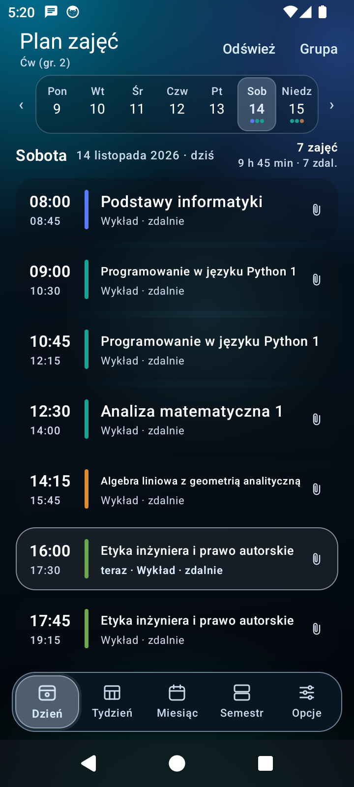 | 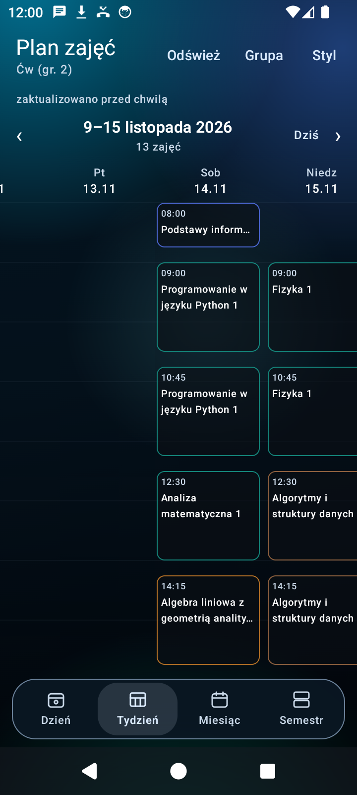 | 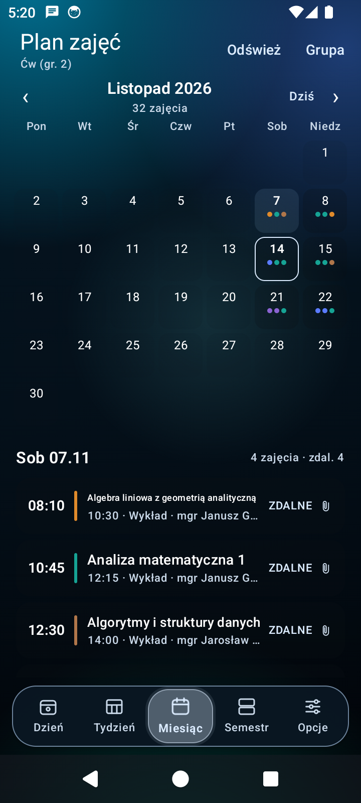 |

| Semestr | Widżet dnia (Vision) | Widżet dnia — kafelki |
| --- | --- | --- |
| 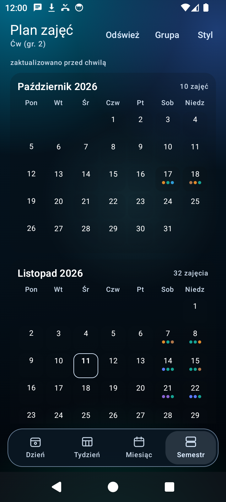 | 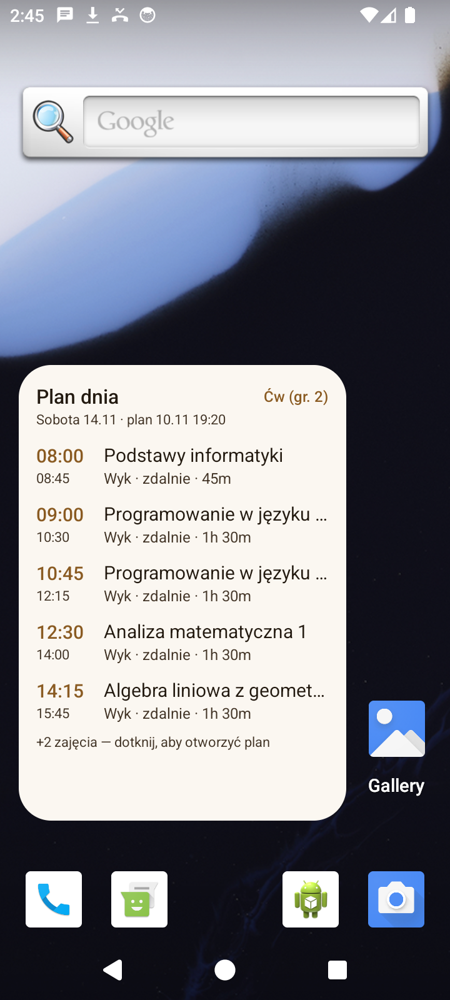 | 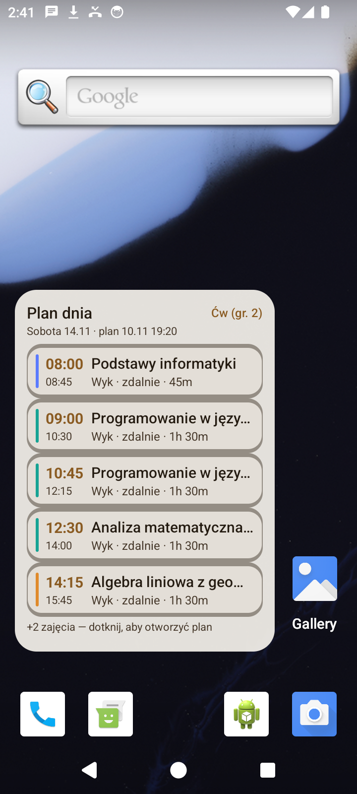 |

| Widżet na większym ekranie | Widżet dnia — Minimal | Widżet dnia — Akcent |
| --- | --- | --- |
| 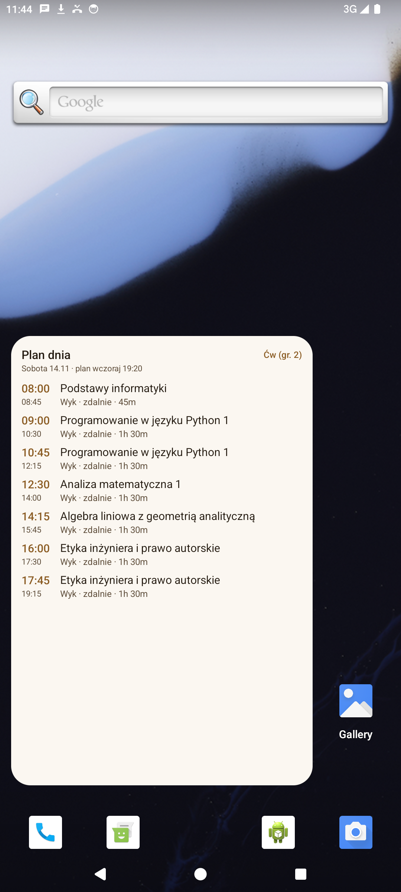 | 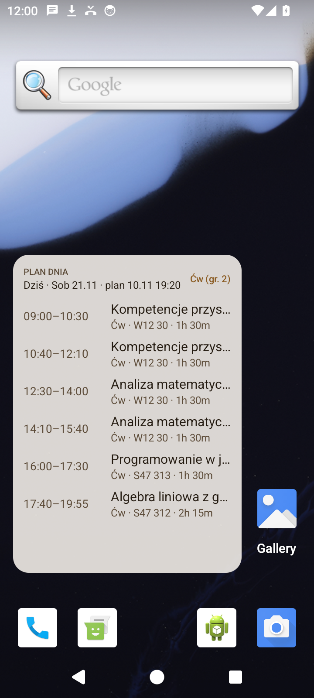 | 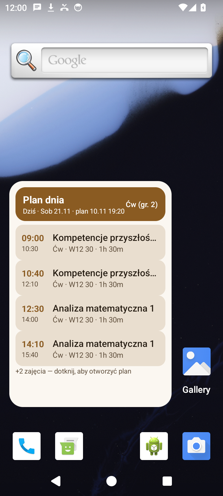 |

| Widżet dnia — Oś czasu | Konfigurator wyglądu | Wybór grupy na start |
| --- | --- | --- |
| 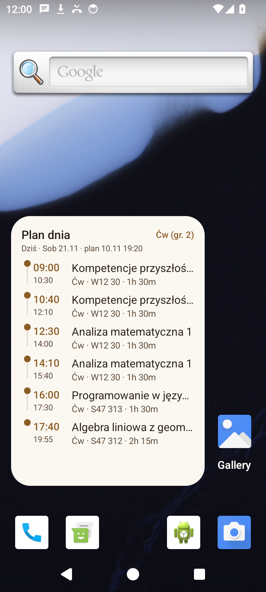 | 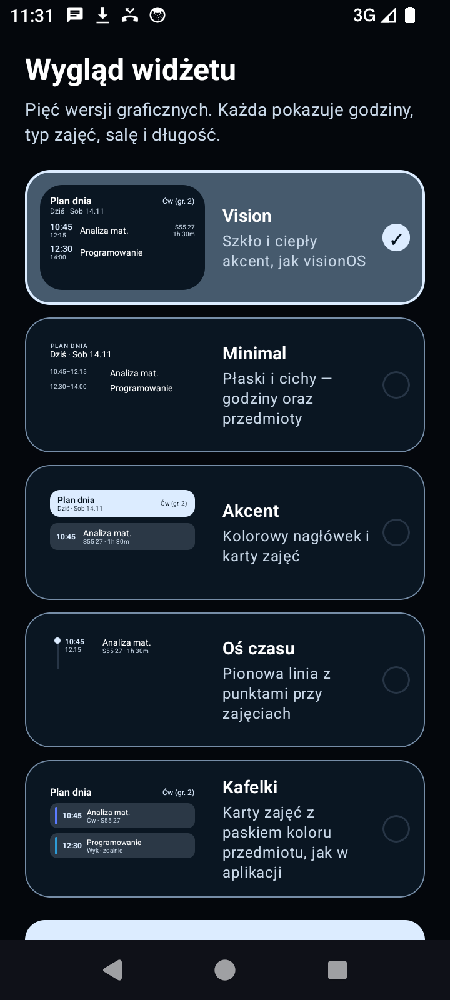 | 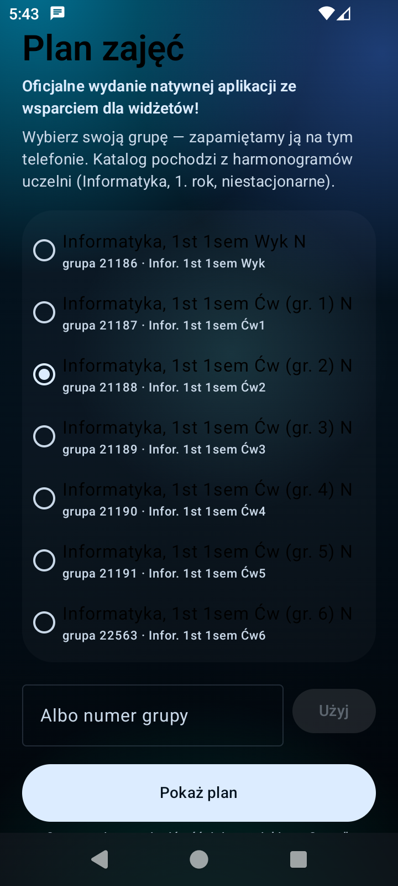 |

| Styl jasny (Liquid Glass 1) | Szczegóły zajęć | Materiały i notatki |
| --- | --- | --- |
| 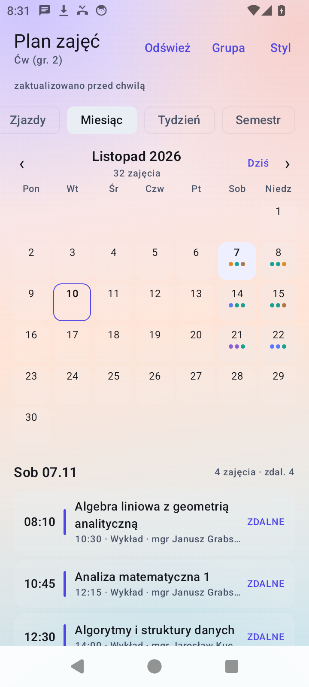 | 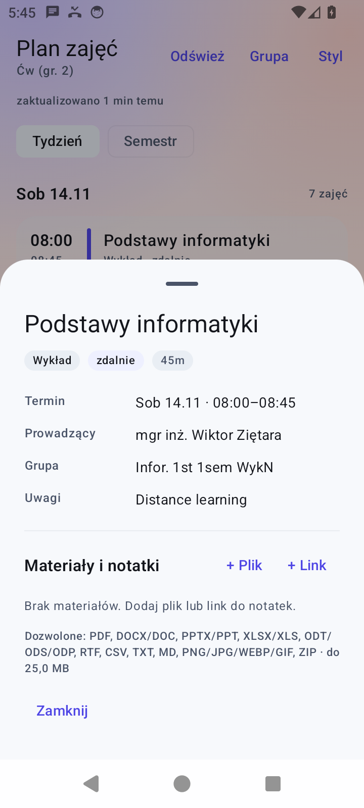 | 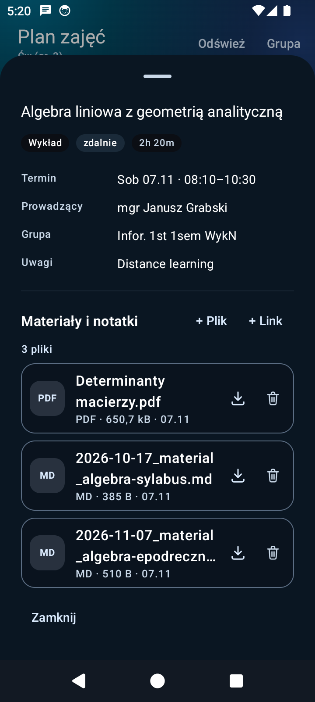 |

| Nowa wersja aplikacji | Panel ustawień (spis treści) |
| --- | --- |
| 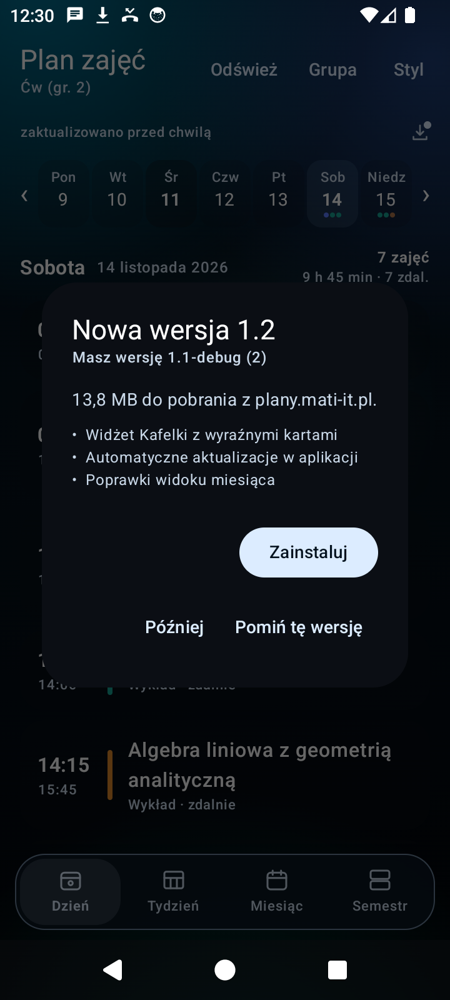 | 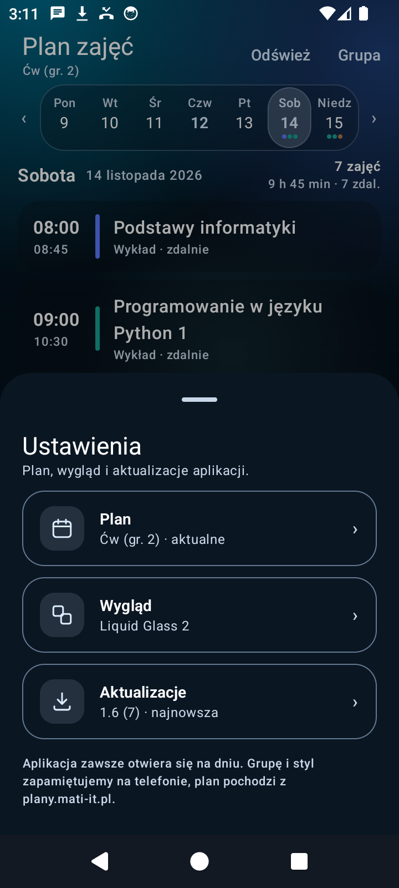 |

| Ustawienia — Plan | Ustawienia — Wygląd | Ustawienia — Aktualizacje |
| --- | --- | --- |
| 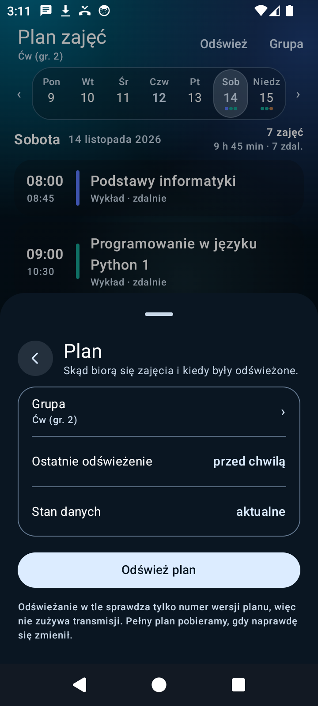 | 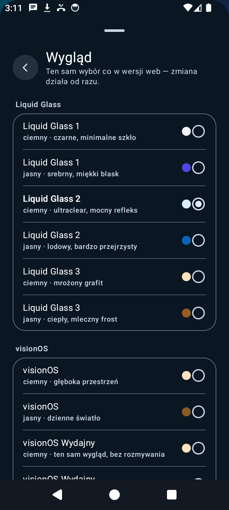 | 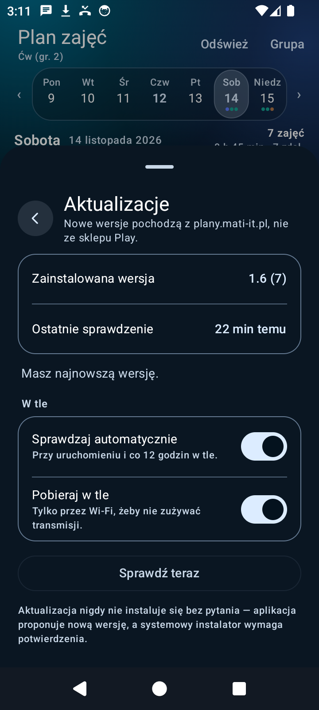 |

| Pigułka w przelocie (klatka z nagrania) |
| --- |
| 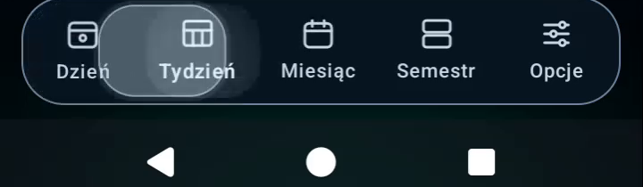 |

Zdjęcia pochodzą z emulatora Android 14 (API 34); część z wersji **release**
(R8), część z debug — ten sam kod i te same ekrany.

## Szybki start

```powershell
cd android
.\gradlew.bat :app:testDebugUnitTest      # 169 testów JVM
.\gradlew.bat :app:assembleDebug          # app-debug.apk
.\gradlew.bat :app:assembleRelease        # app-release.apk (R8 + shrink)
adb install -r app\build\outputs\apk\release\app-release.apk
```

Widżety dodaje się **na dwa sposoby**:

1. **Z launchera**: przytrzymaj pulpit → **Widżety** → **Plan zajęć** → rozwiń
   strzałką i przeciągnij podgląd na pulpit („Plan zajęć — tydzień” albo
   „Plan zajęć — dzień”). Kafel w wyborze widżetów pokazuje prawdziwy podgląd
   (`previewLayout`), a nie pustkę.
2. **Z aplikacji**: **Opcje → Widżety** → „Plan tygodnia” / „Plan dnia”.
   System pokazuje wtedy okienko „Dodaj do ekranu głównego” z miniaturą
   (`requestPinGlanceAppWidget`). Ta sama strona listuje widżety stojące na
   pulpicie i pozwala zmienić wygląd każdego z nich.

Konfigurator wyglądu (siedem wariantów) nadal otwiera launcher przy dodawaniu,
o ile potrafi — widżet ma `reconfigurable|configuration_optional`, więc gdy
launcher nie umie uruchomić aktywności konfiguracji (patrz „Znany problem”
niżej), widżet i tak da się dodać, a wygląd zmienia się z aplikacji.

Adres API można podmienić bez zmian w kodzie (np. na lokalny serwer):

```powershell
.\gradlew.bat :app:assembleDebug -Pplanzajec.apiBase=http://10.0.2.2:3000
```

Build `debug` pozwala na `http://` (`src/debug/AndroidManifest.xml`), więc
lokalne testy działają bez HTTPS. Wydanie `release` tego nie dziedziczy.

Numer wersji leży w `android/version.properties` (`versionCode`, `versionName`)
— podbija go skrypt publikacji, a nie ręczna edycja plików Gradle.

## Decyzje projektowe

**Dlaczego klient API, a nie drugi scraper.** Serwer ma już parser HTML uczelni,
historię wersji, cache na dysku i limity odświeżania. Port tego do Androida
zdublowałby odpowiedzialność i wymagał sieci do harmonogramów uczelni przy każdym
uruchomieniu. Aplikacja czyta `GET /api/plan`, `GET /api/version`, `GET /api/groups`.

**Dwa poziomy odświeżania.** `GET /api/version` to kilkaset bajtów; pełny plan
(~45 kB po kompresji) pobieramy tylko wtedy, gdy `currentId` różni się od wersji
zapisanej. Dzięki temu automatyczne odświeżanie w tle jest tanie, a `Cached`
zwracamy bez sieci, jeśli plik z dysku ma mniej niż 10 minut.

**Cache na dysku, nie w bazie.** Plan to jeden JSON na grupę w
`filesDir/cache/plan-<grupa>.json`, zapisywany atomowo (plik tymczasowy + rename).
Start aplikacji i widżetu czyta go synchronicznie z dysku, bez migracji i bez
Room — mniej kodu i szybszy zimny start.

**Bez frameworka DI.** `PlanGraph` tworzy leniwie jedną instancję repozytorium
i ustawień na proces. Bez Hilt/Koin, bez refleksji, bez generowania kodu.

**Bez biblioteki JSON opartej o refleksję.** `kotlinx.serialization` generuje
parser w czasie kompilacji; nieznane pola API są ignorowane, więc serwer może
dokładać statystyki bez wydania nowej aplikacji.

**Bez OkHttp/Retrofit.** `HttpURLConnection` + gzip + timeauty 10/15 s wystarcza
dla trzech endpointów GET i nie powiększa APK.

**Jeden ekran, jedna aktywność.** Widok tygodnia i semestru to dwa filtry tej
samej listy (`LazyColumn` z kluczami po `classes[].id`), a szczegóły i wybór
grupy to arkusze Material 3. Karty nie przeliczają się przy przewijaniu, bo model
jest niemutowalny, a etykiety godzin powstają raz przy mapowaniu DTO.

**Język treści to polski.** `PlanApplication` ustawia `pl` w konfiguracji
aplikacji, więc formaty dat, nazwy dni i skróty typów zajęć są polskie także na
telefonie z angielskim systemem.

## Widżet tygodnia

- Zakres: **od dziś przez 7 dni**, tylko dni z zajęciami (zjazdy wypadają w
  weekendy, więc puste dni tylko zabierałyby miejsce).
- Nagłówek: grupa (skrócona, np. `Ćw (gr. 2)`), zakres dat i czas pobrania planu
  z harmonogramu uczelni (`plan 08.11 17:56`).
- Każde zajęcia pokazują **typ** (`Wyk`/`Ćw`/`Lab`), **godziny od–do**
  (`10:45–12:15`), **salę albo „zdalnie”** (`s. 204`, `S55 27`) i długość
  (`1h 30m`); gdy API nie podaje sali i zajęcia są stacjonarne, zostaje
  `typ · długość`.
- **Przewijanie zamiast obcinania.** Wszystkie dni i wszystkie zajęcia idą na
  przewijaną listę (`LazyColumn`, które Glance tłumaczy na systemowy `ListView`),
  więc nic nie znika: rozmiar widżetu decyduje tylko o tym, ile linii widać bez
  przewijania. Wcześniej plan był dopasowywany do wysokości kafla, a nadmiar
  zwijał się do etykiety `+N zajęć — dotknij, aby otworzyć plan`.
- Nagłówek jest **pierwszą pozycją listy**, a nie osobnym elementem nad nią.
  Na widżecie 4×2 stały nagłówek zjadałby całe miejsce i lista miałaby kilka
  pikseli wysokości, czyli nie dałoby się przewinąć do żadnych zajęć.
- Każda pozycja listy jest klikalna i otwiera aplikację — `ListView`
  przechwytuje dotknięcia, więc `clickable` na samym panelu by nie wystarczyło.
- Kolory dzień/noc, zaokrąglenie 22–26 dp zależnie od wariantu, tło systemowe
  widżetu (`appWidgetBackground`).

Przewijanie na urządzeniu (widżet tygodnia dosunięty do ostatniego dnia zakresu
i widżet dnia po przewinięciu w górę — wcześniej te zajęcia były schowane za
„+N zajęć”):

| Widżet tygodnia — przewinięty do soboty | Widżet dnia — przewinięty do końca |
| --- | --- |
| 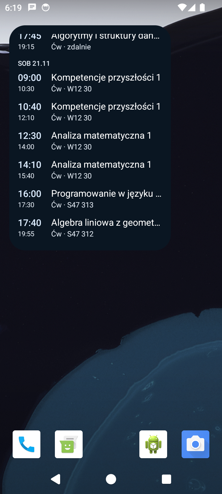 | 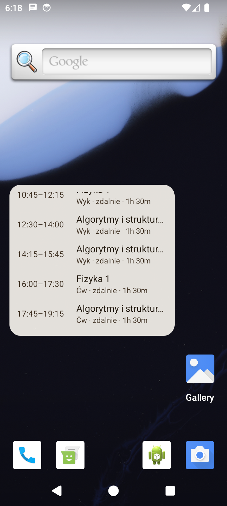 |

Odświeżanie widżetu:

| Zdarzenie | Efekt |
| --- | --- |
| `WorkManager` co godzinę (sieć wymagana) | `version` → ewentualnie plan → widżet |
| dodanie widżetu / `onUpdate` | od razu render z cache + jednorazowe pobranie |
| otwarcie aplikacji (`onResume`) | wymuszony render (force), bo użytkownik patrzy na ekran |
| zmiana grupy w aplikacji | od razu nowy plan w widżecie |
| nowy dzień (przy kolejnym odświeżeniu) | nowe etykiety dni i zakres dat |
| zmiana wyglądu w konfiguratorze | zapis do stanu Glance → natychmiastowy render |

`WidgetUpdater` liczy **fingerprint treści i wyglądu osobno dla każdej instancji**
(grupa, zakres, dni, godziny od–do, przedmioty, sale, długość zajęć, wariant,
motyw, noc) i pomija aktualizację, gdy się nie zmienił — launcher nie
przerysowuje wtedy widoku. Fingerprint jest zapisywany **po** udanej
aktualizacji, więc błąd nie zostawia widżetu na stałe w starym stanie.

### Pięć pułapek Glance (i jak są rozwiązane)

1. **Maks. 10 elementów w jednym kontenerze.** Płaska lista dni ucinała widżet
   (w logu `Column container cannot have more than 10 elements`). Dlatego każda
   pozycja widżetu — nagłówek, etykieta dnia, jedne zajęcia — jest osobnym
   elementem `LazyColumn`, a nie dzieckiem jednej wielkiej kolumny.
2. **`GlanceAppWidget.updateAll` bywa cichym no-op.** Oparty o wewnętrzny rejestr
   odbiorników, który po instalacji bywa pusty. `WidgetUpdater` pobiera
   identyfikatory z `AppWidgetManager.getAppWidgetIds(ComponentName(…))`
   i rysuje każdą instancję przez `update(context, glanceId)`.
3. **`LazyColumn` to systemowy `ListView` i nie da się go zagnieździć.** Glance
   rzuca `Glance does not support nested list views`, więc przewijana jest
   dokładnie jedna lista na widżet — nie osobna lista dla każdego dnia. Druga
   konsekwencja: `ListView` przechwytuje dotknięcia, więc `clickable` na panelu
   widżetu nie działałby na liście; własną akcję dostaje każda pozycja (Glance
   podstawia ją jako *fill-in intent* pod szablon ustawiony na `ListView`).
4. **Glance buforuje kompozycję sesji.** `update()` po zmianie danych spoza
   stanu Glance potrafi nie wywołać `provideGlance` ponownie — dlatego wygląd,
   tonacja i **dzień** są w stanie Glance, a model jest budowany **w kompozycji**
   (`provideContent`). Bez tego widżet po zmianie daty pokazywał wczorajszy plan
   do restartu procesu.
5. **Pozycja listy musi być jednymi zajęciami, a nie całym dniem.** `ListView`
   przewija pozycjami: element wyższy od kafla nie da się przewinąć w całości,
   więc część zajęć z wysokiego dnia zostałaby nieosiągalna. Dlatego lista to
   nagłówek, etykiety dni i pojedyncze wiersze zajęć (`WidgetScroll`), a numer
   pozycji (`itemId`) liczymy z treści, żeby po odświeżeniu planu przewinięcie
   zostało na miejscu (Android 12+).

## Wybór planu na start

Pierwsze uruchomienie pokazuje **kartę wyboru** — ten sam element co w wersji web:
wydział (stały) i cztery wiersze: kierunek, rocznik, specjalność, tryb. Kliknięcie
wiersza otwiera arkusz z krokami; arkusz ma u góry numerowane kroki, a zaznaczenie
widać **w kółku** przy opcji (cały wiersz jest klikalny).

Kolejność kroków jest jak w formularzu uczelni (`/Plany/ZnajdzTok`). Wersja web
po przebudowie (v28) zaczyna od rocznika — APK 1.5 zostaje przy kolejności
poniżej, bo obie korzystają z tych samych endpointów:

1. **Kierunek** — lista z formularza uczelni (`/api/ideis/kierunki`); wydział jest
   stały (Wydział Studiów Stosowanych we Wrocławiu), więc nie ma go na liście.
   Podpis mówi, ile grup i roczników ma kierunek.
2. **Rocznik** — rok, w którym zaczynałeś studia; pokazujemy tylko roczniki,
   które mają grupy na tym kierunku (`nabory` w `/api/ideis/kierunki`).
3. **Specjalność** — z formularza uczelni (`/api/ideis/specjalnosci?nabor=…`),
   tylko specjalności z grupami w tym roczniku, z pierwszym wierszem
   **„Pomiń specjalność”**; starsze nazwy z planów są na końcu listy.
4. **Tryb studiów** — tylko tryby z grupami w wyborze (`/api/ideis/tryby`).
5. **Plan** — grupa wykładowa z bieżącego semestru; gdy wybór pasuje do jednej,
   aplikacja wchodzi w nią od razu, gdy do kilku — pokazuje listę.

Rok studiów i semestr wynikają z rocznika i dzisiejszej daty
(`PlanWizard.withSemester`: X–II zimowy, III–IX letni), więc nie ma osobnego pola
„semestr”. Gdy w katalogu nie ma grup na ten semestr, `PlanWizard.planStep`
luzuje filtr semestru **i zwraca wybór bez niego** — inaczej lista grup do
dodania byłaby pusta.

Po wejściu w plan ekran „Dodaj swoje grupy” pozwala dołożyć własną grupę
ćwiczeniową, laboratoria i lektorat — **wykłady są wliczone automatycznie**.
Plan jest sumą grup (`PlanTarget(groups=…)`, klucz `21613+21614@2026`), a serwer
odsiewa zajęcia cudzych grup. Grupy można podejrzeć i usunąć w **Opcjach → Plan**
(podpis wyboru, „Grupy w planie”, „Dodaj grupy do planu”). Wybór trafia do
`SharedPreferences` (razem ze znacznikiem `has-chosen-group`), więc ekran nie
wraca przy kolejnych startach.

Pod tytułem stoi opis produktu (**„Oficjalne wydanie natywnej aplikacji ze
wsparciem dla widżetów!”**), trzymany w `domain/AppCopy.kt` — ten sam tekst jest
w stopce Opcji i w opisie wydania (`latest.json`).

| Ekran startowy z opisem | Stopka Opcji z tym samym opisem |
| --- | --- |
|  | 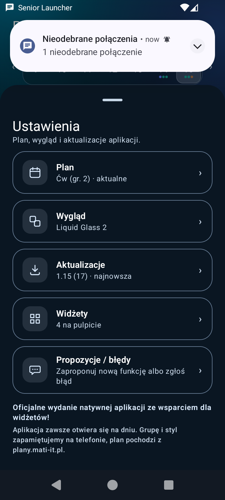 |

| Karta wyboru (start) | Krok 1 — kierunek | Krok 2 — rocznik | Krok 3 — specjalność |
| --- | --- | --- | --- |
| 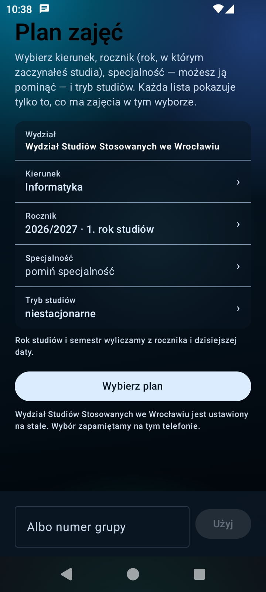 | 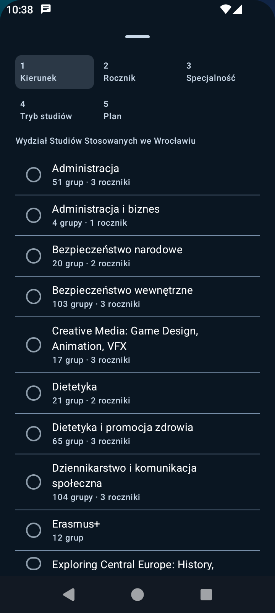 | 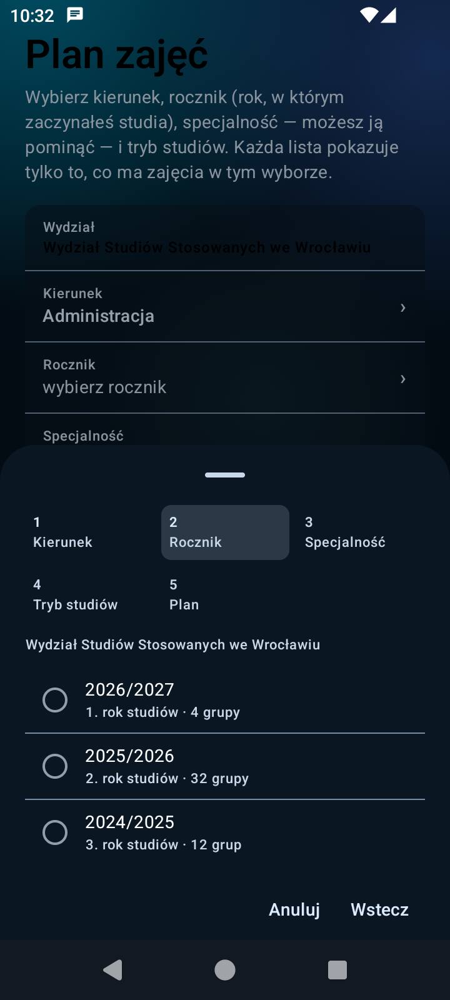 | 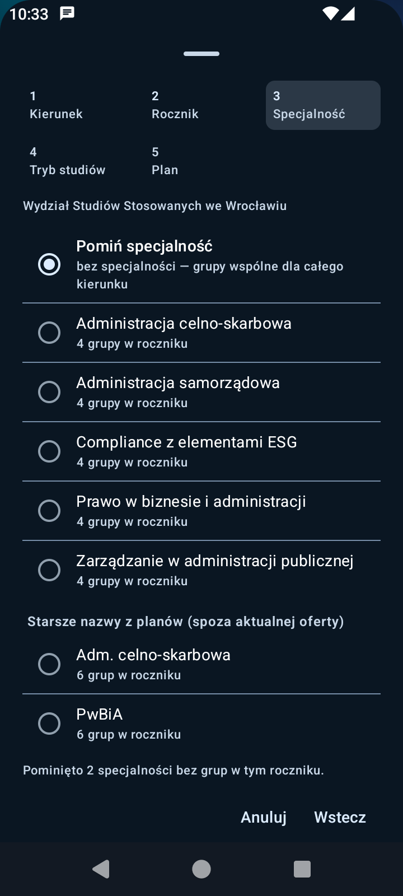 |

| Dodawanie grup (kółko + przycisk nad listą) | Opcje → Plan |
| --- | --- |
| 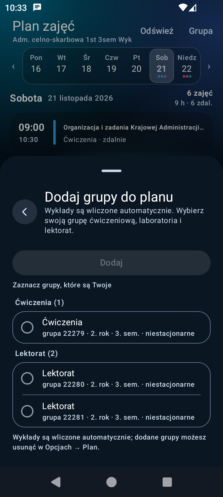 | 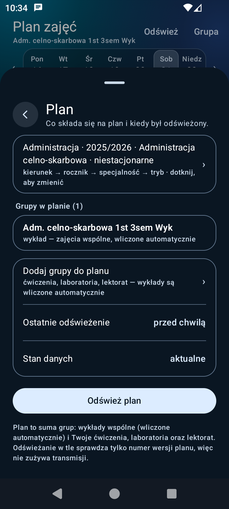 |

Jeśli katalogu nie da się pobrać (pierwsze uruchomienie offline), ekran nadal
pozwala wpisać numer grupy — plan dociągnie się po odzyskaniu sieci.

## Widżety

Aplikacja ma **dwa niezależne widżety** — można dodać oba jednocześnie:

| Widżet | Etykieta w launcherze | Co pokazuje |
| --- | --- | --- |
| Tydzień | „Plan zajęć — tydzień” | 7 dni od dziś, dni z zajęciami, grupa, godziny od–do, typ, sala/zdalnie |
| Dzień | „Plan zajęć — dzień” | dokładnie jeden dzień: **dziś**, a gdy dziś nie ma zajęć — najbliższy dzień z planu (albo ostatni po zakończeniu semestru) |

Każde zajęcia w obu widżetach pokazują **typ (Wyk/Ćw/Lab), godziny od–do, salę
albo „zdalnie”** oraz długość (`1h 30m`); w widżecie tygodnia długość jest
pomijana, żeby tydzień był gęstszy. Oba widżety **przewijają się w pionie**, więc
żadne zajęcia nie są obcinane do wysokości kafla — kafel decyduje tylko o tym,
ile linii widać bez przewijania.

| Widżet tygodnia na pulpicie | Widżet dnia nocą | Menu wyglądu (panel ustawień) |
| --- | --- | --- |
| 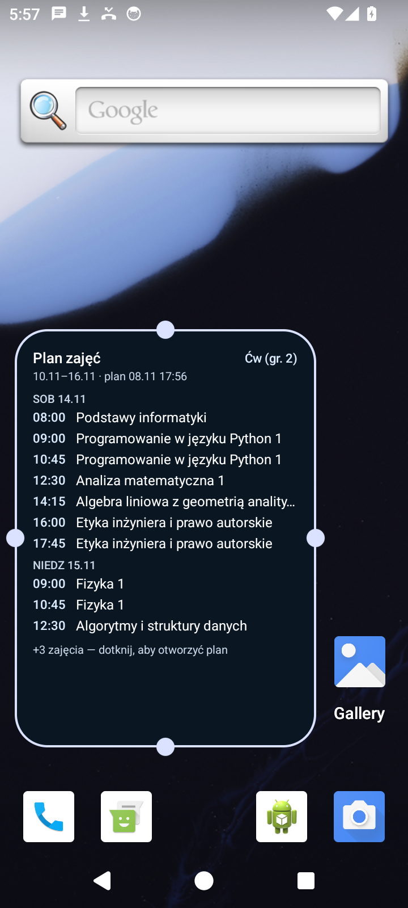 | 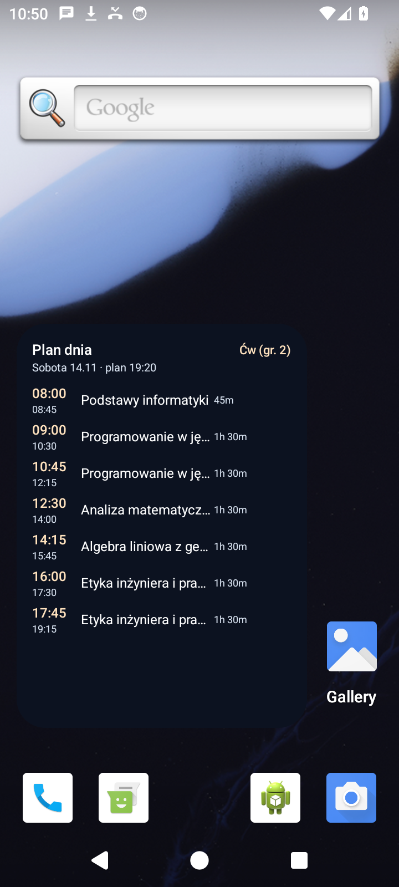 |  |

### Siedem wersji graficznych

Wygląd wybiera się **osobno dla każdej instancji** w konfiguratorze, który
launcher otwiera przy dodawaniu widżetu (później: przytrzymaj widżet → „Edytuj”):

| Wariant | Układ i charakter |
| --- | --- |
| **Vision** | ciepły piaskowy akcent, panel visionOS; godzina startu i końca w kolumnie, pod przedmiotem `Ćw · W12 30 · 1h 30m` |
| **Minimal** | płaski i monochromatyczny: `10:45–12:15` przy przedmiocie, typ i miejsce w drugiej linii, półprzezroczysty panel |
| **Akcent** | wypełniony akcentem nagłówek i karty zajęć w odcieniu akcentu, typ/miejsce/długość w karcie |
| **Oś czasu** | pionowa linia z punktem przy każdych zajęciach, godziny od–do i `typ · miejsce · długość` pod przedmiotem |
| **Kafelki** | karta na każde zajęcia (jak lista dnia w aplikacji): pionowy pasek w **kolorze przedmiotu** — ten sam co kropki w kalendarzu — godziny od–do, przedmiot i `typ · sala · długość` |
| **Kompakt** | **jedna linia na zajęcia** (`08:00–08:45  przedmiot  typ`) i cienkie separatory; w nagłówku od razu dzień i grupa — najgęstszy wariant, w 4×3 mieści 7–8 zajęć |
| **Szkło** | przezroczysty panel, duża godzina (17 sp), cienkie linie zamiast kart, typ zajęć w plakietce po prawej, metadane `zdalnie · 1h 30m` |

Warianty są wspólne dla obu widżetów (`WidgetLook`, `WidgetLookView`). Wybór
jest zapisywany **per instancja** w `WidgetPrefs` (SharedPreferences) — to źródło
prawdy, więc lista w ustawieniach i konfigurator pokazują dokładnie ten wariant,
który ma widżet na pulpicie. Ten sam wybór trafia dodatkowo do **stanu Glance**
instancji (`updateAppWidgetState`): zapis unieważnia kompozycję sesji, więc
zmiana jest widoczna od razu, bez czekania na kolejne odświeżenie planu.

### Znany problem: launcher a konfigurator (Android 14)

Na Androidzie 14 system blokuje start aktywności konfiguracji widżetu z
`PendingIntentu`, którego nadawca nie włączył „activity starts” (BAL hardening).
Objaw w logu: `Background activity launch blocked … (BAL_BLOCK)` i komunikat
„appWidgetId was not returned from the widget configuration activity”, a widżet
nie zostaje dodany. To zależy od launchera, nie od aplikacji ([opis problemu](https://stackoverflow.com/questions/78585725/appwidget-configuration-activity-doesnt-start-in-android-14-missing-opt-in-by)),
ale psuje dwa przepływy — dlatego:

- `widgetFeatures="reconfigurable|configuration_optional"` — launcher może dodać
  widżet **bez** uruchamiania konfiguratora, więc dodawanie działa wszędzie;
- **Opcje → Widżety** daje dodawanie (przypięcie systemowe) i zmianę wyglądu
  z aplikacji, czyli z widocznej aktywności — tam blokada nie występuje.

| Panel „Widżety” | Okno przypinania z podglądem | Podgląd w wyborze widżetów |
| --- | --- | --- |
| 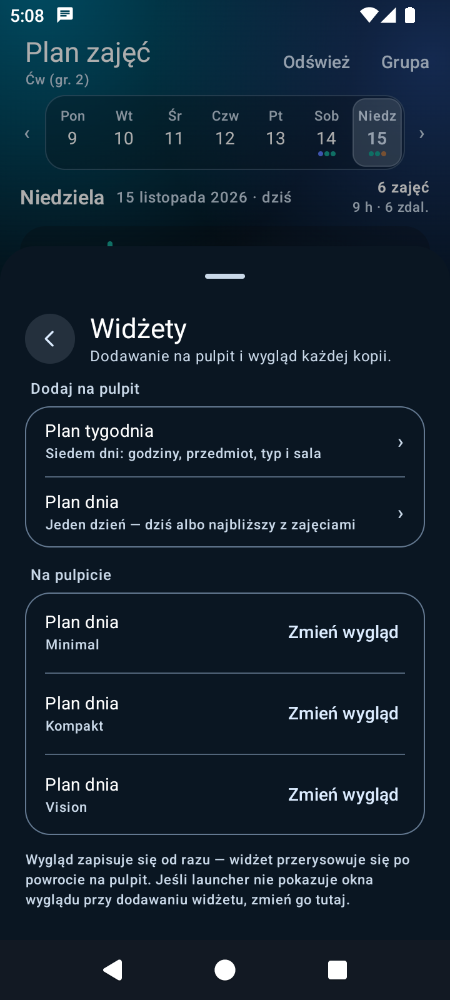 | 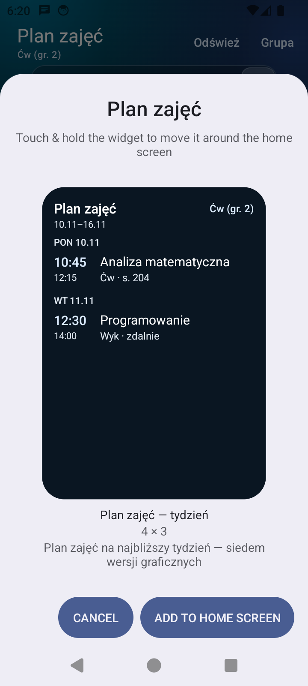 | 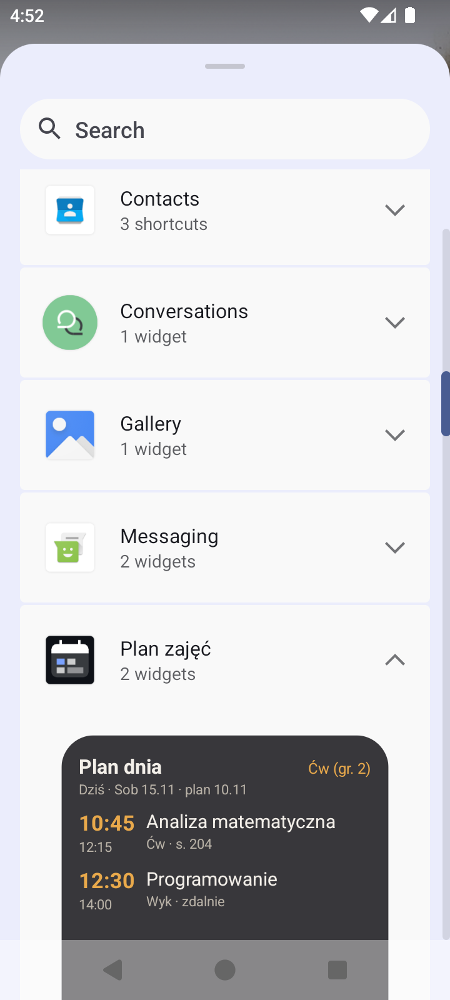 |

**Czego nie sprawdzono przy przewijaniu.** Zachowanie listy zależy od launchera
(gość rysuje `ListView` w swoim kontenerze): przewijanie jest zweryfikowane na
launcherze emulatora API 34, nie na innych pulpitach; nie sprawdzono też
przewijania po zmianie rozmiaru widżetu ani utrzymania pozycji przewinięcia po
odświeżeniu planu na Androidzie 12+ (identyfikatory pozycji są stabilne, ale
samego zachowania nie zmierzono).

**Czytelność i odstępy.** Po zgłoszeniach, że kafelki się zlewają i są
nieczytelne, wiersze dostały stały rytm: **5 dp pionu w każdym wariancie**
(wcześniej 3 dp, a karty tylko 2 dp przerwy), metadane używają koloru
`WidgetColors.meta` (mieszanka `textSoft` z `text` w 45%), a obwódka karty jest
odsunięta od panelu o 44% (wcześniej 30%) — dzięki temu na jasnej tapecie karty
są osobnymi kartami, a nie jednym pasem. Kolumna godzin w „Kafelkach” jest
węższa (46 dp), żeby nazwa przedmiotu miała więcej miejsca, a w „Kompakcie”
godzina jest w kolorze metadanych (akcent tylko dla dnia i grupy), bo pięć
pomarańczowych liczb w kolumnie zagłuszało treść.

**Gęstość listy.** Pozycją listy są jedne zajęcia, a nie cały dzień: `ListView`
przewija pozycjami, więc element wyższy od kafla nie dałby się przewinąć w
całości i część zajęć z wysokiego dnia zostałaby poza zasięgiem. Wiersz ma
stały rytm w każdym wariancie (5 dp pionu), a o tym, ile linii widać bez
przewijania, decyduje rozmiar widżetu — nie żadna arytmetyka budżetu wysokości.

Wariant „Kafelki” odwzorowuje listę dnia z aplikacji: każde zajęcia to osobna
karta z pionowym paskiem w kolorze przedmiotu (`subjectColor` — ta sama funkcja
co kropki w kalendarzu i paski przy zajęciach). Glance 1.2 nie ma obwódek, więc
karta ma **1 dp ramki** zrobionej z zewnętrznego `Box` w ciemniejszym kolorze
(`tileEdge`) i wewnętrznego tła (`tile`, mieszanka panelu z kolorem tekstu),
a między kartami jest 6 dp odstępu — dzięki temu kafelki nie zlewają się w jeden
blok, także w trybie nocnym:

| Kafelki po poprawkach | Szkło (nowy wariant) |
| --- | --- |
|  | 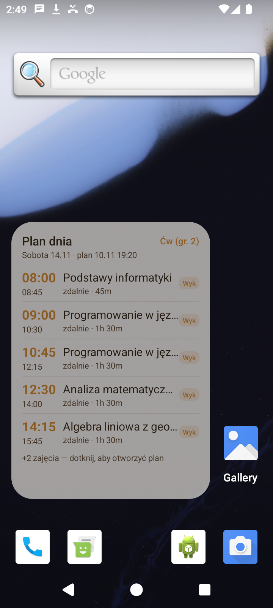 |

| Kompakt (nowy wariant) | Vision po zwiększeniu odstępów |
| --- | --- |
| 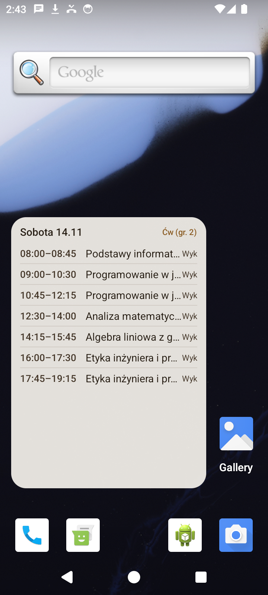 |  |

Sala jest pokazywana, gdy harmonogram uczelni ją podaje. W bieżącym tygodniu
plan grupy 21188 nie ma sal, dlatego na zrzutach z 14.11 ich nie widać (jest
`Wyk · zdalnie · 1h 30m`); po przestawieniu daty emulatora na dzień z salami
(21.11.2026) widżet pokazuje pełny wiersz `Ćw · W12 30 · 1h 30m`:


### Skalowanie na większym ekranie

`SizeMode.Exact` sprawia, że widżet liczy wiersze z realnej wysokości, a nie
z opcji `min`/`max` launchera. Ten sam dzień z 7 zajęciami: przy 720×1600 widać
6 wierszy i `+1 zajęcie`, a przy 1080×2400 (więcej dp na kratkę) — wszystkie 7,
bez ucinania:


Zmiana rozmiaru przerysowuje widżet z nową liczbą wierszy: po zmniejszeniu do
dwóch komórek zostają 3 wiersze i `+4 zajęcia`, a po rozciągnięciu z powrotem
widać 6 wierszy i `+1 zajęcie` — ukryte zajęcia pojawiają się, zamiast zostać
za etykietą:

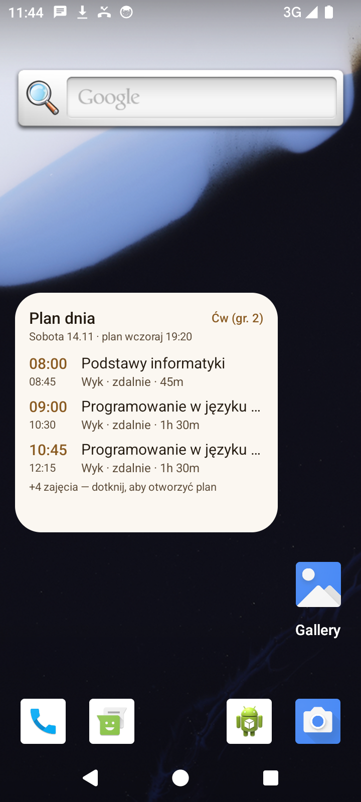

Widżet dnia jest zawsze w **stylu visionOS** (niezależnie od motywu wybranego
w aplikacji): ciepły piaskowy akcent, głębokie granatowe tło w trybie nocnym,
zaokrąglenie 26 dp i panel bez prawdziwego blur. Tonacja idzie za systemem
(dzień/noc) — na Androidzie 10+ wykrywana przez `UiModeManager` i zapisywana
w stanie widżetu, bo kontekst aplikacji bywa nieaktualny po zmianie motywu
systemowego.

Oba widżety mają **własne fingerprinty per instancja** (wariant, styl, noc,
treść), więc `WidgetUpdater` rysuje tylko ten, którego treść naprawdę się
zmieniła. Odbiorniki (`ScheduleWidgetReceiver`, `DayScheduleWidgetReceiver`)
przy dodaniu widżetu planują też odświeżanie w tle i jednorazowe pobranie planu.

Nagłówek widżetu dnia: „Plan dnia”, grupa, etykieta dnia (`Dziś · Sob 14.11`,
`Jutro · Niedz 15.11`, `Sobota 14.11`) i czas pobrania planu. Każde zajęcia
pokazują godziny od–do, przedmiot, salę i długość (`1h 30m`). Lista przewija się
w pionie, więc w kaflu widać wszystkie zajęcia dnia — także te, które nie
mieszczą się bez przewijania.

## Widoki planu

Na dole ekranu jest **pływający pasek z pięcioma kafelkami — Dzień, Tydzień,
Miesiąc, Semestr, Opcje** — każdy z ikoną nad etykietą, jak dolna nawigacja
w web (ikony to te same rysunki co `#i-today`, `#i-grid`, `#i-calendar`
i `#i-sliders` w sprite SVG wersji web, przeniesione do
`res/drawable/ic_view_*.xml` i `ic_options.xml`). Wybrany kafelek ma
własne tło akcentu i pogrubioną etykietę, pozostałe są przygaszone; pasek jest
zaokrągloną, półprzezroczystą pigułką nad paskiem nawigacji. Kolejność jest
stała, a `Semantics` ogłasza stan `selected` czytnikom ekranu. Piąty kafelek
(„Opcje”) nie jest widokiem — otwiera panel ustawień, tak jak „Filtry” w web.

**Aplikacja otwiera się na dniu — zawsze.** Wybór kafelka jest stanem sesji, nie
ustawieniem: wcześniej zapamiętany tryb (np. Semestr) wracał po restarcie i plan
startował na widoku, którego nikt nie chciał. Teraz `ScheduleViewMode.default`
to `DAY`, a `selectViewMode` zmienia tylko stan ekranu (`PlanViewModel`), bez
zapisu w `SharedPreferences`; klucz `view-mode` i `ScheduleViewMode.fromId`
zniknęły razem z odczytem. Pilnuje tego `ScheduleViewsTest` („aplikacja startuje
zawsze na dniu”).

**Podświetlenie jedzie, nie gaśnie.** Oba paski rysują wybór jednym prostokątem
pod kafelkami (`TileIndicator`, `animateRectAsState`), ale sam ruch to za mało:
przy kryciu 14% przesuwanie bladej plamki czytało się jak **zanikanie koloru**.
Dlatego pigułka jest teraz **osobnym, widocznym obiektem** — wypełnienie 26%
akcentu (pasek dnia: 22%), obrys 1 dp o kryciu 55% (na górze 30%) i miękka
poświata 3 dp — a jej geometria odpowiada na ruch:

| Element ruchu | Jak działa |
| --- | --- |
| sprężyna | `spring(dampingRatio = 0.72, stiffness = 210)` — długi, miękki przelot z jednym muśnięciem krawędzi |
| rozciągnięcie | przednia krawędź wysuwa się o 26% pozostałej drogi (maks. 45% szerokości pigułki), tylna zostaje |
| spłaszczenie | w trakcie przelotu pigułka jest niższa o 10% × postęp — kropla, nie prostokąt |
| dryf treści | ikony i etykiety kafelków jadą o 12% pozostałej drogi w stronę przeciwną (maks. 4 dp), więc widać kierunek |
| kolor i skala | `animatedTileContentColor` 120 ms (wcześniej 220 ms), skala wybranego 1.05 (sprężyna 0.72/220) |

Cała matematyka jest wydzielona do `TileMotion` i pokryta `TileMotionTest`:
rozciągnięcie rośnie z odległością i ma sufit, przednia krawędź zawsze idzie
w stronę celu, spłaszczenie to maks. 10% wysokości, a dryf jest przeciwny do
ruchu i słabnie z odległością kafelka od celu. `TileGrid` liczy równy podział
szerokości z przerwami i nie ma geometrii przed pomiarem. Odczyty stanu
w `drawBehind` i `graphicsLayer` oznaczają, że klatki animacji nie powodują
rekompozycji kafelków.

**Ten sam mechanizm, inny kształt: dni są prostokątne.** Pasek tygodnia
w widoku dnia używa `TileBar(style = Subtle)` — ten sam podział i ta sama
animacja podświetlenia, ale **bez poświaty**, z ramką 1 dp o kryciu 30%
(dół: 55%) i tłem 34% (dół: 94%). Kafelki dni nie są już pigułkami: promień
spada z 20 dp do **10 dp** (`TileStyle.subtleRadius`), a zewnętrzny pasek ma
16 dp. Dzięki temu dzień czyta się jak prostokąt z miękkimi rogami — miejsca
wystarcza na dwie linie tekstu i kropki przedmiotów. Dni niebędące wybranymi nie
mają własnego tła, numer dnia i etykieta płynnie przechodzą w kolor akcentu,
a pod numerem zostały kropki przedmiotów. Strzałki `‹`/`›` (zmiana tygodnia) są
małymi, okrągłymi przyciskami po bokach paska.

**Dotknięcie dnia bez zajęć pokazuje jego pusty stan.** Wcześniej taki kafelek
dało się dotknąć, ale wybór po cichu wracał do najbliższego dnia z zajęciami
(wyglądało to jak zepsuty kafelek); teraz widać „Brak zajęć w tym dniu”
i skok do najbliższych zajęć, a gest w bok nadal pomija puste dni.

**Kompaktowy nagłówek.** `TopAppBar` Material 3 ma 64 dp wysokości i własne
odstępy; tutaj jest własny nagłówek (tytuł + grupa + „Odśwież”/„Grupa”) na
~48 dp, a pasek tygodnia i nagłówek dnia mają mniejsze marginesy (2 dp zamiast
4–6 dp), więc te same treści zajmują mniej miejsca, a na plan zostaje
o kilka dp więcej. **Nad planem nie ma paska stanu** („zaktualizowano …”,
plakietki `offline` / `sprzed doby`) ani przycisku „Styl”: oba trafiły do panelu
ustawień. Kropka na kafelku „Opcje” pojawia się tylko wtedy, gdy czeka nowa
wersja aplikacji.

## Panel ustawień

Wcześniej był to jeden długi arkusz: etykiety z wartościami rozstrzelone na całą
szerokość, akapity, przełączniki i przyciski o tej samej randze, bez podziału na
tematy — trudno było w nim cokolwiek znaleźć. Teraz panel ma **dwa poziomy**:

| Strona | Co zawiera |
| --- | --- |
| **Ustawienia** (spis treści) | trzy karty z ikoną, tytułem, **podsumowaniem stanu** („Ćw (gr. 2) · aktualne”, „Liquid Glass 2”, „1.7.1 (9) · najnowsza”) i strzałką; stopka tłumaczy, że widok startuje na dniu |
| **Plan** | grupa (przejście do wyboru), ostatnie odświeżenie, stan danych, przycisk „Odśwież plan”, nota o tanim odświeżaniu |
| **Wygląd** | 14 stylów w grupach, radio + kropka z kolorem akcentu palety; zmiana działa od razu, bez zamykania panelu |
| **Aktualizacje** | wersja, ostatnie sprawdzenie, dostępne wydanie z listą zmian i przyciskiem, przełączniki pracy w tle, „Sprawdź teraz”, nota „nigdy bez pytania” |
| **Grupa** | katalog grup z radio + pole na ręczny numer (zastąpił osobny arkusz) |
| **Widżety** | dodawanie obu widżetów na pulpit (przypięcie systemowe) i zmiana wyglądu każdej kopii; podsumowanie „N na pulpicie” w spisie treści |
| **Propozycje / błędy** | „Zaproponuj nową funkcję” i „Zgłoś błąd” — anonimowa wysyłka na serwer planu |

Każda strona ma nagłówek z **okrągłym przyciskiem „wstecz”**, a przejście jest
animowane w bok (`AnimatedContent`: wjazd z prawej + zanik, 220 ms), więc widać,
czy wchodzimy głębiej, czy wracamy. Systemowy „wstecz” wraca do spisu treści,
a nie zamyka panelu (`BackHandler`). Wiersze mają co najmniej 56 dp wysokości,
a treść strony przewija się, gdy nie mieści się na ekranie.

Wspólne klocki (`ui/settings/SettingsUi.kt`): `SettingsCard` (zaokrąglenie
20 dp i 1 dp ramki, jak kafelek), `SettingsNavRow`, `SettingsInfoRow`,
`SettingsActionRow`, `SettingsSwitchRow`, `SettingsPageHeader`. Podsumowania
liczy `SettingsSummary` (czysta logika, `SettingsSummaryTest`): pusta nazwa grupy
nie zostawia separatora, a dane starsze niż doba i tryb offline mają własne
etykiety. Osobny arkusz grupy i osobny arkusz stylu zniknęły — `OptionsSheet.kt`
i `StyleSheet.kt` zostały usunięte, żeby ustawienia miały jedno miejsce.

| Widok | Co pokazuje | Gest w bok |
| --- | --- | --- |
| **Dzień** (domyślny) | pasek tygodnia z kropkami przedmiotów, agenda jednego dnia (jeden dzień = jedna lista) i skoki do najbliższych/ostatnich zajęć | następny/poprzedni **dzień z zajęciami** (puste dni pomijane) |
| **Tydzień** | siatka godzin × 7 dni z blokami zajęć i kolumnami dla nakładających się przedmiotów; nagłówek z zakresem dat, „Dziś” i strzałkami | następny/poprzedni **tydzień** (gest na nagłówku; siatkę w poziomie przewija się osobno) |
| **Miesiąc** | kalendarz miesiąca od poniedziałku z kropkami przedmiotów, nawigacja ‹ › + „Dziś”, lista wybranego dnia pod siatką | następny/poprzedni **miesiąc** |
| **Semestr** | kolejne miesiące semestru z miniaturowymi kalendarzami | **przewija listę** do następnego/poprzedniego miesiąca |

Nagłówek dnia (pod paskiem tygodnia) ma z lewej **pogrubioną nazwę dnia**
i datę (`Sobota  14 listopada 2026`, z „dziś”/„jutro” dopisanym do daty), a przy
prawej **liczbę zajęć i łączny czas** (`7 zajęć` / `9 h 45 min · 7 zdal.`).
Nazwa dnia występuje tylko raz — wcześniej data powtarzała dzień tygodnia
w drugiej linii.

Pionowe paski przy zajęciach (karta dnia i kompaktowy wiersz miesiąca) mają
**kolor przedmiotu** — ten sam co kropki w kalendarzu (`subjectColor`), więc
dany przedmiot ma jeden kolor w każdym widoku.

**Trwające zajęcia zaznacza delikatny obrys, nie wypełnienie.** Karta dostaje
1 dp ramki w kolorze akcentu (krycie 55%) i ledwo widoczne podbarwienie środka —
akcent 8% na zwykłym tle karty — a zamiast wypełnionej plakietki „teraz” jest
samo słowo w kolorze akcentu. Wcześniej cała karta była wypełniona akcentem:
mocny, drugi kolor przykrywał treść i wyglądał jak osobny stan ekranu. Spinacz
materiałów siedzi na końcu wiersza, po prawej, więc nie rozpycha godziny ani
przedmiotu.

**Nazwa przedmiotu zawsze mieści się w jednej linii.** Zamiast łamać tytuł na
dwie linie (`maxLines = 2`) karta używa `TextAutoSize.StepBased`: czcionka
schodzi od 16 sp w dół (krok 0.5 sp) i zatrzymuje się na największym rozmiarze,
przy którym cała nazwa się mieści — „Algebra liniowa z geometrią analityczną”
renduje się w całości około 11 sp, a „Fizyka 1” zostaje przy 16 sp. Podłogą jest
10 sp (wiersz miesiąca: 9 sp, bo jest węższy), a wielokropek zostaje wyłącznie
jako zabezpieczenie przed absurdalnie długą nazwą. Żeby zwolnić miejsce na tekst,
status „teraz” przeniósł się do linii metadanych (`teraz · Wykład · zdalnie`),
a „dziś” zniknęło z kart — dzień jest w nagłówku (`Sobota 14 listopada 2026 ·
dziś`). Tytuł w szczegółach zajęć też jest jednoliniowy (24 → 16 sp). Widok
tygodnia zostaje przy dwóch liniach w bloku, bo kolumna ma ~100 dp szerokości.

Gest obsługuje wspólny `Modifier.periodSwipe` (`ui/components/SwipeNavigation.kt`)
i jest **czuły na dwa sposoby**: wystarczy pokonanie progu odległości **albo**
krótkie, szybkie pchnięcie palcem. Prędkość liczy `VelocityTracker` w trakcie
przeciągania, a decyzję podejmuje czysta funkcja
`ScheduleViews.swipeForward(deltaX, threshold, velocity, velocityThreshold, min)`:

| Parametr | Wartość | Po co |
| --- | --- | --- |
| próg odległości | **32 dp** (było 56 dp) | przesunięcie na ~półtora kafelka wystarcza; licznik rusza po systemowym „slopie” (~8 dp), więc palec realnie jedzie ~40 dp |
| prędkość pchnięcia | **600 dp/s** | szybki „pstryk” (np. 70 px w 50 ms) zmienia dzień, mimo że jest krótszy niż próg |
| minimalny ruch | **12 dp** | drgnięcie palca przy dotknięciu nie przeskakuje dnia, nawet przy dużej prędkości |

Kierunek bierze się z przesunięcia (palec w lewo = następny okres). Elementy,
które same przewijają się w poziomie (siatka tygodnia), konsumują gest wcześniej,
więc przesuwanie siatki nie zmienia tygodnia — gest na nagłówku tygodnia nadal
przełącza tydzień.

Logika widoków jest czysta i testowana (`domain/ScheduleViews.kt`): tydzień od
poniedziałku, siatka miesiąca z pustymi polami, kolumny dla nakładających się
zajęć (port `layoutDay` z web), zakres godzin siatki i kierunek gestu.

## Style i wygląd

Menu wyglądu (strona „Wygląd” w panelu ustawień) zawiera **te same 14 pozycji co
wersja web**, z tymi samymi identyfikatorami (`lg1-dark`, `lg2-light`,
`visionos-perf-dark`, `apple`, `auto`, `light`, `dark`), więc zapis wyboru jest
zgodny między platformami:

| Grupa | Warianty |
| --- | --- |
| Liquid Glass 1 | ciemny (czarne, minimalne szkło), jasny (srebrny) |
| Liquid Glass 2 | ciemny (ultraclear), jasny (lodowy) |
| Liquid Glass 3 | ciemny (mrożony grafit), jasny (mleczny frost) |
| visionOS | ciemny (głęboka przestrzeń), jasny (dzienne światło) |
| visionOS Wydajny | ciemny/jasny — bez plam tła i bez półprzezroczystości |
| Klasyczne | Apple, Auto (jak system), Jasny, Ciemny |

Każdy wariant ma własną paletę: gradient bazowy + plamy „aurora” (kolory i
położenia przepisane z `public/styles.css`), kolor paneli, krawędzi, tekstu i
akcentu. Tło rysuje `AuroraBackground` w `drawWithCache` — statycznie, bez
animacji, więc przewijanie listy nie przemalowuje tła. „visionOS Wydajny” ma
puste plamy i prawie nieprzezroczyste panele (odpowiednik wariantu bez
`backdrop-filter`).

Prawdziwego rozmycia tła (backdrop-blur) w Andrzeju nie ma — szkło jest
odwzorowane półprzezroczystymi panelami na miękkim gradiencie. To świadoma
decyzja wydajnościowa: brak `RenderEffect` na każdej karcie oznacza stały koszt
przewijania.

Paski systemowe (ikony statusu i nawigacji) zmieniają jasność razem z motywem, a
`windowBackground` jest ustawiane na kolor strony, żeby nie było białego mignięcia
przy starcie. Widżet też korzysta z wybranej palety (tło, tekst, akcent), więc
zmiana stylu jest widoczna także na pulpicie.

## Ikona aplikacji

Ikona pochodzi z arkusza projektowego (`plany-android/design/ikony`), wariant
**03-kalendarz**: granatowo-turkusowy gradient, jasny nagłówek kalendarza i sześć
kafelków z podświetlonym dniem.

| Ikona w launcherze |
| --- |
|  |

- **Ikona adaptywna** (`mipmap-anydpi-v26/ic_launcher.xml`): warstwa `foreground`
  to PNG z projektu (`mipmap-*/ic_launcher_foreground.png`, 108 dp canvasa),
  a `background` to jednolity kolor — gradient jest częścią grafiki, więc widać
  go w całości, a launcher może go dowolnie maskować (koło, squircle, kwadrat
  z zaokrągleniem). Glif leży w strefie bezpiecznej, więc żadna maska go nie
  utnie.
- **Monochrome** (`drawable/ic_launcher_monochrome.xml`) zostaje wektorową
  sylwetką kalendarza — dla ikon tematycznych Androida 13+.
- Klasycznych PNG 48–192 px **nie ma**: przy `minSdk 26` każdy obsługiwany
  Android czyta ikonę adaptywną, więc pliki ważyłyby ~170 kB bez efektu.

Pliki generuje [scripts/android-icons.ps1](../scripts/android-icons.ps1) z PNG
z arkusza (pięć gęstości, skalowanie HighQualityBicubic):

```powershell
.\scripts\android-icons.ps1                 # foreground: mipmap-*/ic_launcher_foreground.png
.\scripts\android-icons.ps1 -Legacy       # dodatkowo klasyczne ic_launcher(.round).png
.\scripts\android-icons.ps1 -Design 01-pasek-dni   # inny wariant z arkusza
```

## Materiały i notatki

Sekcja w szczegółach zajęć odpowiada sekcji „Materiały i notatki” z wersji web:

- **lista plików i linków** pobierana z `GET /api/attachments?group=…&class=…`
  przy każdym otwarciu (pliki zmieniają się często, więc nie ma cache'u),
- **dodawanie pliku** przez systemowy wybór dokumentu (SAF), z limitem rozmiaru
  z API (`maxFileBytes`, domyślnie 25 MB) sprawdzanym przed wysłaniem,
- **dodawanie linku** (walidacja `http(s)`, tytuł opcjonalny),
- **pobieranie** przez `DownloadManager` do `Pobrane/Plan zajęć/` — bez uprawnień
  do pamięci na Androidzie 10+,
- **usuwanie** pliku lub linku z potwierdzeniem; po każdej operacji lista jest
  odświeżana z serwera.

**Materiały są widoczne od razu po otwarciu szczegółów.** Każdy plik to osobna
karta: kwadratowa plakietka z typem (PDF, MD…), nazwa jako największy tekst,
pod nią `typ · rozmiar · data`, a po prawej ikony **pobierania** i **usuwania**
(cała karta też pobiera). Linki mają tę samą kartę z ikoną „otwórz w przeglądarce”
i adresem hosta w drugim planie. Pod nagłówkiem sekcji jest licznik
(„3 pliki”, „1 link”, `Format.filesCount` / `Format.linksCount`), więc widać,
że coś do zajęć dołączono, jeszcze przed przewinięciem. Wcześniej były to ciągi
tekstu z dwoma przyciskami tekstowymi i separatorami — ginęły w reszcie ekranu.

**Bez listy formatów i limitu pod listą.** Lista „Dozwolone: PDF, DOCX/DOC, … ·
do 25 MB” została usunięta: powtarzała to samo przy każdych zajęciach, a limit
i tak jest sprawdzany przy wyborze pliku i wraca jako konkretny komunikat
błędu. Nagłówek „+ Plik” i „+ Link” wystarcza jako podpowiedź.

**Materiały do wykładu są wspólne dla wszystkich grup.** Identyfikator zajęć
z planu nie zawiera numeru grupy — wykład ma ten sam `classId` w każdej grupie
(np. `2026-10-17|9:00|10:30|74835|Wyk|Infor. 1st 1sem WykN`), a ćwiczenia mają
w nim nazwę swojej sekcji (`…|Ćw|Infor. 1st 1sem Ćw2N`). Serwer traktuje więc
**identyfikator zajęć jako tożsamość materiałów**: zapis trafia do katalogu grupy,
z której dodano plik, ale odczyt scala katalogi wszystkich grup o tym samym
`classId` (`AttachmentStore.mergeMeta`). Skutek: notatki z wykładu dodane przez
jedną grupę widać we wszystkich, a materiały z ćwiczeń pozostają przy swojej
sekcji. Limity (30 plików, 200 MB) liczą się dla całej wspólnej listy, więc
wykład nie mnoży miejsca przez liczbę grup.

**Spinacz przy zajęciach.** Aplikacja pobiera raz `GET /api/attachments/index` —
mapę `classId → {files, links}` — i rysuje ikonę spinacza po prawej stronie karty
dnia i wiersza miesiąca, jeśli zajęcia mają cokolwiek. Indeks odświeża się przy
starcie, przy powrocie do aplikacji i po każdej zmianie w sekcji materiałów;
na serwerze jest trzymany w pamięci przez 15 s i unieważniany przy zapisie, więc
lista jest zawsze zgodna z tym, co dodano przed chwilą. Widok tygodnia nie ma
spinacza — bloki są zbyt małe, a pełna lista jest w szczegółach zajęć.

Kontrakt API (surowsze bajty zamiast `multipart`, nagłówek `x-plan-upload: 1`,
`DELETE` po ID) jest ten sam, co opisany w głównym README. Operacje są publiczne
— tak jak w web — więc każdy, kto widzi zajęcia, może dodać lub usunąć materiał.

## Propozycje i błędy

W panelu ustawień jest strona **„Propozycje / błędy”** z dwoma wejściami:
„Zaproponuj nową funkcję” i „Zgłoś błąd”. Oba otwierają to samo okno z polem
tekstowym (limit 2000 znaków, licznik), a wysyłka idzie do
`POST /api/feedback` — **bez konta, bez logowania i bez adresu e-mail**.
Do zgłoszenia dołączamy tylko wersję aplikacji (`1.12 (14)`) i platformę
(`android`), żeby wiedzieć, czego dotyczy problem. Po sukcesie okno pokazuje
„Dziękuję! Zgłoszenie jest już u autor planu”; przy błędzie treść **zostaje
w polu**, więc nie trzeba jej pisać od nowa.

Zgłoszenia zbiera serwer planu (plik `data/feedback/feedback.jsonl`, limit
10 zgłoszeń na IP na minutę). Autor przegląda je na
[plany.mati-it.pl/propozycje](https://plany.mati-it.pl/propozycje) — ta sama
lista jest w `GET /api/feedback`; usuwanie wpisów wymaga tokenu
(`?token=…` w adresie strony albo nagłówek `x-feedback-token`).

## Co nowego

Po **pierwszym uruchomieniu nowej wersji** aplikacja pokazuje arkusz
„Co nowego” z listą zmian. Treść jest **w aplikacji** (`domain/WhatsNew.kt`),
więc działa bez sieci i nie zależy od manifestu aktualizacji:

- `WhatsNew.releases` to lista wydań (numer, nazwa, punkty zmian) — dopisujemy
  wpis przy każdej publikacji,
- `WhatsNew.pending(seen, current)` decyduje, co pokazać: przy pierwszym
  uruchomieniu z tą funkcją tylko najnowsze wydanie (żeby nie zasypać historią),
  potem wyłącznie wydania nowsze od zapamiętanego, zawsze od najnowszego,
- po zamknięciu arkusza zapisujemy `whats-new-seen-version` w
  `SharedPreferences`, więc ta sama wersja nie wraca; ekran nie przykrywa
  wyboru grupy ani okna aktualizacji.

Logika jest pokryta `WhatsNewTest` (6 testów): kolejność wydań, pierwsze
uruchomienie, aktualizacja o jedno wydanie, powtórka tej samej wersji,
wydanie spoza changelogu i wydanie nowsze niż zainstalowane.

## Aktualizacje aplikacji

Aplikacja nie trafia do sklepu Play, więc o nowej wersji dowiaduje się sama —
z tego samego serwera, który serwuje plan.

**Przebieg**

1. Start aplikacji → `GET /api/app/latest?versionCode=N` (manifest ~400 B,
   najwyżej raz na 6 h) i dodatkowo praca w tle co 12 h (`UpdateWorker`).
2. Manifest ma nowszy `versionCode` → okno „Nowa wersja X” z listą zmian
   i rozmiarem pliku.
3. „Pobierz i zainstaluj” ściąga APK do prywatnego katalogu aplikacji
   (`files/updates/`), licząc po drodze SHA-256, i porównuje z manifestem.
4. Kompletny plik otwiera systemowy instalator (`ACTION_VIEW` + FileProvider),
   więc użytkownik potwierdza aktualizację jednym dotknięciem.
5. Po instalacji Android zamyka stary proces; aplikacja startuje z nowym
   `versionCode` i okno nie wraca.

**Ustawienia** — kafelek **„Opcje”** na dole ekranu (sekcja „Aktualizacje”;
wcześniej była to ikona na końcu paska stanu, który zniknął z ekranu):

- „Sprawdzaj automatycznie” (domyślnie tak) — start aplikacji + praca w tle,
- „Pobieraj w tle” (domyślnie tak) — tylko przez Wi-Fi, żeby nie zużywać
  transmisji mobilnej,
- „Sprawdź teraz”, ostatnie sprawdzenie, „Pomiń tę wersję” / „Przywróć”.

Kropka na kafelku „Opcje” pojawia się tylko wtedy, gdy czeka nowa wersja.

Pominięte wydanie nie wraca, dopóki nie pojawi się nowsze. „Później” odkłada
pytanie o dobę. Gdy manifest ogłasza `minSupportedVersionCode` wyższy niż
zainstalowany, okno nie ma przycisku odłożenia — aktualizacja jest obowiązkowa.

**Co chroni użytkownika** — manifest musi dotyczyć tej aplikacji (`app`),
mieć poprawny `versionCode`, rozmiar w limicie 120 MB i SHA-256; adres APK
może być tylko `http(s)`. Bez zgodnej sumy kontrolnej plik jest kasowany,
a w oknie pojawia się błąd z „Ponów”. Brak zgody „instaluj nieznane
aplikacje” (Android 8+) aplikacja rozpoznaje i prowadzi do właściwego
ekranu ustawień.

**Publikacja nowej wersji**

```powershell
.\scripts\publish-apk.ps1 -Bump -Notes "Co nowego…"     # APK + manifest lokalnie
.\scripts\publish-apk.ps1 -Bump -Notes "…" -Upload      # + scp na VPS
```

Skrypt podbija `android/version.properties`, buduje `assembleRelease`, liczy
SHA-256, zapisuje `releases/latest.json` i (z `-Upload`) wysyła oba pliki do
`/opt/plan-grupy/data/releases/`. Katalog leży na wolumenie danych, więc
publikacja **nie przebudowuje kontenera** — pliki są widoczne od razu, a
`GET /health` pokazuje `app.latestVersionCode`. Skrypt działa w Windows
PowerShell 5.1 i w PowerShell 7; gdy polityka wykonania blokuje pliki `.ps1`,
uruchom `powershell -NoProfile -ExecutionPolicy Bypass -File scripts\publish-apk.ps1 …`.

**Pułapki**

- `versionCode` musi rosnąć przy każdym wydaniu — inaczej telefon nie zobaczy
  aktualizacji i pokaże „Masz najnowszą wersję”.
- Klucz podpisu musi zostać ten sam. Zmiana keystore kończy się
  `INSTALL_FAILED_UPDATE_INCOMPATIBLE` i wymaga odinstalowania aplikacji.
- Plik APK musi leżeć w katalogu wydań razem z `latest.json`; sam manifest
  bez pliku daje 404 przy pobieraniu.
- Wydanie `release` nie pozwala na `http://` (cleartext), więc testy
  aktualizacji robi się na buildzie `debug` z `-Pplanzajec.apiBase`.

## Struktura

```
android/app/src/main/java/pl/matiit/planzajec/
├── MainActivity.kt              # jedyna aktywność, edge-to-edge, paski systemowe
├── PlanApplication.kt           # wymuszony język treści (pl)
├── core/                        # PlanConfig (API, okno, TTL), wspólny Json
├── data/
│   ├── model/PlanDtos.kt        # DTO planu i katalogu grup
│   ├── model/AttachmentDtos.kt  # DTO plików, linków i limitów materiałów
│   ├── remote/                  # PlanRemote, AttachmentsRemote, AttachmentUrls
│   ├── local/                   # PlanStorage, SharedPrefsSettings, MaterialDownloader
│   ├── PlanRepository.kt        # version → plan, cache, offline, grupa, styl
│   ├── AttachmentsRepository.kt # materiały i notatki
│   └── PlanGraph.kt             # leniwe singletony + odczyt pliku z SAF
├── domain/                      # ClassSlot, mapper, okno 7 dni, Format (pl)
│   └── ScheduleViews.kt         # widoki: siatka miesiąca, kolumny, gesty, godziny
├── update/                      # manifest wydania, reguły wersji, pobieranie,
│   │                            # instalator (FileProvider), menedżer stanu
├── ui/                          # PlanViewModel, ScheduleApp, WelcomeScreen
│   ├── components/              # karta dnia, wiersz listy, siatka miesiąca, periodSwipe
│   ├── views/                   # Dzień, Tydzień, Miesiąc, Semestr
│   ├── materials/               # MaterialsViewModel + sekcja materiałów
│   ├── update/                  # okno „nowa wersja” i ekran ustawień aktualizacji
│   └── theme/                   # StyleCatalog (14 palet), AuroraBackground, Theme
├── widget/                      # Glance: modele, przewijana lista (WidgetScroll), 7 wariantów, konfigurator, updater
└── work/                        # RefreshWorker, UpdateWorker + harmonogramy WorkManager

android/app/src/main/res/
├── mipmap-anydpi-v26/           # ikona adaptywna (background + foreground + monochrome)
├── mipmap-*/ic_launcher_foreground.png   # grafika ikony z arkusza projektowego
├── drawable/ic_launcher_monochrome.xml   # sylwetka dla ikon tematycznych
└── xml/*_widget_info.xml        # opis widżetów (rozmiary, previewLayout, features)
```

Ikony generuje `scripts/android-icons.ps1` (patrz „Ikona aplikacji”).

## Testy

`.\gradlew.bat :app:testDebugUnitTest` — 209 czystych testów JVM, bez emulatora (169 z wersji bazowej + testy forka niżej):

- `ScheduleWindowTest` (6) — okno 7 dni, sortowanie, pomijanie pustych dni i
  wpisów spoza okna.
- `ScheduleMapperTest` (6) — mapowanie DTO → domena, wpisy uszkodzone, parser
  godzin (`9:00` bez zera wiodącego).
- `FormatTest` (19) — polskie etykiety, odmiana „zajęcie/zajęcia/zajęć”, liczba
  materiałów („1 plik / 2 pliki / 5 plików”) i linków, czas
  względny i bezwzględny, próg „sprzed doby”, rozmiar pliku i data materiału,
  nazwy miesięcy, pełna data, data bez dnia tygodnia (`14 listopada 2026`),
  zakres dat zjazdu, łączny czas, sala z numeru („204” → „s. 204”, „S55 27” bez
  zmian), skrót typu („Wykład” → „Wyk”), krótkie „kiedy to było” dla sprawdzeń
  aktualizacji („przed chwilą” … „3 dni temu”, także przy cofniętym zegarze).
- `ScheduleViewsTest` (19) — tydzień od poniedziałku, siatka miesiąca z pustymi
  polami, kolumny dla nakładających się zajęć, zakresy godzin, najbliższy dzień,
  kolejność czterech widoków, domyślny widok dnia (`ScheduleViewMode.default`),
  gesty lewo/prawo w widoku dnia (pomijanie pustych dni, próg, końce zakresu),
  kierunek gestu okresowego oraz **czułość gestu**: krótkie szybkie pchnięcie
  (20 dp i 1500 dp/s) zmienia okres, wolny krótki ruch nie, drgnięcie palca
  (4 dp) nie liczy się nawet przy dużej prędkości, a bez próbek prędkości
  decyduje sam próg odległości.
- `TileMotionTest` (8) — geometria paska (`TileGrid`: równy podział z przerwami,
  brak geometrii przed pomiarem) i matematyka ruchu pigułki: rozciągnięcie rośnie
  z odległością i ma sufit 45%, przednia krawędź idzie w stronę celu, spłaszczenie
  maks. 10% wysokości, dryf treści przeciwny do ruchu i ograniczony do 4 dp,
  a dni tygodnia mają mniejszy promień niż dolne kafelki (`TileStyle.subtleRadius`).
- `SettingsSummaryTest` (7) — podsumowania spisu treści panelu: grupa + świeżość
  danych, ostrzeżenie o danych starszych niż doba, offline, brak danych, pusta
  nazwa grupy bez separatora, wersja „najnowsza” vs „dostępna 1.7”, tytuły stron.
- `WidgetScrollTest` (12) — zawartość przewijanej listy: wszystkie zajęcia bez
  obcinania (także 60 pozycji), pomijanie pustych dni, kolejność dni i zajęć,
  oznaczenie pierwszego dnia i ostatniego wiersza dnia, unikalne i stabilne
  identyfikatory pozycji (brak kolizji z nagłówkiem, odporne na dodanie zajęć).
- `WidgetModelTest` (7) — model widżetu, skracanie nazwy grupy, stabilność
  fingerprintu, czas pobrania z API, godziny od–do, typ, sala, „zdalnie”
  i długość w metadanych wiersza.
- `WidgetLookTest` (6) — domyślny wariant Vision, nieznane identyfikatory,
  zapis i odczyt każdego z siedmiu wariantów (w tym Kompakt i Szkło), unikalność
  identyfikatorów.
- `PlanRepositoryTest` (10) — świeży cache bez sieci, ta sama wersja bez
  pobierania planu, nowa wersja z zapisem, `force`, offline z cache, błąd bez
  cache, TTL katalogu grup, zapamiętanie grupy i stylu, znacznik wyboru grupy.
- `StyleCatalogTest` (9) — 14 unikalnych stylów, aliasy starych zapisów,
  rozwiązywanie `auto`, kontrast tekstu dla jasnych/ciemnych palet, brak plam w
  wariancie wydajnym, kolejność grup w menu.
- `AttachmentUrlsTest` (6) — kodowanie identyfikatora zajęć (znaki `|`, `:` i
  spacje), ścieżki uploadu, linków, pobierania i usuwania oraz adres indeksu
  spinaczy (bez grupy i bez identyfikatora zajęć).
- `AttachmentDtosTest` (4) — parsowanie listy plików, linków i limitów, pusta
  odpowiedź, ignorowanie nowych pól z serwera oraz mapa indeksu
  `classId → {files, links}` z kluczami zawierającymi `|`, `:` i spacje.
- `MaterialsValidationTest` (2) — walidacja adresów linków `http(s)`.
- `WhatsNewTest` (6) — kolejność wydań w changelogu, pierwsze uruchomienie
  (tylko najnowsze wydanie), aktualizacja o jedno wydanie, powtórka tej samej
  wersji, wersja spoza changelogu i wydanie nowsze niż zainstalowane.
- `FeedbackDtosTest` (5) — kodowanie zgłoszenia do JSON (bez pustych pól),
  parsowanie odpowiedzi po wysłaniu, lista zgłoszeń i komunikat błędu
  („Za dużo zgłoszeń naraz”).
- `DayWidgetModelTest` (8) — wybór dnia (dziś → najbliższy → ostatni), etykiety
  „Dziś/Jutro/data”, puste stany, fingerprint niezależny od czasu, sale oraz
  godziny od–do w wierszach.
- `WidgetInstancesTest` (6) — lista widżetów w ustawieniach: kolejność (tydzień
  przed dniem, po identyfikatorze), brak zapisanego wyglądu → wariant domyślny,
  wygląd per kopia, puste wejście, podsumowanie „brak/1/N na pulpicie” i stabilne
  identyfikatory rodzajów.
- `WidgetPreviewTest` (7) — treść podglądu (dni, zajęcia, typ/sala/długość,
  zajęcia zdalne), niezależność od zegara oraz **regresja pustej miniaturki**:
  lista podglądu tygodnia ma oba przykładowe dni i oba zajęcia, a podgląd dnia
  wszystkie 3 przykładowe (wysokość widżetu nie ogranicza już podglądu).

Testy dodane w forku (razem 209 testów JVM):

- `PlanWizardTest` (8) — semestr z rocznika i daty, rok studiów z rocznika
  (`cohortYear`), plan bazowy i grupy do dodania, luzowanie pustego semestru
  (`planStep`) razem z wyborem, którego potem używa lista grup do dodania.
- `PlanSelectionTest` (11) — dopasowanie grup do wyboru (pusty wymiar, „—” =
  grupy bez wymiaru, nabór jako lista) i opis wyboru, ten sam kontrakt co
  `public/selection.js`.
- `PlanTargetTest` (4) — klucz planu `21613+21614@2026`, kolejność grup
  i odczyt klucza.
- `GroupsDtoTest` (3) — katalog grup z krótkimi kluczami wymiarów, grupa bez
  specjalności i tolerancja nowych pól.

## Weryfikacja

Sprawdzone lokalnie (Windows, JDK 21, Android SDK 36.1, Gradle 9.4.1, AGP 9.2.1):

```text
.\gradlew.bat :app:testDebugUnitTest   BUILD SUCCESSFUL (169 testów, 0 błędów)
.\gradlew.bat :app:assembleDebug       BUILD SUCCESSFUL (APK ~14,5 MB)
.\gradlew.bat :app:assembleRelease     BUILD SUCCESSFUL (R8 + shrink, APK ~2,43 MB)
.\gradlew.bat :app:lintDebug           BUILD SUCCESSFUL (0 błędów, 21 ostrzeżeń:
                                       wersje bibliotek/AGP, atrybuty previewLayout/
                                       targetCell*/widgetFeatures obu widżetów
                                       API 28/31+, wymuszony język, katalog v26)
```

Na emulatorze (Android 14, API 34) — na wersji **release** i debug — sprawdzono:

- ekran powitalny z wyborem grupy i zapamiętaniem wyboru,
- start aplikacji i pobranie planu z `https://plany.mati-it.pl`,
- przełączanie grup (katalog 7 grup + ręczny numer) i podążanie widżetu za zmianą,
- cztery widoki i kafelki na dole: Dzień (pasek tygodnia + agenda), Tydzień
  (siatka godzin, kolumny, auto-przewinięcie do weekendu), Miesiąc (siatka +
  lista wybranego dnia), Semestr (miniatury miesięcy, skok do dnia po dotknięciu),
- gesty we wszystkich widokach: dzień 15.11 → 21.11 (puste dni pomijane), tydzień
  9–15.11 → 16–22.11 (gest na nagłówku), miesiąc listopad → grudzień, semestr
  przewinięty do kolejnego miesiąca,
- nagłówek dnia: „Sobota  14 listopada 2026” po lewej i „7 zajęć / 9 h 45 min ·
  7 zdal.” po prawej (dzień tygodnia bez powtórzenia),
- pionowe paski w kolorze przedmiotu w agendzie dnia i w liście miesiąca,
- **delikatne zaznaczenie trwających zajęć (1.9)**: o 14:45 trwała „Analiza
  matematyczna 1” (12:30–14:00) — karta miała sam obrys akcentu, ledwo widoczne
  podbarwienie i słowo „teraz”, a nie wypełnioną plamę koloru,
- **spinacz materiałów (1.9)**: zajęcia z plikami mają ikonę po prawej stronie —
  sprawdzone w widoku dnia („Podstawy informatyki”, 08:00) i w wierszach miesiąca;
  po usunięciu pliku ikona znika po odświeżeniu indeksu,
- **materiały z wykładu widoczne między grupami (1.9)**: plik dodany przez
  **grupę 21186** do wykładu „Analiza matematyczna 1” (14.11, 12:30) pojawił się
  w aplikacji działającej na grupie **21188** — spinacz na karcie i plik
  `test-miedzy-grupami.txt` w szczegółach; ten sam plik widziała także grupa
  21190, a `DELETE` wykonany z 21188 usunął go z katalogu 21186 (wspólna lista).
  Ćwiczenia pozostały rozdzielone — identyfikator zawiera nazwę sekcji. Plik
  testowy został po sprawdzeniu usunięty, indeks wrócił do 11 klas,
- **karty materiałów (1.10)**: w szczegółach „Algebra liniowa…” (07.11) sekcja
  pokazała licznik „3 pliki” i trzy karty z plakietkami `PDF` / `MD`, nazwą,
  metadanymi `PDF · 650,7 kB · 07.11` oraz ikonami pobierania i kosza; linki
  mają kartę z ikoną „otwórz w przeglądarce”. Linia „Dozwolone: … · do 25 MB”
  zniknęła z ekranu,
- **nazwy przedmiotów w jednej linii (1.11)**: w widoku dnia
  „Programowanie w języku Python 1” (zawężone przez spinacz) i „Algebra liniowa
  z geometrią analityczną” mieszczą się w całości — bez wielokropka i bez
  drugiej linii; to samo w wierszach miesiąca („Algebra liniowa z geometrią
  analityczną”, „Algorytm i struktury danych”) oraz w tytule szczegółów.
  Wysokość kart spadła o linię, więc na ekranie mieści się o jedno zajęcie
  więcej. `TextAutoSize` robi kilka przebiegów układu na tekst — przy 7–8
  kartach na ekranie nie widać spadku płynności przewijania,
- szczegóły zajęć i wybór widoku (po restarcie aplikacja wraca na **Dzień**),
- widżet dnia: dodany na pulpicie w wersji release, tryb jasny i nocny (visionOS),
  „dziś → najbliższy → ostatni”, w każdym wierszu typ (`Wyk`/`Ćw`), godziny
  od–do, sala/„zdalnie” i długość (`Ćw · W12 30 · 1h 30m`),
- **konfigurator wyglądu**: siedem wariantów (Vision, Minimal, Akcent, Oś czasu,
  Kafelki, Kompakt, Szkło) z miniaturami układu; wybór zapisany w stanie Glance
  wraca po ponownym otwarciu konfiguratora,
- **przełączanie wariantów na żywo** na jednej instancji widżetu (Vision →
  Kafelki → Vision) bez restartu aplikacji; konfigurator otwierany z numerem
  instancji (`adb … --ei appWidgetId 5`), a zapis weryfikowany w stanie Glance,
- wariant „Kafelki” na pulpicie: karty zajęć z paskiem koloru przedmiotu
  (fioletowy, morski, pomarańczowy — te same kolory co kropki w kalendarzu),
  z 1 dp ramki i **6 dp odstępu** między kartami (żeby kafelki nie zlewały się
  w blok), z mocniejszym kontrastem ramki i czytelniejszymi metadanymi,
- **nowe warianty na urządzeniu**: „Szkło” (duża godzina, plakietka typu,
  cienkie linie) i „Kompakt” (7 zajęć w jednym widżecie 4×3, cienkie separatory,
  dzień i grupa w nagłówku) — oba przełączone w konfiguratorze i sprawdzone na
  pulpicie,
- **odstępy i czytelność**: ten sam widget przed i po zmianach — 5 czytelnych kart
  z wyraźnymi ramkami i ciemniejszymi metadanymi (wtedy jeszcze z etykietą
  „+N zajęć”, którą zastąpiło przewijanie); „Kompakt” pokazywał 7 pozycji,
  sprawdzone w trybie jasnym i nocnym,
- **przewijanie zamiast obcinania**: widżet dnia (Vision, kafel 4×3) pokazuje 4
  z 6 zajęć, a przesunięcie palcem w górę odsłania `16:00` i `17:45`; to samo
  przesunięcie na widżecie tygodnia dochodzi do `SOB 21.11`, czyli ostatniego
  dnia zakresu — żadne zajęcia nie są już schowane za „+N zajęć”,
- **dotknięcie wiersza na liście** otwiera aplikację (`glance-action:` +
  `BAL_ALLOW_PENDING_INTENT` w logu); `clickable` na samym panelu nie
  wystarcza, bo `ListView` przechwytuje dotknięcia,
- **okienko przypinania**: miniatura rysuje ten sam układ (nagłówek + lista
  przykładowych zajęć), a przypięcie nie kończy się `ClassCastException`,
- **sala w widżecie na prawdziwych danych**: data emulatora przestawiona na
  21.11.2026 (dzień z salami) → wszystkie warianty pokazują `W12 30`,
  `S47 313`, `S47 312`; po powrocie do bieżącej daty wracają dni bez sal, bo API
  ich wtedy nie podaje,
- **zmiana dnia**: po przestawieniu daty widżet od razu przelicza dzień i etykietę
  (`Dziś · Sob 21.11` → `Sobota 14.11`), bez restartu procesu — data jest w stanie
  Glance, a model buduje się w kompozycji,
- tryb nocny: po `cmd uimode night yes` i wejściu do aplikacji widżet przechodzi
  na ciemną paletę visionOS (i wraca po `night no`),
- gesty w widoku dnia: przesunięcie w lewo → kolejny dzień z zajęciami
  (np. 15.11 → 21.11, pomijając puste dni), w prawo → poprzedni; krótki gest i
  pionowe przewijanie nie zmieniają dnia,
- **materiały i notatki na produkcyjnym API**: dodanie linku, usunięcie linku,
  upload pliku TXT przez systemowy wybór dokumentu, pobranie pliku do
  `Pobrane/Plan zajęć/` i usunięcie go z serwera (testowe artefakty posprzątane),
- strona „Wygląd”: zmiana na Liquid Glass 1 jasny, visionOS jasny i z powrotem na
  Liquid Glass 2 ciemny; paski systemowe i widżet zmieniają paletę razem z motywem,
  a panel zostaje otwarty (podgląd działa od razu),
- tryb offline: wyłączony internet → plan z cache + plakietka `offline`,
- **aktualizacja end-to-end** (serwer lokalny pod `10.0.2.2:3199`, build debug
  z `-Pplanzajec.apiBase`): zainstalowana wersja 2, w manifeście 3 → okno
  „Nowa wersja 1.2” z listą zmian, `UpdateWorker` pobrał APK w tle (przycisk
  od razu „Zainstaluj”), systemowy instalator pokazał „Do you want to update
  this app?”, a po potwierdzeniu `versionCode` wzrósł z 2 na 3,
- **aktualizacja z produkcji**: na emulatorze zainstalowana wersja **1.1 (2)**,
  `https://plany.mati-it.pl/api/app/latest` ogłosiło **1.2 (3)** → okno z listą
  zmian pojawiło się samo, brak zgody „instaluj nieznane aplikacje” zaprowadził
  na właściwy ekran systemowy, a po powrocie przycisk pobrał 2,2 MB, otworzył
  instalator i po „UPDATE” aplikacja miała `versionCode=3` / `versionName=1.2`
  (czyli: nowe wydanie da się pobrać i zainstalować z aplikacji bez kabla),
- **aktualizacja 1.2 → 1.3 z produkcji**: w arkuszu „Opcje” → „Sprawdź teraz”
  telefon zobaczył `1.3 (kod 4)`, pobrał 2,2 MB i po potwierdzeniu w instalatorze
  miał `versionCode=4`; nowy kod serwera (`/api/app/latest` na VPS) obsłużył to
  bez przebudowy kontenera,
- **aktualizacja 1.3 → 1.4 z produkcji**: ta sama ścieżka (Opcje → Sprawdź
  teraz → Pobierz i zainstaluj → UPDATE) dała `versionCode=5` / `1.4` — czyli
  każdą kolejną wersję da się wgrać jednym `publish-apk.ps1 -Bump -Upload`
  i zainstalować z aplikacji,
- **aktualizacja 1.4 → 1.5 z produkcji**: identycznie, do `versionCode=6` /
  `1.5` (pasek dni z delikatną ramką i sprężystą animacją wyboru),
- **nowy układ ekranu**: nad planem nie ma już paska stanu ani przycisku
  „Styl” — zostaje tytuł, „Odśwież” i „Grupa”; na dole doszedł piąty kafelek
  „Opcje” (arkusz z sekcjami Plan / Wygląd / Aktualizacje), a na ekranie
  mieści się 6 kart zajęć zamiast 5,
- **wspólny styl kafelków**: pasek tygodnia u góry dzieli z dolną nawigacją
  promień, podział i akcent wyboru, ale jest **lżejszy** — bez cienia, ramka
  1 dp o kryciu 24% (dół: 55%) i tło 34% (dół: 94%); numer dnia w kolorze
  akcentu dla „dziś” i wyboru. Sprawdzone w motywie ciemnym i jasnym
  (Liquid Glass 1 jasny),
- **animacja podświetlenia (sprężyna + rozciąganie + spłaszczenie)**: nagranie
  ekranu (`screenrecord`, 25 kl./s) pokazuje pigułkę w połowie przelotu jako
  **wydłużoną kapsułę** między „Dzień” a „Tydzień”, a po 300 ms — wyrównaną pod
  „Tydzień”; to samo działa w pasku dni
  (dotknięcie „Wt 10” przesunęło podświetlenie na tę pozycję),
- **dzień bez zajęć**: dotknięcie „Wt 10” pokazało „Brak zajęć w tym dniu”
  z odnośnikiem do najbliższej soboty, a gest w bok z tego dnia nadal
  przeskoczył do 14.11 (puste dni pomijane tylko przy przesuwaniu),
- **kompaktowy nagłówek**: tytuł i grupa mają ciaśniejsze odstępy, pasek
  tygodnia 2 dp marginesu, nagłówek dnia 2 dp u góry — łącznie o ~26 dp
  więcej na plan niż w wersji 1.2,
- po aktualizacji: ekran ustawień pokazuje „1.2-debug (3)” i „Masz najnowszą
  wersję”, okno nie wraca; „Pomiń tę wersję” chowa plakietkę i przeżywa
  restart, „Przywróć” ją przywraca (stan w `plan-settings.xml`),
- brak zgody na instalowanie: cofnięty `REQUEST_INSTALL_PACKAGES` → okno
  tłumaczy i pokazuje „Zezwól w ustawieniach”, otwiera systemowy ekran
  „Install unknown apps” dla tej aplikacji; po powrocie przycisk wraca do
  „Pobierz i zainstaluj”,
- „Później” zapisuje `updates-last-prompt-version=5` — po restarcie aplikacji
  okno się nie powtarza (odstęp doby),
- ograniczenie tempa: nowe wydanie opublikowane 3 minuty po sprawdzeniu nie
  jest widoczne przy starcie (minęło mniej niż 6 h) — dopiero „Sprawdź teraz”
  albo praca w tle je zauważa; to celowe, żeby nie odpytywać serwera bez potrzeby,
- **domyślny widok dnia (1.7)**: aplikacja stała na „Semestr”, po `force-stop`
  i ponownym starcie otwiera się **na dniu** (pigułka pod „Dzień”, pasek tygodnia
  i agenda) — mimo zapisanego wcześniej trybu; ponowne przełączenie kafelków
  działa, a kolejny restart znowu wraca na dzień,
- **panel ustawień (1.7)**: kafelek „Opcje” → spis treści (Plan / Wygląd /
  Aktualizacje z podsumowaniami), wejście w każdą stronę i powrót okrągłym
  „wstecz”; systemowy „wstecz” wraca do spisu treści, a nie zamyka panelu;
  „Grupa” w nagłówku otwiera od razu stronę wyboru grupy; zmiana stylu
  w „Wyglądzie” przełącza paletę aplikacji, nie zamykając panelu,
- **czytelność panelu**: klatka z nagrania w połowie przejścia pokazuje wjazd
  strony z prawej (220 ms), a wiersze mają 56 dp wysokości i drugi plan
  w kolorze przygaszonym — wcześniej wszystko było jedną listą o równej randze,
- **aktualizacja 1.6 → 1.7 → 1.7.1 z produkcji**: `publish-apk.ps1` opublikował
  `planzajec-1.7-8.apk`, telefon z 1.6 (7) zobaczył okno „Nowa wersja 1.7”
  z listą zmian, pobrał 2,2 MB, otworzył instalator i po „UPDATE” miał
  `versionCode=8` / `1.7`; po poprawce obsługi „Wstecz” wydanie **1.7.1 (9)**
  (`planzajec-1.7.1-9.apk`, SHA-256 `d5b5c3bc…75c341`, ten sam plik na VPS)
  przeszło tę samą drogę → `versionCode=9` / `1.7.1`,
- **„Wstecz” w panelu ustawień**: na stronie „Plan” systemowy przycisk wstecz
  wraca do spisu treści (panel zostaje otwarty), a nie zamyka całości —
  `BackHandler` musi siedzieć **w środku** `ModalBottomSheet`, bo arkusz
  rejestruje własną obsługę „wstecz” i wygrywa ta późniejsza; sprawdzone na
  urządzeniu po instalacji 1.7.1,
- **prostokątne dni (1.8)**: pasek tygodnia w widoku dnia — kafelek wybranego
  dnia ma promień 10 dp (było 20 dp), a zewnętrzny pasek 16 dp (było 22 dp);
  porównane na zrzucie przed i po, `TileStyle.subtleRadius` pilnuje tego testem,
- **czulszy gest w bok (1.8)**, zmierzone na emulatorze (`adb shell input swipe`):
  krótki szybki gest **70 px w 50 ms** (~35 dp, ~700 dp/s) zmienił dzień
  z 14.11 na 15.11 — wcześniej taki ruch przepadał; gest **90 px w 250 ms**
  (45 dp) też zmienia dzień po obniżeniu progu do 32 dp; **40 px w 300 ms**
  (20 dp, wolno) nie zmienia niczego (ochrona przed drgnięciem); gest
  **160 px** na nagłówku tygodnia przełączył 9–15.11 → 16–22.11, a pionowe
  przewinięcie agendy (400 px w 300 ms) nie zmieniło dnia — dzień i lista
  przewijają się niezależnie,
- **aktualizacje 1.7.1 → 1.8 z produkcji**: `planzajec-1.8-10.apk`
  (SHA-256 `abb277cb…cf28cd`, ten sam plik na VPS) pobrane i zainstalowane
  z poziomu panelu („Aktualizacje” → „Sprawdź teraz” → „Pobierz i zainstaluj”
  → „UPDATE”) → `versionCode=10` / `1.8`, bez czyszczenia danych,
- **aktualizacja 1.8 → 1.9 z produkcji**: `planzajec-1.9-11.apk`
  (SHA-256 `2e937dd6…799f5a`; manifest, plik lokalny i plik na VPS mają tę samą
  sumę) → okno z trzema punktami zmian → pobranie 2,2 MB → instalator →
  `versionCode=11` / `1.9`,
- **aktualizacja 1.9 → 1.10 z produkcji**: `planzajec-1.10-12.apk`
  (SHA-256 `6990148a…4852150`, ta sama suma lokalnie, w manifeście i na VPS)
  → okno z trzema punktami zmian → instalator → `versionCode=12` / `1.10`,
- **aktualizacja 1.10 → 1.11 z produkcji**: `planzajec-1.11-13.apk`
  (SHA-256 `b87836bc…a99c484`, ta sama suma w trzech miejscach) → instalator →
  `versionCode=13` / `1.11`,
- **propozycje i błędy (1.12)**: w Opcjach nowa pozycja „Propozycje / błędy” →
  „Zaproponuj nową funkcję” → treść wpisana z klawiatury → „Wyślij” →
  „Dziękuję! Zgłoszenie jest już u autora planu”; zgłoszenie pojawiło się
  w `GET /api/feedback` z wersją `1.11 (13)` i platformą `android`, a także na
  stronie `/propozycje`. Wpis testowy usunąłem potem przez
  `DELETE /api/feedback/<id>` z tokenem (bez tokenu serwer zwraca 403),
- **„Co nowego” (1.12)**: po instalacji 1.12 arkusz pojawił się sam przy starcie
  z listą trzech zmian; „Rozumiem” zapisało `whats-new-seen-version=14`
  i po restarcie aplikacji arkusz już nie wracał,
- **aktualizacja 1.11 → 1.12 z produkcji**: `planzajec-1.12-14.apk`
  (SHA-256 `cb0af63f…d51dff6`, ta sama suma lokalnie, w manifeście i na VPS)
  → okno z trzema punktami zmian → instalator → `versionCode=14` / `1.12`,
- **widżety 1.13 — podgląd w wyborze widżetów**: przed poprawką kafel „Plan
  zajęć” w launcherze był **biały i pusty** (Glance nie generuje podglądów na
  Androidzie 14, brakowało `previewLayout`); po dodaniu
  `layout/widget_preview_*.xml` kafel pokazuje ciemny panel z nagłówkiem
  „Plan dnia”, grupą i dwoma przykładowymi zajęciami,
- **widżety 1.13 — dodawanie z launchera**: przeciągnięcie kafla na pulpit
  dodaje widżet **od razu** (`reconfigurable|configuration_optional`); wcześniej
  start konfiguratora blokował system (`BAL_BLOCK`) i launcher zgłaszał
  „appWidgetId was not returned from the widget configuration activity”,
  a widżet nie powstawał,
- **widżety 1.13 — dodawanie z aplikacji**: Opcje → Widżety → „Plan dnia” →
  systemowe okno z miniaturą (3 przykładowe zajęcia z typem, salą i długością)
  → „ADD TO HOME SCREEN” → `AppWidgetManager` pokazał nową instancję,
  a lista „Na pulpicie” urosła do trzech widżetów; to samo dla „Plan tygodnia”
  (miniatura: nagłówek i dwa dni z zajęciami),
- **widżety 1.13 — zmiana wyglądu z aplikacji**: Opcje → Widżety → „Zmień
  wygląd” przy widżecie dnia otworzyło konfigurator z **zaznaczonym wariantem,
  który widżet naprawdę ma** (Szkło → Kafelki → Minimal), a po „Gotowe” widżet
  przerysował się na pulpicie; `shared_prefs/widget_state.xml` potwierdził
  `look_5=minimal` i `look_8=compact`, a stan Glance — `.widget-look = minimal`,
- **widżety 1.13 — przypinanie bez crasha**: pierwsza wersja przypinania
  kończyła się `ClassCastException: DpSize cannot be cast to Preferences`
  w kompozycji podglądu (Glance podstawia pod `currentState` rozmiar) — po
  wydzieleniu `WeekWidgetPreview`/`DayWidgetPreview` okno przypinania działa,
  a miniaturka nie jest pusta (rozmiar 250×230 dp zamiast `minHeight` = 110 dp),
- **widżety 1.13 — oba widżety na pulpicie**: widżet tygodnia w 4×3 pokazuje
  „Plan zajęć · Ćw (gr. 2) · 15.11–21.11 · plan 10.11 19:20”, dzień „NIEDZ
  15.11” z pięcioma wierszami i „+7 zajęć — dotknij, aby otworzyć plan”,
  a widżet dnia — nagłówek, godziny od–do i metadane `Wyk · zdalnie · 1h 30m`,
- **ikona 1.14 (03-kalendarz)**: w szufladzie aplikacji ikona to granatowo-
  turkusowy gradient z jasnym nagłówkiem kalendarza i sześcioma kafelkami
  (podświetlony jeden dzień), przycięta przez launcher do zaokrąglonego
  kwadratu — bez białych pasów i bez uciętego glifu (`docs/android-icon.png`),
- **aktualizacja 1.13 → 1.14 z produkcji**: `planzajec-1.14-16.apk`
  (SHA-256 `0a9b72c2…f7443e75`, ta sama suma lokalnie, w manifeście i na VPS)
  → okno „Nowa wersja 1.14” z dwoma punktami o ikonie → instalator →
  `versionCode=16` / `1.14`; arkusz „Co nowego 1.14” pojawił się sam,
- **opis 1.15 (AppCopy.TAGLINE)**: ekran startowy pokazuje pod tytułem
  „Oficjalne wydanie natywnej aplikacji ze wsparciem dla widżetów!”, ten sam
  tekst jest w stopce Opcji (nad notką o planie), a okno „Nowa wersja 1.15”
  i arkusz „Co nowego 1.15” wyświetliły go jako pierwszy punkt,
- **aktualizacja 1.14 → 1.15 z produkcji**: `planzajec-1.15-17.apk`
  (SHA-256 `cbf232d3…f317fb37`, ta sama suma lokalnie, w manifeście i na VPS)
  → instalator → `versionCode=17` / `1.15`; stan aplikacji (grupa, 4 widżety)
  przetrwał aktualizację.

## Podpis wydania

Domyślnie `assembleRelease` podpisuje APK **kluczem debug**, żeby plik dało się
zainstalować bez zakładania sklepu. Własny klucz: połóż `android/keystore.properties`

```properties
storeFile=../keys/plan-zajec.jks
storePassword=…
keyAlias=plan-zajec
keyPassword=…
```

Wtedy Gradle użyje konfiguracji `release` (plik i hasła są w `.gitignore`).

## Ograniczenia

- Pierwsze uruchomienie bez sieci pokazuje pusty stan (brak cache i katalogu);
  wybór grupy można wtedy wpisać ręcznie.
- Materiały są publiczne — bez logowania każdy, kto widzi zajęcia, może dodać
  lub usunąć plik/link. Tak działa całe API i wersja web.
- Pliki są pobierane przez systemowy `DownloadManager` do `Pobrane/Plan zajęć/`;
  aplikacja nie ma wbudowanego podglądu PDF/DOCX (otwiera systemowa aplikacja).
- Style są odwzorowaniem palet i nastroju z web (aurora, panele, akcenty), ale
  bez prawdziwego `backdrop-filter` — na Andrzeju szkło to półprzezroczyste
  panele na gradiencie.
- Widok tygodnia na telefonie przewija się w poziomie (7 kolumn nie mieści się
  na szerokość); siatka sama ustawia się na pierwszym dniu z zajęciami, a gest
  w bok na nagłówku zmienia tydzień.
- W widoku miesiąca i semestru dotknięcie dnia otwiera widok dnia — tak jak
  kalendarz w web prowadzi do szczegółów dnia.
- Widżety dodaje się z launchera albo z **Opcje → Widżety**; niektóre launchery
  na Androidzie 14 nie otwierają konfiguratora wyglądu z poziomu pulpitu
  (blokada BAL po stronie launchera) — dlatego wygląd zmienia się też z aplikacji
  (patrz „Znany problem”). Usuwanie widżetu zostaje po stronie launchera.
- Historia wersji planu pozostaje funkcją serwera/web — aplikacja pokazuje
  aktualny plan, grupy i materiały.
- Widżet nie przewija się — mieści tyle linii, ile pozwala launcher; resztę
  pokazuje aplikacja po dotknięciu.
- Sala pojawia się tylko wtedy, gdy harmonogram uczelni ją podaje. Przykładowo
  plan grupy 21188 na 14.11.2026 nie ma sal (same przedmioty i godziny), więc
  widżet pokazuje wtedy samą długość zajęć.
- Odświeżanie w tle nie działa częściej niż co 15 minut (limit WorkManagera);
  ustawiono godzinę, aby nie budzić telefonu bez potrzeby.
- Wersja `debug` ma sufiks `applicationId` `.debug`, więc można ją trzymać obok
  wydania (osobny cache i osobny widżet).
- Aktualizacje: pierwsze sprawdzenie idzie przy starcie aplikacji (najwyżej raz
  na 6 h) i w pracy w tle (co 12 h), więc nowe wydanie nie pojawia się
  natychmiast po publikacji — można wymusić „Sprawdź teraz”. Pobieranie w tle
  idzie tylko przez Wi-Fi; z transmisji mobilnej APK ściąga się dopiero po
  dotknięciu „Pobierz i zainstaluj”.
- Instalacja wymaga zgody „instaluj nieznane aplikacje” (Android 8+) i tego
  samego klucza podpisu co poprzednie wydanie — inaczej system odmówi
  aktualizacji i trzeba odinstalować aplikację.
- Brak profilu bazowego (baseline profile) — wymaga urządzenia z Androidem 7+;
  można dograć później bez zmian w kodzie.
