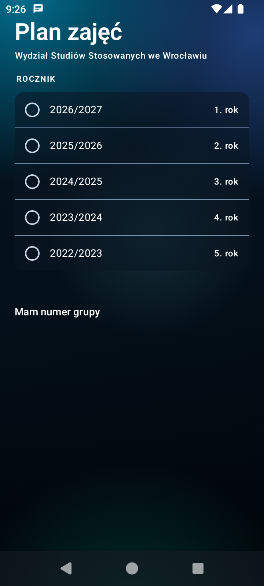
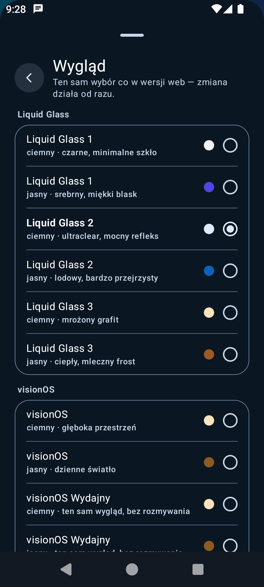
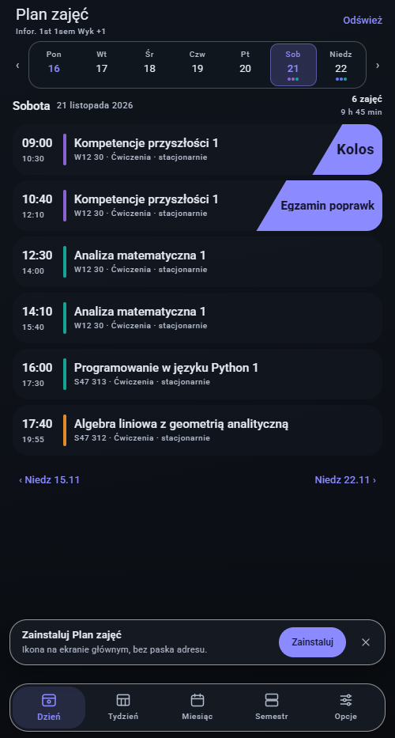
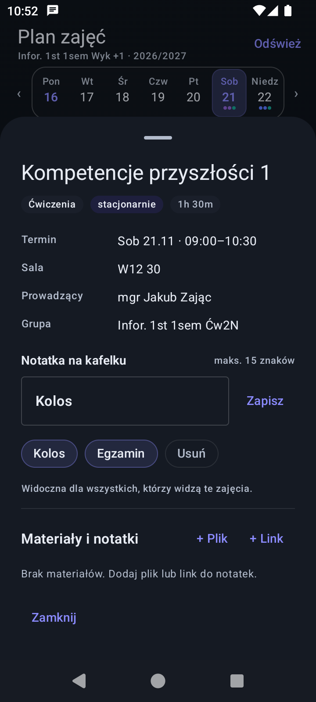

# Zmiany do przeniesienia do aplikacji APK (wydanie 1.6)

Stan: **16 listopada 2026**. Dokument opisuje **wszystkie** zmiany z sesji
(serwer + web v26 → v32) i mówi dokładnie, co z nimi zrobić w aplikacji
natywnej. Punkt odniesienia: opublikowane **APK 1.5 (versionCode 11)**,
`planzajec-ideis-1.5-11.apk`.

> **Realizacja (16.11.2026):** punkty **4, 5, 6, 7 i 13 są już zrobione w tym
> repozytorium** i sprawdzone na emulatorze — szczegóły, kod i dowody w
> sekcji [17](#17-realizacja-w-apk-16112026). Punkty 11–12 nadal opcjonalne
> (decyzja produktowa). Do wydania 1.6 zostaje podbicie wersji i publikacja
> (`scripts/publish-apk.ps1 -Bump -Upload`).

Legenda statusów:

| Status | Znaczenie |
| --- | --- |
| ✅ **SERWER** | Wdrożone na produkcję (`https://ideis.mati-it.pl`). APK korzysta z tego automatycznie — **bez zmiany kodu**. |
| 📦 **APK w repo** | Kod Androida **już zmieniony** w tym repozytorium, ale **nie ma go w wydaniu 1.5-11**. Wystarczy wydać nową wersję. |
| 🛠 **APK do zrobienia** | Poprawka zrobiona w webie; w APK trzeba ją napisać w Compose/Kotlinie. |
| ✅ **APK zrobione** | Punkt 🛠 wykonany 16.11.2026 (kod + testy + sprawdzenie na emulatorze). |
| ⛔ **nie dotyczy APK** | Usterka wyłącznie webowa albo APK już zachowuje się poprawnie (opisane, żeby nikt nie „naprawiał” drugi raz). |

Skrót — 13 pozycji:

| # | Zmiana | Status |
| --- | --- | --- |
| 1 | Tożsamość wersji planu = odcisk treści (`fingerprint`), nie numer procesu | ✅ serwer + 📦 APK |
| 2 | Odcisk obejmuje formę zaliczenia i przypisanie do grup | ✅ serwer |
| 3 | `/api/app/latest` bez wydania → `200 {published:false}` | ✅ serwer + 📦 APK |
| 4 | Sprawdzanie wersji planu przy powrocie do aplikacji | ✅ APK zrobione |
| 5 | Kotwica tygodnia = ten sam dzień co widok dnia | ✅ APK zrobione |
| 6 | Pusty plan: wyjaśnienie + skrót do zmiany rocznika | ✅ APK zrobione |
| 7 | Szkic wyboru w pickerze ≠ wybór zapisany | ✅ APK zrobione |
| 8 | Wyścig wczytań planu (animacja gaśnie po pierwszym planie) | ⛔ APK już anuluje poprzednie wczytanie |
| 9 | Animacja panelu Opcji powtarzana przy przerysowaniu | ⛔ APK używa `AnimatedContent` |
| 10 | Kafelek dnia w „Semestrze” → widok „Dzień” | ⛔ APK już tak działa |
| 11 | Link `?groups=…` otwiera plan | 🛠 APK (opcjonalne — APK nie ma deep linków) |
| 12 | Wybór planu jednym ekranem (rocznik → kierunek → …) | 🛠 APK (opcjonalne, decyzja produktowa) |
| 13 | Stopka Opcji: „plan pochodzi z harmonogramu uczelni (ideis.mati-it.pl)” | ✅ APK zrobione |

---

## 1. ✅ SERWER + 📦 APK — tożsamość wersji planu

### Problem

`version.id` był licznikiem **w pamięci procesu** (`server/versions.js`, `nextId`).
Po restarcie serwera `seed()` z pliku cache znowu dawał `#1`. Klient, który
porównywał tylko numer, uznawał swój stary plan za aktualny **na zawsze** —
każda zmiana planu po wdrożeniu była dla niego niewidoczna. Dotyczyło to też
planu scalonego (`mergedVersionId` haszował numery wersji grup).

Odtworzenie sprzed poprawki (`node scripts/check-restart-version.js`):

```
krok 3: po restarcie — 99 zajęć, wersja #1
krok 4: klient ma wersję #1 (100 zajęć), serwer podaje currentId #1 (99 zajęć)
✗ kolizja: #1 == #1, klient zostaje przy 100 zajęciach mimo 99 u uczelni
```

### Co zmieniłem (serwer)

- `server/versions.js` — `fingerprint(plan)` (SHA-1 z treści zajęć) jest
  **tożsamością wersji**; `classKey(c)` zbiera pola: `id, subject, start, end,
  roomRaw, lecturer, notes, form.raw, passForm, groupIds (posortowane)`.
  `summary()` dokłada `currentFingerprint`.
- `server/merge.js` — `mergedFingerprint(stamps)`: odcisk planu scalonego
  z odcisków grup; `mergedVersionId(groupIds, ay, stamps)` dostaje **odciski**
  zamiast numerów, więc jego numer też jest stabilny treściowo.
- `server/index.js` — `mergedVersionOf()` bierze `store.current().fingerprint`;
  `version.fingerprint` w `/api/plan` i w kopercie planu scalonego;
  `/api/version` (także `?groups=`) zwraca `currentFingerprint`.

### Kontrakt API po zmianie (bez łamania zgodności)

```jsonc
// GET /api/plan?group=21188&ay=2026
"version": {
  "id": 1,                        // numer w pamięci procesu — do historii wersji
  "fingerprint": "a17ceef4f8b3b5d2", // TOŻSAMOŚĆ TREŚCI
  "fetchedAt": "2026-11-15T22:46:21.483Z",
  "classes": 100
}

// GET /api/version?group=21188&ay=2026  (i ?groups=…)
{ "ok": true, "currentId": 1, "currentFingerprint": "a17ceef4f8b3b5d2",
  "currentFetchedAt": "2026-11-15T22:46:21.483Z", "versionIds": [1] }
```

### Co zrobiłem w APK (📦, wymaga wydania)

`android/app/src/main/java/pl/matiit/planzajec/data/model/PlanDtos.kt`

```kotlin
@Serializable
data class PlanVersionDto(
    val id: Long? = null,
    val fingerprint: String? = null,   // NOWE
    val fetchedAt: String? = null,
    val checkedAt: String? = null,
    val classes: Int = 0,
)

@Serializable
data class VersionDto(
    val ok: Boolean = false,
    val groupId: String? = null,
    val currentId: Long? = null,
    val currentFingerprint: String? = null,  // NOWE
    val currentFetchedAt: String? = null,
    val checkedAt: String? = null,
)
```

`…/data/PlanRepository.kt` — nowa funkcja (poziom pliku, `internal`) i użycie
w `refresh()` zamiast porównywania samych numerów:

```kotlin
internal fun samePlanVersion(cached: PlanVersionDto?, remote: VersionDto?): Boolean {
    if (remote == null) return false
    val remotePrint = remote.currentFingerprint
    val cachedPrint = cached?.fingerprint
    if (remotePrint != null && cachedPrint != null) return remotePrint == cachedPrint
    val remoteFetchedAt = remote.currentFetchedAt
    val cachedFetchedAt = cached?.fetchedAt
    if (remoteFetchedAt != null && cachedFetchedAt != null) return remoteFetchedAt == cachedFetchedAt
    val remoteId = remote.currentId
    return remoteId != null && cached?.id == remoteId
}

// w refresh():
val remoteVersion = try { remote.version(target) } catch (e: IOException) { null }
if (samePlanVersion(cached?.plan?.version, remoteVersion) && cached != null) {
    settings.setCheckedAt(key, now)
    return RefreshOutcome.NotModified(cached.copy(savedAtMillis = now))
}
```

Kolejność jest istotna: **odcisk → `fetchedAt` → numer**. `fetchedAt` jest
zapasem dla serwera bez odcisku (starsze wdrożenie), numer — ostatnią deską.

Test: `android/app/src/test/java/pl/matiit/planzajec/data/PlanVersionIdentityTest.kt`
(5 przypadków: ten sam odcisk, numer bez odcisku przy zmienionej treści,
stary serwer po `fetchedAt`, fallback po numerze, brak odpowiedzi).

### Weryfikacja

```powershell
node scripts/check-restart-version.js --fixtures="$env:TEMP\aprfix"
# po poprawce: „krok 4: klient ma wersję #1 (odcisk a17ceef…), serwer podaje #1 (odcisk 87f8866…)”
#              „✓ tożsamość wersji pozwala rozpoznać zmianę po restarcie”
#              5/5 sprawdzeń przeszło
```

---

## 2. ✅ SERWER — odcisk obejmuje formę zaliczenia i przypisanie do grup

### Problem

Odcisk (początkowa wersja) haszował `id, subject, start, end, roomRaw,
lecturer, notes, form.raw`. Uczelnia mogła zmienić **formę zaliczenia**
(`passForm`) albo **przypisać zajęcia do innej grupy** (`groupIds`) i wersja
się nie zmieniała. `groupIds` jest groźniejsze: po nim `merge.js` filtruje plan
scalony — zajęcia mogłyby zniknąć z planu bez nowej wersji.

### Co zmieniłem

Jak w punkcie 1: `classKey()` w `server/versions.js` dokłada `passForm`
i posortowane `groupIds` (kolejność linków w komórce nie robi „nowej wersji”).

### Weryfikacja (Twoja sonda `scripts/probe-fields.js`)

```
✓ nowa wersja  forma zaliczenia       #13 → #14  pole w planie zmienione: tak
✓ nowa wersja  przypisanie do grupy   #21 → #22  pole w planie zmienione: tak
7/7 pól wykrytych jako zmiana wersji.
```

APK dostaje to za darmo (serwer tworzy nową wersję → `NotModified` przestaje
pasować → plan się dociąga). Warunek: APK z punktu 1 (porównanie odcisku).

---

## 3. ✅ SERWER + 📦 APK — `/api/app/latest` bez wydania

### Problem

Gdy nie było manifestu wydania, endpoint zwracał `404`. Przeglądarka logowała
błąd w konsoli przy każdym starcie. APK traktował `404` jako „brak wydania”
(`HttpUpdateRemote`, gałąź `HTTP_NOT_FOUND -> null`), więc samo `200` bez
zmiany klienta skończyłoby się komunikatem „Brak numeru wersji w odpowiedzi.”

### Co zmieniłem (serwer, `server/index.js`)

```js
const release = await releases.latest();
if (!release) {
  return json(res, 200, {
    ok: true, published: false, release: null,
    versionCode: 0, updateAvailable: false,
    generatedAt: new Date().toISOString(),
  });
}
```

### Co zrobiłem w APK (📦, `…/update/UpdateRemote.kt`)

```kotlin
HttpURLConnection.HTTP_NOT_FOUND -> null          // starsze serwery

in 200..299 -> connection.inputStream.use { stream ->
    PlanJson.decodeFromString<UpdateManifestDto>(stream.readBytes().decodeToString())
}.takeIf { it.versionCode >= 1 }                  // pusty manifest = brak wydania
```

Bez tej linii APK pokazałby błąd zamiast „masz najnowszą wersję”.

---

## 4. 🛠 APK — sprawdzanie wersji planu przy powrocie do aplikacji

### Objaw (web, naprawione w v30)

Przy otwartej aplikacji plan u uczelni mógł się zmienić, a użytkownik widział
stary do przeładowania strony. W webie dochodziło do tego, że przy świeżym
cache (`FRESH_MS = 10 min`) `load()` **w ogóle nie pytał** o `/api/version`.

### Co zrobiłem w webie

`public/app.js`:

- `checkPlanVersion()` — lekkie `GET /api/version`, porównanie odcisku
  (`samePlanVersion`), przy różnicy `load(true)`;
- `VERSION_POLL_START_MS = 30_000` (pierwsze sprawdzenie po starcie),
  `VERSION_POLL_MS = 5 * 60_000` (cyklicznie);
- wywołanie także przy `visibilitychange` (powrót do karty), z pominięciem
  ukrytej karty i trybu offline.

### Co zrobić w APK

`PlanViewModel.onResume()` robi tylko `load()`, a `PlanRepository.refresh()`
przy cache młodszym niż `PlanConfig.FOREGROUND_FRESH_MS` (10 min) zwraca
`RefreshOutcome.Cached` **bez pytania o wersję** — czyli ten sam problem.

Propozycja (najmniejsza zmiana, jedno miejsce):

```kotlin
// PlanRepository.kt
/** Tani test „czy treść planu się zmieniła” — pyta tylko /api/version. */
suspend fun planChanged(target: PlanTarget = currentTarget()): Boolean {
    val known = cachedPlan(target)?.plan?.version ?: return true   // brak cache → pobierz
    val remoteVersion = runCatching { remote.version(target) }.getOrNull() ?: return false
    return !samePlanVersion(known, remoteVersion)
}

// PlanViewModel.kt
fun onResume() {
    val today = LocalDate.now()
    _state.update { it.copy(today = today) }
    refreshAttachmentIndex()
    viewModelScope.launch {
        val changed = withContext(Dispatchers.IO) {
            runCatching { repository.planChanged() }.getOrDefault(false)
        }
        val stale = System.currentTimeMillis() - lastLoadAt > RESUME_REFRESH_MS
        if (changed || stale) load(force = changed)
    }
}
```

Uwaga: `POST /api/refresh` (czyli `load(force = true)`) dotyka harmonogramu
uczelni i jest throttlowany po stronie serwera — dlatego `force` dopiero, gdy
odcisk się różni.

### Kryterium akceptacji

1. Zmiana planu u uczelni (albo `scripts/mock-apr.js` + `state.json`) →
   powrót do aplikacji → plan dociąga się **bez** zabijania procesu.
2. Bez zmian: powrót nie wykonuje `POST /api/refresh`.
3. Test jednostkowy: `planChanged()` zwraca `false`, gdy `samePlanVersion`
   pasuje; `true`, gdy odcisk inny; `false` przy błędzie sieci (nie spamujemy).

---

## 5. 🛠 APK — kotwica tygodnia = ten sam dzień co widok dnia

### Objaw (web, naprawione w v30)

Ten sam plan startował w trzech różnych miejscach: Dzień na pierwszym dniu
z zajęciami, Tydzień na „dziś”, Miesiąc na pierwszym dniu z zajęciami
w miesiącu. W tygodniu często witało „Brak zajęć w tym tygodniu”, mimo że plan
miał zajęcia.

### Co zrobiłem w webie

`public/app.js`: jedna funkcja `anchorDay()` = `activeDay()` (wybór użytkownika,
a bez niego `ScheduleViews.initialDay(dates, today)`), używana przez
`selectView`, `renderWeek`, `renderMonth`, `shiftWeek`, `shiftMonth`.

### Co zrobić w APK

`ui/views/WeekView.kt` (linia ~68):

```kotlin
// BYŁO — tydzień „dziś”, dzień i miesiąc „pierwszy dzień z zajęciami”
val initial = remember(days, today) { ScheduleViews.weekStart(selectedDate ?: today) }

// MA BYĆ — ta sama kotwica co w DayView i MonthView
val anchor = selectedDate ?: ScheduleViews.initialDay(days, today) ?: today
val initial = remember(days, today, selectedDate) { ScheduleViews.weekStart(anchor) }
```

`DayView` (`active = selectedDate ?: ScheduleViews.initialDay(days, today)`)
i `MonthView` (fallback `initialDay`) są już poprawne — tylko tydzień odstawał.

### Kryterium akceptacji

Dla planu, którego pierwsze zajęcia są np. 27.11, a „dziś” to 16.11:
Dzień = 27.11, Tydzień = 23–29.11 (z zajęciami), Miesiąc = listopad
z podświetlonym 27.11. Dodatkowo test JVM na czystej funkcji, jeśli wyciągniesz
wybór kotwicy do `ScheduleViews.anchorDate(days, today, selectedDate)`.

---

## 6. 🛠 APK — pusty plan: wyjaśnienie i skrót

### Objaw (web, naprawione w v30)

`Brak zajęć do wyświetlenia · Odśwież plan albo wybierz inną grupę.` — bez
informacji, że dla starszego rocznika to **normalne** (uczelnia publikuje jeden
rok akademicki na grupę), i bez skrótu do zmiany rocznika.

### Co zrobiłem w webie

`public/app.js` (gałąź `!state.dates.length` w `render()`):

```
Ten plan nie ma zajęć
Wybrany rocznik lub grupa nie mają zajęć w planie uczelni.
Na starszych rocznikach to normalne — plan bywa już zamknięty.
[Zmień rocznik lub plan]  → Opcje → Wybór planu
[Odśwież]
```

### Co zrobić w APK

`ui/ScheduleApp.kt` (linia ~264) — w tym samym pliku `showSettings`
i `settingsPage` są już stanami (`rememberSaveable`), więc akcja to ich ustawienie:

```kotlin
days.isEmpty() -> EmptyMessage(
    title = "Ten plan nie ma zajęć",
    body = "Wybrany rocznik lub grupa nie mają zajęć w planie uczelni. " +
        "Na starszych rocznikach to normalne — plan bywa już zamknięty.",
    actionLabel = "Zmień rocznik lub plan",
    onAction = {
        settingsPage = SettingsPage.GROUP
        showSettings = true
    },
    modifier = Modifier.fillMaxSize(),
)
```

`EmptyMessage` (`ui/components/ScheduleComponents.kt`, linia ~341) przyjmuje
dziś **jeden** przycisk (`actionLabel` + `onAction`). Jeśli chcesz dwa
(zmiana planu **i** odświeżenie), dołóż parametry
`secondaryActionLabel/onSecondaryAction` i drugi `TextButton`.

---

## 7. 🛠 APK — szkic wyboru w pickerze ≠ wybór zapisany

### Objaw (web, naprawione w v30)

Kroki pickera zmieniają wybór **od razu**, a plan zmienia się dopiero po
wskazaniu grupy. Zamknięcie Opcji w połowie wyboru zostawiało kartę „Plan”
z „Informatyka · 2023/2024” przy planie 2. roku, a „Dodaj grupy” filtrowało
listę złym rocznikiem. Do tego szkic trafiał do `localStorage`, więc po
przeładowaniu strony `ensurePlanBase()` mógł dograć grupę wykładową z innego
rocznika.

### Co zrobiłem w webie

- kroki pickera **nie zapisują** już wyboru do pamięci (`writePrefs` usunięte
  z `wizChooseNabor/Kierunek/Spec/Tryb` i `wizReset`); wybór zapisuje dopiero
  `selectPlan()` razem z planem,
- `state.wizard.applied = { sel, site }` — kopia wyboru opisującego wczytany
  plan, ustawiana w `selectPlan()` i po korekcie z katalogu,
- `restoreAppliedSelection()` w `closeSheet()` cofa szkic, gdy arkusz zamyka
  się bez wybrania planu.

### Co zrobić w APK

`ui/PlanViewModel.kt` — `chooseKierunek/chooseNabor/chooseSpec/chooseTryb`
wołają `repository.rememberSelection(selection)` po każdym kroku, a strona
„Plan” pokazuje `selectionSummary` z **bieżącego** wyboru
(`SettingsSheet.kt` linia ~386). To ten sam problem.

Propozycja:

1. Usuń `rememberSelection()` z kroków pickera; zapisuj wybór tam, gdzie
   powstaje plan (`selectPlan()` / `selectGroup()` / `addGroups()`).
2. W `PlanUiState` trzymaj `appliedSelection: PlanSelection?` ustawiane
   w `selectPlan()`; `selectionSummary` na stronie „Plan” licz z
   `appliedSelection ?: selection`.
3. Przy zamykaniu arkusza (jeśli plan nie został zmieniony) przywróć
   `selection = appliedSelection` i `site` z kopii.

Test: `PlanViewModel` — po `chooseNabor(...)` i zamknięciu arkusza
`selection` wraca do wartości opisującej plan; `addableGroups` filtruje po
roczniku planu, nie szkicu.

---

## 8. ⛔ APK — wyścig wczytań planu (animacja „pierwszego planu”)

### Objaw (web, naprawione w v31)

Przy dodawaniu kilku grup animacja wczytywania gasła po **pierwszym** planie,
a resztę zajęć „doładowywało” po chwili. Powód: dwa `load()` biegły naraz
(wybór planu + dodanie grup), a starsza odpowiedź gasiła animację i wstawiała
plan bez nowych grup.

### Dlaczego APK tego nie ma

`PlanViewModel.load()` zaczyna się od `loadJob?.cancel()` — nowe wczytanie
anuluje poprzednie, więc wyścigu nie ma. **Nie trzeba nic robić.** Poprawka
webowa (licznik `loadSeq` + `isCurrent()` w `public/app.js`) jest tylko dla
przeglądarki.

---

## 9. ⛔ APK — powtarzana animacja panelu Opcji

### Objaw (web, naprawione w v32)

Wejście w Opcje „przesuwało się w bok kilka razy”. Animacja `.settings-page`
odpalała się przy **każdym przerysowaniu**: 1,2 s po starcie dociąganie wydania
APK, 1,5 s — sprawdzanie aktualizacji PWA, do tego service worker zgłaszający
nowe wydanie (stąd „tylko niekiedy, po nowym wydaniu / po pierwszym
uruchomieniu”).

### Dlaczego APK tego nie ma

`ui/settings/SettingsSheet.kt` animuje **przejścia** przez `AnimatedContent`
(klucz = `SettingsPage`), więc recompozycja treści nie powtarza ruchu. Nic do
roboty.

---

## 10. ⛔ APK — kafelek dnia w „Semestrze” → „Dzień”

W APK od dawna:

```kotlin
// ScheduleApp.kt
onOpenDay = { date ->
    onSelectDate(date)
    viewModel.selectViewMode(ScheduleViewMode.DAY)
},
```

Web dogonił APK w v32 (`selectDate()` przy `state.view === 'semester'`
przełącza widok). **APK nie wymaga zmian** — to punkt odniesienia.

---

## 11. 🛠 APK (opcjonalne) — linki `?group=` / `?groups=`

### Co zrobiłem w webie (v30)

- `?groups=21186,21188&ay=2026` otwiera plan także na świeżej przeglądarce
  (`needsGroup` uwzględnia `query.groups`; wybór z adresu jest zapisywany),
- aplikacja sama produkuje takie adresy, więc wcześniej „nie rozumiała”
  własnych linków.

### Stan APK

`MainActivity` ma już `android:launchMode="singleTop"`, ale nie ma
`intent-filter` z `VIEW`/`BROWSABLE` ani obsługi `Intent`, więc APK nie
przyjmuje żadnych linków. Jeśli chcesz tę funkcję:

1. `android:launchMode="singleTop"` + `onNewIntent` w `MainActivity`,
2. `PlanTarget` już modeluje `groups` + `ay` — wystarczy parser:
   `?groups=a,b,c` → `PlanTarget(orderedGroups = listOf(a,b,c), academicYear = ay)`.
3. `PlanViewModel.selectGroup(...)`/`selectPlan(...)` już przyjmują gotowy
   wybór — link może od razu ustawić `groupId` + `planGroups` + `needsGroupSelection=false`.

Bez tego punktu APK działa jak dotąd — to funkcja, nie poprawka błędu.

---

## 12. 🛠 APK (opcjonalne) — wybór planu jednym ekranem (web v29)

### Co zmieniłem w webie (v29, `public/app.js` + `public/wizard.js`)

- na starcie widać **tylko rocznik**, kolejne kroki pojawiają się pod nim,
- wybrane kroki zwijają się do jednego wiersza („Rocznik · 2024/2025”),
- brak paska kroków i arkusza; specjalność/tryb przechodzą same, gdy nie ma
  z czego wybierać,
- „Mam numer grupy” jest schowane pod linkiem,
- `PW.stepsFor(selection)` decyduje, które kroki w ogóle pokazać.

### Stan APK

`ui/WelcomeScreen.kt` + `ui/selection/SelectionWizard.kt` mają arkusz z paskiem
kroków w kolejności **kierunek → rocznik**. To **inna decyzja produktowa**, nie
błąd. Jeśli chcesz wyrównać do web:

- przenieść kolejność na `rocznik → kierunek → specjalność → tryb`
  (`WelcomeScreen.kt` linie ~212–215 już liczą pierwszy brakujący krok —
  wystarczy zamienić kolejność warunków),
- zastąpić pasek kroków listą „podsumowanie + otwarty krok” (jeden
  `LazyColumn` z sekcjami; logikę `stepsFor()` można przenieść z
  `public/wizard.js` do `domain/PlanWizard.kt` i pokryć testem JVM),
- ukryć pole numeru grupy pod linkiem „Mam numer grupy”.

Szacunek: 1 sesja pracy + testy `PlanWizardTest`. **Do decyzji, czy w 1.6.**

---

## 13. 🛠 APK — tekst stopki Opcji

Web v30: „…plan pochodzi z harmonogramu uczelni (ideis.mati-it.pl)” — wcześniej
myląco „plany.mati-it.pl” (adres aplikacji bazowej).

W APK sprawdź teksty w `ui/settings/SettingsSheet.kt` / `ui/About`-owych
wierszach; jeśli jest tam `plany.mati-it.pl`, podmień na
`harmonogram uczelni (ideis.mati-it.pl)`.

---

## 14. Wydanie APK 1.6 — checklist

```powershell
# 1. Testy i lint (z katalogu android)
.\gradlew.bat :app:testDebugUnitTest :app:lintDebug

# 2. Wersja żyje w android/version.properties (versionCode=11, versionName=1.5)
#    i podbija ją dopiero publikacja (-Bump → 12 / 1.6). Nie edytuj ręcznie.

# 3. Wpis „Co nowego” (domain/WhatsNew.kt) — propozycja:
#    „Plan odświeża się sam także po restarcie serwera — zmiana planu jest
#     rozpoznawana po treści, nie po numerze wersji.”

# 4. Publikacja (z katalogu plany-wybor)
.\scripts\publish-apk.ps1 -Bump -Notes "1.6 — plan odświeża się po restarcie serwera; pusty plan mówi, że to normalne; tydzień startuje na tym samym dniu co dzień" -Upload
```

Po publikacji sprawdź:

```powershell
(Invoke-WebRequest 'https://ideis.mati-it.pl/api/app/latest').Content
# → { ok: true, versionCode: 12, versionName: "1.6", apkFile: "...", sha256: "..." }
```

Strona „Aplikacja Android” w webie pokaże nową wersję i rozmiar
(`Opcje → Aplikacja Android`).

---

## 15. Weryfikacja całości (wyniki z tej sesji)

| Sprawdzenie | Wynik |
| --- | --- |
| `node scripts/self-test.js` (serwer + web) | **103 przeszło, 0 nie przeszło** |
| `node scripts/check-restart-version.js` | 5/5 (przed poprawką 3/4 — kolizja `#1 == #1`) |
| `node scripts/probe-fields.js` | 7/7 pól wykrytych (w tym forma zaliczenia, przypisanie do grupy) |
| `node scripts/check-plan-change.js` | 15/15 (zmiana sali/formy zaliczenia tworzy nową wersję) |
| `node scripts/check-plan-parity.js --combos=10 --extra=4` | 14 grup + plan scalony — wszystko zgodne ze źródłem |
| `.\gradlew.bat :app:testDebugUnitTest :app:lintDebug` | BUILD SUCCESSFUL |
| Produkcja (`https://ideis.mati-it.pl`) | web v32, `app.js` sha256 `5f4c7cd1…`, `/api/version` → `currentFingerprint` |

Czego **nie** zweryfikowałem: zachowania na realnym telefonie po tych zmianach
(testy APK to JVM + lint), iOS/Safari oraz emulatora po nowym wydaniu.

---

## 16. Ryzyka i otwarte punkty

1. **Stare APK 1.5-11** nadal porównuje `version.id` — po restarcie serwera
   (każde wdrożenie) nie zauważy zmiany planu. Wydanie 1.6 z punktu 1 zamyka
   temat; do tego czasu użytkownicy 1.5 powinni od czasu do czasu użyć
   „Odśwież”, bo `force=true` omija porównanie wersji.
2. **Punkt 7 (szkic vs plan)** zmienia zachowanie pickera w APK — po zmianie
   warto przetestować: wybór rocznika → zamknięcie arkusza → karta „Plan”
   pokazuje rocznik planu, „Dodaj grupy” filtruje po roczniku planu.
3. **Punkt 4** dotyka harmonogramu uczelni: `force` tylko przy różnicy odcisku,
   inaczej throttling serwera (`REFRESH_MIN_GAP_S`) będzie odbijał żądania.
4. **Punkty 11–12** to funkcje, nie błędy — decyzja produktowa: robimy je w 1.6
   czy zostawiamy na 1.7.
5. Dokument opisuje stan z 16.11.2026. Kod web/serwera: `public/app.js`
   (v32), `server/*`, testy `scripts/*`. Kod APK:
   `android/app/src/main/java/pl/matiit/planzajec/**`.

---

## 17. Realizacja w APK (16.11.2026)

Punkty 4–7 i 13 są **wykonane**. Poniżej: co dokładnie zmieniłem, jak to działa
i czym sprawdziłem. Wszystko jest w `android/` — wystarczy wydać 1.6.

### 4. Sprawdzanie wersji planu przy powrocie

**Kod**

`data/PlanRepository.kt` — nowa funkcja obok `samePlanVersion`:

```kotlin
suspend fun planChanged(target: PlanTarget = currentTarget()): Boolean {
    val known = cachedPlan(target)?.plan?.version ?: return true      // brak cache → pobierz
    val remoteVersion = runCatching { remote.version(target) }.getOrNull() ?: return false
    return !samePlanVersion(known, remoteVersion)                      // błąd sieci ≠ zmiana
}
```

`ui/PlanViewModel.kt` — `onResume()`:

```kotlin
viewModelScope.launch {
    if (loadJob?.isActive == true) return@launch        // start aplikacji już ładuje
    val changed = withContext(Dispatchers.IO) {
        runCatching { repository.planChanged() }.getOrDefault(false)
    }
    val stale = System.currentTimeMillis() - lastLoadAt > RESUME_REFRESH_MS   // 15 min
    if (changed || stale) load(force = changed)          // force tylko przy różnicy odcisku
}
```

**Dlaczego tak:** `force = true` to `POST /api/refresh` (dotyka harmonogramu
uczelni i jest throttlowany) — wysyłamy go dopiero, gdy odcisk się różni.
Błąd sieci nie może udawać zmiany, inaczej każde odblokowanie telefonu bez
zasięgu kończyłoby się odświeżaniem.

**Testy** (`PlanRepositoryTest`): „planChanged jest fałszywe gdy odcisk ten
sam”, „…prawdziwe gdy odcisk inny”, „…bez cache każe pobrać plan”, „…przy braku
sieci nie udaje zmiany”. Sprawdzają też, że tanie sprawdzenie **nie** pobiera
planu (`planCalls == 0`).

### 5. Kotwica widoków

`domain/ScheduleViews.kt` — jedna reguła dla Dnia, Tygodnia i Miesiąca:

```kotlin
fun anchorDay(days: List<DaySchedule>, today: LocalDate, selected: LocalDate? = null): LocalDate? =
    selected ?: initialDay(days, today)
```

- `WeekView` startuje z `weekStart(anchorDay)` i ma
  `LaunchedEffect(anchorDay)` — po zmianie planu (data wyboru jest czyszczona)
  tydzień przeskakuje na tydzień nowego planu, zamiast witać „Brak zajęć
  w tym tygodniu”,
- `MonthView` ma to samo (`FallbackMonth` + `LaunchedEffect(anchor)`) i przy
  przesuwaniu miesiąca zaznacza pierwszy dzień z zajęciami, więc powrót do
  „Dnia” pokazuje ten miesiąc, a nie poprzedni,
- `DayView` korzysta z tej samej kotwicy (bez zmiany zachowania).

**Dodatkowo naprawione przy okazji:** przesunięcie tygodnia ustawiało wybrany
dzień na **poniedziałek** — po powrocie do „Dnia” zamiast czwartku był
poniedziałek. Teraz `shiftWeek` zachowuje dzień tygodnia:

```kotlin
val shiftWeek: (Long) -> Unit = { weeks ->
    val next = anchorDay.plusWeeks(weeks)
    anchorText = ScheduleViews.weekStart(next).toString()
    onSelectDate(next)
}
```

**Test:** `ScheduleViewsTest` — „kotwica widoków to wybrany dzień a bez wyboru
pierwsze zajęcia” (plan od 27.11, „dziś” 16.11 → dzień 27.11, tydzień od 23.11;
wybór użytkownika ma pierwszeństwo; plan bez zajęć → `null`).

### 6. Pusty plan

`ui/ScheduleApp.kt`:

```kotlin
days.isEmpty() -> EmptyMessage(
    title = "Ten plan nie ma zajęć",
    body = "Wybrany rocznik lub grupa nie mają zajęć w planie uczelni. " +
        "Na starszych rocznikach to normalne — plan bywa już zamknięty.",
    actionLabel = "Zmień rocznik lub plan",
    onAction = {
        settingsPage = SettingsPage.GROUP
        showSettings = true
    },
    modifier = Modifier.fillMaxSize(),
)
```

Drugi przycisk („Odśwież”) nie był potrzebny — „Odśwież” jest w górnym pasku,
a `EmptyMessage` przyjmuje jedną akcję.

### 7. Szkic pickera ≠ wybór zapisany

`ui/PlanViewModel.kt` + `PlanUiState`:

- `selection` = szkic (to, co użytkownik klika w pickerze),
- `appliedSelection` / `appliedSite` = wybór opisujący **wczytany** plan,
  ustawiane tylko w jednej drodze zmiany planu (`applyPlan`, wołane przez
  `selectPlan`/`addGroups`/`removeGroup`),
- kroki `chooseKierunek/chooseNabor/chooseSpec/chooseTryb` **nie zapisują już**
  wyboru do ustawień (`repository.rememberSelection` usunięte razem z metodą),
- `addableGroups` filtruje po `appliedSelection` — „Dodaj grupy” pokazuje grupy
  rocznika **planu**, nie przeglądanej oferty,
- `restoreAppliedSelection()` wołane przy zamknięciu Opcji: szkic wraca do
  wyboru planu (rocznik, kierunek, specjalność) i czyści cache list,
- `selectionSummary()` liczy podpis z `appliedSelection` (+ etykiety
  `appliedSite`, a po restarcie z wartości katalogu `field`/`spec`), więc karta
  „Plan” mówi o planie, który jest na ekranie.

**Testy** (`ui/PlanUiStateTest`): podpis planu bierze wybór zapisany a nie szkic;
po restarcie podpis powstaje z wartości katalogu; „dodawanie grup filtruje po
roczniku planu”; „lista grup w pickerze nadal idzie za szkicem”.

### 13. Stopka i domeny

- `ui/settings/SettingsSheet.kt`: „…plan pochodzi z **harmonogramu uczelni
  (ideis.mati-it.pl)**”,
- `ui/update/UpdateSurfaces.kt`: „do pobrania z **ideis.mati-it.pl**”, „Nowe
  wersje pochodzą z **ideis.mati-it.pl**, nie ze sklepu Play” (wydania serwuje
  ten sam serwer co API — wcześniej tekst wskazywał `plany.mati-it.pl`),
- `ui/settings/FeedbackPage.kt`: „…widać je na **ideis.mati-it.pl/propozycje**”.

### Nowe błędy znalezione przy testowaniu (i naprawione)

Te punkty **nie były** w pierwotnej liście — wyszły dopiero przy przeklikiwaniu
aplikacji na emulatorze. Wszystkie są w tym samym wydaniu:

1. **Po restarcie aplikacji Opcje → „Wybór planu” były puste** („Brak listy
   kierunków — spróbuj ponownie za chwilę”). Katalog kierunków ładował się
   tylko na ekranie powitalnym, który pokazuje się raz. Teraz `ScheduleApp`
   robi `LaunchedEffect(showSettings) { if (showSettings) viewModel.loadKierunki() }`.
   Objaw dotyczył każdego, kto chciał zmienić plan po restarcie telefonu.
2. **Krok „Tryb studiów” kończył się „Brak trybów dla tego wyboru”**, gdy wybór
   pochodził z domyślnych serwera: `site.kierunekId` było puste (nikt nie
   kliknął kroku „Kierunek”), a endpoint trybów wymaga numeru kierunku.
   Poprawka: `loadKierunki` dopasowuje kierunek po nazwie
   (`SiteSelection.withKierunek`) i dociąga specjalności oraz tryby, a
   `loadTryby` bez numeru kierunku liczy tryby z katalogu (`catalogTryby`).
3. **Krok „Rocznik” był pusty** z tego samego powodu co punkt 2 (lista
   roczników pochodzi z pozycji kierunku) — naprawione tym samym dopasowaniem.
4. **„Zjazdy” w pustym tygodniu** — widok nazywa się „Semestr” od 1.5; tekst
   poprawiony.
5. **„Odświeżanie w tle sprawdza tylko numer wersji planu”** — nieprawda od
   wydania 1.6; teraz „pobiera tylko odcisk wersji planu”.
6. **Domena `plany.mati-it.pl`** w Aktualizacjach i Propozycjach (opisane
   w punkcie 13).

### Weryfikacja

| Sprawdzenie | Wynik |
| --- | --- |
| `.\gradlew.bat :app:testDebugUnitTest :app:lintDebug` | **BUILD SUCCESSFUL**, 222 testy, 0 błędów |
| `.\gradlew.bat :app:assembleRelease` (R8 + shrinkResources) | BUILD SUCCESSFUL |
| Emulator Pixel 9 Pro (API 34), APK debug 1.5 (11) | instalacja i uruchomienie bez wyjątku w logcat |
| Pierwsze uruchomienie: ekran powitalny → rocznik → pomiń specjalność → tryb → plan | plan wczytany (2 zajęcia 22.11), brak „Brak trybów” |
| Restart aplikacji → Opcje → Grupa → Rocznik | lista kierunków i roczników (2026/2025/2024/2023) widoczna |
| Przejrzenie rocznika 2025 i „Anuluj” → Opcje → Plan | karta nadal „Informatyka · 2026/2027” (szkic cofnięty) |
| Wybór planu 2025/2026 → „Dodaj grupy” | lista grup rocznika **planu** (2. rok, 3. sem.), dodanie ćwiczeń → plan scalony „Wyk +1”, 5 zajęć |
| Usunięcie grupy z planu | powrót do 1 grupy, plan wykładu, brak błędu |
| Dzień / Tydzień / Miesiąc / Semestr | ten sam dzień (29.11 → tydzień 23–29.11 → listopad z 29.11); przesunięcie tygodnia i powrót do Dnia pokazuje **ten sam dzień tygodnia** (niedziela 29.11) |
| Kafelek dnia w „Semestrze” (14.09) | przejście do widoku „Dzień” z tą datą |
| Pusty plan (podmieniony cache, 0 zajęć) | „Ten plan nie ma zajęć” + „Zmień rocznik lub plan” → otwiera „Wybór planu” |
| Odświeżenie po podmianie odcisku w cache + powrót do aplikacji | `onResume` wykrył różnicę i pobrał plan ponownie (odcisk wrócił do `1d1de1ed6f620c87`) |

**Czego nie sprawdziłem:** realnego telefonu i Androida 8–13 (emulator to
API 34), zachowania widżetów po tych zmianach, oraz publikacji 1.6.

### Co zostaje przed wydaniem 1.6

```powershell
# z katalogu android
.\gradlew.bat :app:testDebugUnitTest :app:lintDebug

# wpis „Co nowego” (domain/WhatsNew.kt) — dodać przy podbiciu wersji, bo test
# `historia zaczyna sie od wersji, ktora jest w tej chwili wydana` porównuje
# pierwszy wpis z opublikowanym versionCode:
#   versionCode = 12, versionName = "1.6"
#   „Plan odświeża się sam po powrocie do aplikacji, także po restarcie serwera”
#   „Pusty plan mówi, że na starszym roczniku to normalne, i daje skrót do zmiany planu”
#   „Tydzień startuje na tym samym dniu co dzień; zmiana planu przestawia kalendarz”
#   „Wybór planu po restarcie aplikacji nie jest już pusty”

# z katalogu plany-wybor
.\scripts\publish-apk.ps1 -Bump -Upload -Notes "1.6 — plan odświeża się po powrocie; pusty plan z podpowiedzią; tydzień i miesiąc na dniu planu; picker nie gubi wyboru"
```


## 18. 🛠 APK — widżety w motywie aplikacji + trzy nowe motywy (16.11.2026)

Zakres: widżety mają wyglądać jak aplikacja (także na pulpicie), zmiana motywu
ma działać **na już stojącym widżecie**, nowy widżet ma przejmować bieżący styl,
a zmiana wariantu graficznego ma realnie przerysować kafel. Do aplikacji doszły
trzy motywy: **Fiolet**, **Róż** i **Połączony** (fiolet + róż).

### Co było nie tak

1. **Widżet „Dzień” i oba podglądy miały zaszyty visionOS** —
   `StyleCatalog.palette(if (night) "visionos-dark" else "visionos-light", …)`
   w `DayScheduleWidget` i `WidgetPreviews`. Motyw aplikacji nie miał z tym nic
   wspólnego, więc ten widżet zawsze był ciemny (lub beżowy), nawet przy
   „Jasnym” czy „Apple”.
2. **Styl czytany raz, poza kompozycją.** `ScheduleWidget.provideGlance` robił
   `val styleId = …styleId` **przed** `provideContent`, a Glance trzyma sesję
   kompozycji: `update()` odtwarza kompozycję z przechwyconymi zmiennymi, więc
   po zmianie motywu widżet rysował się w starych kolorach do końca sesji.
3. **Odcisk treści widżetu „Dzień” nie zawierał stylu** —
   `"$today|$night|${dayModel.fingerprint()}"` — więc zmiana motywu mogła
   w ogóle nie wywołać aktualizacji (fingerprint bez zmian → pominięte).
4. **Zmiana motywu w aplikacji wołała odświeżenie „nie-wymuszone”**
   (`onPlanChanged`), czyli opierała się tylko na odcisku.
5. **Zmiana trybu jasny/ciemny w systemie nie docierała do widżetów.** Widżety
   nie dostają `ACTION_CONFIGURATION_CHANGED`, a tonacja jest zapisana w stanie
   Glance — bez jawnego przerysowania kafel zostawał w starej tonacji.
6. **Po dodaniu grup do planu widżet rysował pusty tydzień.** Odświeżenie
   widżetów leciało w `applyPlan` (w chwili kliknięcia), a scalony plan przychodzi
   dopiero z sieci — widżet dostawał poprzedni (pusty) cache i już nikt go nie
   odświeżał.
7. **Statyczny podgląd w wyborze widżetów był tylko ciemny** —
   `res/values/widget_preview_colors.xml` bez wariantu `values-night`.

### Jak to działa teraz

| Element | Zmiana |
| --- | --- |
| `widget/WidgetTheme.kt` (nowy) | jedno źródło motywu widżetu: `palette()`, `colors()`, `contentKey()` — widżety, podglądy i odciski nie mogą się już rozjechać |
| `ScheduleWidget`, `DayScheduleWidget`, `WidgetPreviews` | `WidgetTheme.colors(state.widgetStyle() ?: styleId, night)` — widżet „Dzień” nie ma już własnej palety |
| `WidgetLookState.kt` | nowy klucz `widget-style` w stanie Glance; `writeWidgetContext(styleId, night, today)` zapisuje motyw razem z tonacją i dniem |
| `WidgetUpdater` | odcisk treści **obu** widżetów z `WidgetTheme.contentKey(...)`, czyli ze stylem aplikacji |
| `PlanViewModel.selectStyle` | nowy callback `onStyleChanged` → `WidgetUpdater.requestUpdate(force = true)` |
| `PlanApplication.onConfigurationChanged` | przy zmianie tonacji systemu `requestUpdate(force = true)` (aplikacja żyje → widżet zaraz się przemalowuje) |
| `ScheduleWidgetReceiver` / `DayScheduleWidgetReceiver` | `onUpdate` → `requestUpdate(force = true)`; system woła `onUpdate` także po zmianie konfiguracji (sprawdzone w logcat: `AppWidgetServiceImpl: Trying to notify widget update…`) |
| `PlanViewModel.applyStored` | `onPlanChanged()` **po** zapisaniu planu — widżet nie zostaje z pustym tygodniem po dodaniu grup |
| `res/values-night/widget_preview_colors.xml` | nocny wariant statycznego podglądu; dzienny w `values/` |

### Trzy nowe motywy (grupa „Kolorowe”)

| Id | Podpis | Charakter | Akcent (jasny / ciemny) |
| --- | --- | --- | --- |
| `violet-light` / `violet-dark` | Fiolet | lawenda / aksamitny fiolet | `#6D28D9` / `#C4B5FD` |
| `pink-light` / `pink-dark` | Róż | pudrowy róż / różowa poświata | `#BE1E63` / `#FFB3CE` |
| `mix-light` / `mix-dark` | Połączony | fiolet z różem w jednym tle | `#A21CAF` / `#E9B8FF` |

`StyleCatalog.styles` ma teraz **20 pozycji** (12 motywów × warianty jasny/ciemny
+ `Auto`). Grupa „Kolorowe” jest tylko w aplikacji — wersja web nie zna tych
identyfikatorów i spadnie do motywu domyślnego.

### Weryfikacja na emulatorze (Pixel 9 Pro, API 34, APK debug)

| Sprawdzenie | Wynik |
| --- | --- |
| Motyw „visionOS jasny” + widżet tygodnia na pulpicie | panel `(251,247,241)` = `#FBF7F1` = `panelSolid` jasnego visionOS |
| Zmiana na „Fiolet ciemny” **na stojącym widżecie** | panel `(18,10,36)` = `#120A24`, bez restartu aplikacji i bez dodawania widżetu |
| Widżet „Dnia” dodany przy motywie fioletowym | od razu fioletowy panel i fioletowe akcenty (wcześniej visionOS) |
| Motyw „Róż jasny” | oba widżety `(255,251,253)` = `#FFFBFD` (po poprawce klucza `widget-style`) |
| Motyw „Połączony ciemny” | oba widżety `(23,12,34)` = `#170C22` |
| Motyw „Auto” + tryb dzienny systemu | tydzień `(232,231,232)` (panel 90% na tapecie), dzień `(255,255,255)` |
| `cmd uimode night yes` (Auto) | tydzień `(21,24,34)`, dzień `(21,26,35)` = `#151A23` — przerysowanie bez otwierania aplikacji |
| `cmd uimode night no` | powrót do jasnych wartości |
| Zmiana wyglądu „Tydzień”: Vision → Kompakt (Ustawienia → Widżety → Zmień wygląd) | nagłówek zmienił się na „16.11–22.11”, panel półprzezroczysty, cienkie separatory |
| Zmiana wyglądu „Dzień”: Vision → Szkło (przytrzymanie widżetu na pulpicie → Settings) | przezroczysty panel, duże godziny, plakietki „Wyk” |
| Plan scalony (5 grup) | widżety pokazują „Wyk S + Informatyka”, 4 dni z zajęciami (WT/ŚR/CZW/PT) |
| Przewijanie tygodnia (treść dłuższa niż kafel) | swipe w kaflu przewija listę (górny nagłówek schowany, odsłonięte PT 20.11); drugi widżet bez zmian |
| Widżety po zmianie planu (dodanie 4 grup) | odświeżyły się po pobraniu scalonego planu — pusty tydzień już się nie zdarza |

Zrzuty: [`android-widget-violet.png`](android-widget-violet.png),
[`android-widget-pink.png`](android-widget-pink.png),
[`android-widget-week-scroll.png`](android-widget-week-scroll.png).

### Bramki jakości

| Sprawdzenie | Wynik |
| --- | --- |
| `.\gradlew.bat :app:testDebugUnitTest :app:lintDebug` | **BUILD SUCCESSFUL**, 231 testów (było 222), 0 błędów |
| `.\gradlew.bat :app:assembleRelease` | BUILD SUCCESSFUL |
| Nowe testy | `widget/WidgetThemeTest` (6) — motyw widżetu = motyw aplikacji, `auto`, nieznany styl, odcisk ze stylem; `StyleCatalogTest` (+3) — trzy nowe motywy, warianty jasny/ciemny, różne akcenty |

### Czego nie sprawdziłem

- realnego telefonu i Androida 8–13 — na API 26–28 tonacja idzie z konfiguracji
  zasobów (zamrożonej przez `createConfigurationContext` w `PlanApplication`),
  więc noc bez restartu procesu może się nie odmalować,
- launcherów innych niż Pixel Launcher (One UI, MIUI) — używają tego samego
  `AppWidgetProvider`, ale inaczej wołają `onUpdate`,
- publikacji 1.6: `version.properties` i wpis „Co nowego” bez zmian, więc nowe
  motywy i widżety wejdą do wydania dopiero po podbiciu wersji.

### Co się dzieje po ubiciu aplikacji

Sprawdzone przez `run-as <pakiet> kill -9 <pid>` (proces ubity jego własnym UID,
bez `force-stop`, więc system nie oznacza pakietu jako zatrzymanego):

| Sytuacja | Wynik |
| --- | --- |
| Proces aplikacji ubity, widżety na pulpicie | kafle **dalej pokazują plan** — `RemoteViews` żyją w procesie launchera, nie w aplikacji |
| Przewijanie kafla bez procesu | **działa** (lista jest wypieczona w `RemoteViews`) |
| Kliknięcie w kafel bez procesu | uruchamia aplikację (pid wrócił: `8481`) |
| Zmiana motywu w aplikacji | wymaga aplikacji — to oczywiste, motyw zmienia się jej ustawieniem |
| Zmiana trybu jasny/ciemny w systemie **przy martwym procesie** | kafel **zostaje w starej tonacji** — Android nie budzi dostawcy widżetu na `ACTION_CONFIGURATION_CHANGED`, a launcher odtwarza zapisane `RemoteViews` (`LauncherAppWidgetHostView: App widget with id: 4 loaded`) |
| Po otwarciu aplikacji albo po systemowym `onUpdate` | kafel wraca do właściwej tonacji (sprawdzone: `(232,231,232)` i `#151A23`) |

Wniosek: „działa” trzeba rozdzielić na **pokazywanie i przewijanie** (działa
zawsze) oraz **odświeżanie** (potrzebuje procesu — Android uruchamia go sam na
`onUpdate`, na pracę cykliczną albo na kliknięcie).

Dlatego oba widżety mają teraz `android:updatePeriodMillis="1800000"` (30 min —
najmniejsza wartość honorowana przez system), a `onUpdate` **nie** ciągnie sieci
(tylko lokalne przerysowanie z cache). Sieć zostaje tam, gdzie była: `onEnabled`
(pierwszy kafel), praca cykliczna (60 min) i wejście do aplikacji. Wcześniej
`updatePeriodMillis` było `0`, więc po zmianie trybu systemowego przy
zamkniętej aplikacji tonacja czekała wyłącznie na pracę w tle.

**Czego nie zmierzyłem:** realnego 30-minutowego ticku systemowego — `adb shell
am broadcast -a android.appwidget.action.APPWIDGET_UPDATE` jest zablokowany
(broadcast chroniony, `Permission Denial`), a czekanie 30 minut nie mieści się
w tej sesji. Mechanizm jest ten sam, który obsługuje `onUpdate` sprawdzony przy
zmianie konfiguracji z żywym procesem.

### Wydanie 1.6 (16.11.2026)

| Element | Wartość |
| --- | --- |
| `versionCode` / `versionName` | **12 / 1.6** (`android/version.properties`, podbite przez `publish-apk.ps1 -Bump`) |
| APK | `releases/planzajec-ideis-1.6-12.apk`, 2 594 544 B (2,47 MB) |
| SHA-256 | `2c614c92cdb701a01dc8816e389dd8246ab7dbd995015407de5e70e0a61d1f30` |
| Manifest | `releases/latest.json` (app `pl.matiit.planzajec.ideis`, notatki o widżetach i motywach) |
| Endpoint | `GET /api/app/latest?versionCode=12` → 1.6 (kod 12), APK `/api/app/download/planzajec-ideis-1.6-12.apk` |

Przy wydaniu dopisane: wpis „Co nowego” `versionCode = 12, versionName = "1.6"`
w [domain/WhatsNew.kt](../android/app/src/main/java/pl/matiit/planzajec/domain/WhatsNew.kt)
(pięć punktów: motyw widżetów, trzy nowe motywy, przerysowanie po trybie
systemowym, „Plan dnia” bez zaszytego visionOS, brak pustego tygodnia po
dodaniu grup) oraz oczekiwanie w `WhatsNewTest`.

**Weryfikacja opublikowanego artefaktu** (nie tylko lokalnej budowy):

| Sprawdzenie | Wynik |
| --- | --- |
| Pobranie APK z serwera i porównanie SHA-256 | zgodne z manifestem (`curl` → 200, 2 594 544 B) |
| Instalacja opublikowanego APK na emulatorze (API 34) | `versionCode=12`, `versionName=1.6` |
| Pierwsze uruchomienie wersji release (R8 + shrinkResources) | kreator wyboru planu bez wyjątku w logcat |
| Wybór planu → ekran „Co nowego” | lista 1.6 (12) z pięcioma punktami, „Rozumiem” zamyka |

Zrzut ekranu „Co nowego”: [`android-whats-new-1-6.png`](android-whats-new-1-6.png).


## 19. Panel wyboru i zarządzania planem 1:1 z PWA (16.11.2026)

Cel: **natywna aplikacja ma dokładnie ten sam panel wyboru i zarządzania planem
co wersja web**. Wcześniej APK miała własny ekran: kartę z czterema wierszami
(kierunek → rocznik → specjalność → tryb), arkusz z paskiem numerowanych kroków
i przyciski „Anuluj”/„Wstecz”. Web od wersji v29 rysuje jeden ekran, w którym
wybrane kroki zwijają się do wiersza, a otwarty jest tylko jeden.

### Co się zmieniło

| Element | Wcześniej (APK) | Teraz (APK = web) |
| --- | --- | --- |
| Układ | karta 4 wierszy + arkusz kreatora | jeden panel: zwinięte wiersze `pick-sum` + jedna otwarta sekcja `pick-section` |
| Kolejność | kierunek → rocznik → specjalność → tryb | **rocznik → kierunek → specjalność → tryb → plan** |
| Pasek kroków | numerowane kafelki 1–5 | brak — kroki pojawiają się same (`PickerSteps.visible`) |
| Szukanie kierunku | brak | pole „Szukaj kierunku” od 8 pozycji (`PickerSteps.SEARCH_MIN`) |
| Rocznik | lista wybranego kierunku | lista **całego wydziału** (`cohortIndex`), z „N. rok” po prawej |
| Zachowanie kroków | ręczne przejścia | ten sam rocznik/kierunek tylko zamyka krok; zmiana rocznika zostawia kierunek, gdy ma grupy |
| Koniec wyboru | zawsze lista planów | jeden plan bazowy = wejście od razu (`wizChooseTryb`) |
| Reset | brak | „Zacznij od nowa” (`wizReset`) — plan na ekranie zostaje |
| Komponent | `WizardCard` + `SelectionWizard` | `PlanPickerPanel` — **ten sam** na ekranie powitalnym i w Opcjach → „Wybór planu” |
| Nagłówek Opcji → Plan | „kierunek → rocznik → …” | „rocznik → kierunek → specjalność → tryb · dotknij, aby zmienić” |
| Grupa bazowa | pogrubiona | plakietka **BAZA** (`.plan-base`) |
| Dodaj grupy | brak kontekstu | „W planie: …” + nowy podpis sekcji |

### Pliki

- `domain/PickerSteps.kt` (nowy) — czysta logika z `public/wizard.js`:
  `visible`, `firstIncomplete`, `cohortIndex`, `kierunkiInCohort`,
  `rankKierunki` (+ `foldText`, `score`). Bez Androida, więc testy JVM pokrywają
  to samo, co self-test serwera.
- `ui/selection/SelectionWizard.kt` — `PlanPickerPanel`, `SummaryRow`,
  `SectionHead`, `SearchField`, kroki `NaborStep`/`KierunekStep`/`SpecjalnoscStep`/
  `TrybStep`/`PlanSection`, plakietka BAZA. `WizardCard` i stary arkusz usunięte.
- `ui/WelcomeScreen.kt` — tytuł, wydział, panel i „Mam numer grupy” (schowane).
- `ui/settings/SettingsSheet.kt` — strona „Wybór planu” używa tego samego panelu;
  strona „Plan” i „Dodaj grupy” z podpisami jak w webie.
- `ui/PlanViewModel.kt` — kolejność i zachowania kroków (`chooseNabor` zostawia
  kierunek, `chooseKierunek` zostawia rocznik, `chooseTryb` wchodzi w jedyny
  plan), stan `pickerQuery`, `resetPicker()`, fallback trybów z katalogu, oraz
  **picker startuje pusty** jak w PWA (wcześniej podstawiał wybór domyślny
  serwera i ekran od razu pokazywał cztery wypełnione kroki).

### Weryfikacja (emulator MotoE15 API 34, build debug)

| Sprawdzenie | Wynik |
| --- | --- |
| `:app:compileDebugKotlin` | OK |
| `:app:testDebugUnitTest` | 30 klas, 0 błędów — w tym nowe `PickerStepsTest` (7 testów: kolejność kroków, podpisy, roczniki wydziału, kierunki rocznika, szukanie bez ogonków, pierwszy brakujący krok) |
| `:app:lintDebug` | OK (exit 0) |
| Pierwsze uruchomienie | widać **tylko „ROCZNIK”** — zgodnie z PWA |
| Wybór rocznika | Rocznik zwija się do wiersza, otwiera się „KIERUNEK” z polem „Szukaj kierunku” |
| Szukanie | wpisane „info” zawęża listę do „Informatyka” |
| Specjalność | 1. rok Informatyki nie ma specjalności → krok znika sam, otwiera się „TRYB” |
| Tryb | lista z katalogu (fallback), po wyborze otwiera się „PLAN” z dwoma wykładami |
| Plan | wejście w „Infor. 1st 1sem Wyk” ładuje plan i pyta „Dodaj swoje grupy” |
| Opcje → Plan | „Informatyka · 2026/2027 · niestacjonarne”, „Grupy w planie (1)”, plakietka **BAZA**, „Dodaj grupy do planu”, odświeżanie |
| Opcje → Wybór planu | te same zwinięte wiersze + otwarty „PLAN” z zaznaczoną bieżącą grupą, „Zacznij od nowa”, „Albo wpisz numer grupy” |
| Dodaj grupy | „W planie: Infor. 1st 1sem Wyk”, podpis „Wykłady są wliczone automatycznie — wybierz swoje ćwiczenia, laboratoria i lektorat.”, grupy po rodzaju |

Zrzuty: [`android-picker-start.png`](android-picker-start.png),
[`android-picker-tryb.png`](android-picker-tryb.png),
[`android-picker-opcje.png`](android-picker-opcje.png),
[`android-plan-page.png`](android-plan-page.png).


### 19a. Ekran startowy jednym kolorem + „Wygląd” 1:1 z PWA (16.11.2026)

Dwie rzeczy zgłoszone po wdrożeniu panelu:

1. **Wszystkie teksty ekranu startowego mają jeden kolor** — wcześniej tytuł szedł
   z `onBackground`, wydział i etykiety z `onSurfaceVariant`, a wartości wierszy
   z `onSurface`, więc na ciemnym tle wyglądały na różne odcienie (a przy
   półprzezroczystej karcie `contentColorFor` potrafiło dać ciemny tekst).
   Teraz cały panel (`PlanPickerPanel`, nagłówek, „Mam numer grupy”, „Zacznij od
   nowa”, szukanie, meta „N. rok”) używa **jednego koloru z palety motywu**
   (`StylePalette.text`), a kółka wyboru — `textSoft`/`accent`. Kolor idzie
   z motywu, więc w jasnych stylach tekst jest ciemny, a nie „zawsze biały”.

2. **Wybór motywu wygląda jak w PWA** — `StyleRow` w Opcjach → Wygląd nie
   używa już `RadioButton` z Material (inna grubość i rozmiar niż w webie), tylko
   naszego `RadioMark` (20 dp, obwódka 2 dp, kropka po zaznaczeniu), próbki
   koloru 14 dp i typografii z `.settings-style` (tytuł 14 sp z `letter-spacing`
   .25, 600 po zaznaczeniu; podpis 11 sp, 500, `letter-spacing` .5, kolor
   `text-soft`). Nagłówki grup mają styl `.settings-group-head` (12 sp, 600,
   rozstrzelone, `text-soft`).

| Przed | Po |
| --- | --- |
|  |  |

Zrzut przełączenia motywu (Fiolet, ciemny — cała powłoka i karta wyboru):
[`android-look-violet.png`](android-look-violet.png).

Weryfikacja na emulatorze (API 34): start → wszystkie teksty w jednym kolorze;
Opcje → Wygląd → grupy Liquid Glass / visionOS / Klasyczne / **Kolorowe**
(20 pozycji) → dotknięcie „Fiolet” natychmiast przemalowuje arkusz i kartę
wyboru, kropka zaznaczenia zostaje na wybranym wierszu. `:app:testDebugUnitTest`
i `:app:lintDebug` — exit 0.


## 20. Wydanie 1.7 (13) — publikacja (16.11.2026)

| Element | Wartość |
| --- | --- |
| `versionCode` / `versionName` | **13 / 1.7** (`android/version.properties`) |
| APK | `releases/planzajec-ideis-1.7-13.apk`, 2 594 544 B (2,47 MB) |
| SHA-256 | `9652446aa8e2a3b68adb055c77c74b110080fe2b27394ab09d6f1a13e13c0724` |
| Manifest | `releases/latest.json` (`app: pl.matiit.planzajec.ideis`, notatka o panelu 1:1 z PWA i kolorach) |
| Publikacja | `scripts/publish-apk.ps1 -VersionCode 13 -VersionName 1.7 -Upload` (buduje `assembleRelease`, kopiuje APK, pisze manifest, `scp` na VPS, sprawdza endpoint) |
| Endpoint | `GET /api/app/latest` → 1.7 (13); `/api/app/apk` → 302 na `/api/app/download/planzajec-ideis-1.7-13.apk` |

Przy wydaniu dopisany wpis „Co nowego” `versionCode = 13, versionName = "1.7"`
w [domain/WhatsNew.kt](../android/app/src/main/java/pl/matiit/planzajec/domain/WhatsNew.kt)
(pięć punktów: panel jak w webie, kolejność kroków, szukanie kierunku,
„Zacznij od nowa”, jednolity kolor tekstu i wybór motywu jak w PWA).

**Weryfikacja opublikowanego artefaktu** (nie tylko lokalnej budowy):

| Sprawdzenie | Wynik |
| --- | --- |
| `:app:testDebugUnitTest` | 238 testów, 0 błędów (w tym poprawiony `WhatsNewTest`: pierwszy wpis musi zgadzać się z `BuildConfig.VERSION_CODE`) |
| `:app:lintDebug` | exit 0 |
| Pobranie APK z `/api/app/apk` i porównanie SHA-256 | zgodne z manifestem (`9652446a…`), 2 594 544 B |
| `aapt2 dump badging` opublikowanego pliku | `pl.matiit.planzajec.ideis`, `versionCode 13`, `versionName 1.7` |
| Instalacja wydania release na emulatorze | „Co nowego 1.7 (13)”, panel wyboru jak w PWA |
| Stary APK na VPS | usunięty przez skrypt (`planzajec-ideis-1.6-12.apk`) — zostaje jedno wydanie |

Zrzut ekranu „Co nowego” 1.7: [`android-whats-new-1-7.png`](android-whats-new-1-7.png).

## 21. Wydanie 1.8 (14) — plan tylko z Opcji, nagłówek bez skrótu (16.11.2026)

Zgłoszenie: w prawym górnym rogu planu nie ma być skrótu do zmiany planu —
plan zmienia się wyłącznie z Opcji. Dotyczy **obu klientów**.

| Klient | Zmiana |
| --- | --- |
| web/PWA | z nagłówka zniknął przycisk „Plan” (`#btnGroup`) i jego nasłuch; zostaje „Odśwież”; powłoka **v37** |
| APK | z nagłówka zniknął `TextButton("Grupa")`; plan: Opcje → Plan → podpis wyboru → „Wybór planu” |

Test regresyjny w `scripts/self-test.js` („plan zmienia się tylko z Opcji — bez
skrótu w nagłówku”) pilnuje, żeby `index.html` nie odzyskał `btnGroup`, a
„Odśwież” został.

| Element | Wartość |
| --- | --- |
| `versionCode` / `versionName` | **14 / 1.8** |
| APK | `releases/planzajec-ideis-1.8-14.apk`, 2 594 544 B |
| SHA-256 | `b46734fcb80bc87df8f3cc27b2c2029118e8513bd0bb3ba329ce5d4533ceb764` |
| Publikacja | `publish-apk.ps1 -VersionCode 14 -VersionName 1.8 -Notes … -Upload` (stary 1.7 usunięty z VPS) |
| Endpoint | `/api/app/latest` → 1.8 (14); `/api/app/apk` → 302 na `/api/app/download/planzajec-ideis-1.8-14.apk` |

Wpis „Co nowego 1.8 (14)”: brak skrótu w nagłówku + gdzie zmienić plan.

**Weryfikacja:**

| Sprawdzenie | Wynik |
| --- | --- |
| `node scripts/self-test.js` | 109 testów, 0 błędów (nowy test nagłówka) |
| `:app:testDebugUnitTest` / `:app:lintDebug` | 238 testów, 0 błędów / exit 0 |
| Web lokalnie i na produkcji | w `.topbar-actions` tylko „Odśwież”; Opcje → Plan → „Wybór planu” działa (zwinięte kroki + otwarty krok) |
| Web powłoka | `index.html` bez `btnGroup`, `app.js?v=37`, `sw.js VERSION='v37'` |
| APK na emulatorze | nagłówek: „Plan zajęć”, „Odśwież”, brak „Grupa”; wybór planu z Opcji działa |
| Pobranie APK z `/api/app/apk` | SHA-256 zgodny z manifestem, `aapt2`: `versionCode 14`, `versionName 1.8` |

## 22. Notatki na kafelkach zajęć („Kolos”, „Egzamin”) — web + APK

Zgłoszenie: do każdych zajęć ma dać się dopisać **ważną notatkę** w rodzaju
„Kolos” albo „Egzamin”, widoczną na kafelku jak w załączonym projekcie. Kolor
dopasowany do motywu, notatka zawsze czytelna, maks. 15 znaków, rozmiar tekstu
dopasowuje się sam, notatka zajmuje najwyżej 35% kafelka. Każdy może ją
edytować. Poza tym nic się nie zmienia.

### Model danych

Notatka należy do **konkretnych zajęć**, nie do przedmiotu: identyfikator zajęć
z planu zawiera datę, godzinę i grupę (`2026-11-21|09:00|10:30|74858|Cw|…`), więc
„Kolos” świeci tylko w tym dniu, a nie na wszystkich tygodniach. Ten sam
identyfikator widzą wszyscy — dzięki temu notatka jest **wspólna**: dopisana
w APK jest od razu w webie i odwrotnie, a każdy może ją zmienić albo usunąć.

- jedna linia, maks. **15 znaków** (emoji liczy się jako jeden),
- treść pusta = usunięcie notatki,
- reguła stoi w trzech miejscach i jest taka sama: `server/notes.js`
  (`normalizeNote`, `MAX_LENGTH`), `public/app.js` (`NOTE_MAX`, `clampNote`)
  i `domain/NoteText.kt` (`sanitize`, `MAX_LENGTH`) — testy pilnują limitu.

### Wygląd plakietki

| Element | Wartość |
| --- | --- |
| Pozycja | prawa krawędź kafelka, **pełna wysokość** karty (nie pigułka w środku) |
| Szerokość | do **35%** karty; krótka notatka zabiera tylko tyle, ile potrzebuje |
| Kształt | lewy brzeg **ścięty ukośnie** (chorągiewka przy prawej krawędzi): skos = 60% wysokości karty, maks. 44 px; web `clip-path`, APK `GenericShape` |
| Kolor | akcent motywu: `--accent`/`--accent-on` (web) i `primary`/`onPrimary` (APK) — ta sama paleta, więc notatka jest widoczna w każdym z 20 motywów |
| Rozmiar tekstu | dopasowywany automatycznie: web `fitNotes()` 20 → 9 px (krok 0,5), APK `TextAutoSize.StepBased` 22 → 9 sp |
| Układ | plakietka jest **elementem karty**, nie nakładką — nazwa przedmiotu zwęża się tylko o jej szerokość i nigdy nie chowa się pod nią |

Kolor nie jest zaszyty: ciemny motyw daje jasny akcent z ciemnym tekstem, jasny
motyw (np. Apple) niebieski z białym — sprawdzone w obu wariantach.

### Edycja

Wchodzi się tam, gdzie dotąd: **dotknięcie kafelka → szczegóły zajęć**.
Sekcja „Notatka na kafelku” stoi nad materiałami i ma tę samą treść w obu
klientach:

- pole tekstowe z limitem 15 znaków (Enter/„Zapisz” zapisuje),
- chipy **„Kolos”** i **„Egzamin”** — zapisują jednym dotknięciem,
- **„Usuń”** (widoczne tylko, gdy notatka jest),
- podpis „Widoczna dla wszystkich, którzy widzą te zajęcia.”

### Serwer

Nowy moduł [`server/notes.js`](../server/notes.js) i dwa endpointy:

| Metoda | Ścieżka | Opis |
| --- | --- | --- |
| GET | `/api/notes` | mapa „identyfikator zajęć → notatka” + `maxLength` |
| POST | `/api/notes` | zapis (`{classId, text}`); puste `text` usuwa — od sekcji 24 wymaga też `group`/`groups` |

- plik `notes.json` w wolumenie cache (w Dockerze `./data`),
- zapis atomowy (plik tymczasowy + `rename`) i serializowany — równoległe edycje nie gubią wpisów,
- walidacja: identyfikator musi wyglądać jak zajęcia z planu (`data|start|end|…`), tekst maks. 15 znaków, `content-type: application/json`, zgodność `Origin`,
- limity: 5000 notatek, przycinanie notatek do zajęć starszych niż 60 dni, limit IP dzielony z uploadem materiałów,
- `GET /api/notes` jest w `apiSummary()` i w schemacie OpenAPI (nowy tag `notes`).

### Klienty

| Klient | Zmiany |
| --- | --- |
| web/PWA | `state.notes` + `loadNotes()` (jedno `GET` na plan, obok indeksu materiałów), `noteBadge()` na karcie dnia, `fitNotes()`, edytor w `openDetail()`, style `.note-badge` w `native.css`; powłoka **v38**, „Co nowego” **v35** |
| APK | `domain/NoteText.kt`, `data/model/NoteDtos.kt`, `data/remote/HttpNotesRemote.kt`, `data/NotesRepository.kt`, `PlanGraph.notes()`, `PlanViewModel.refreshNotes()/saveNote()`, `ClassCard(note = …)` + `NoteBadge`, `NoteEditor` w `ClassDetailSheet`; „Co nowego” **1.9 (15)** |

Notatka jest w widoku **dnia** (karta zajęć). Widok tygodnia i miesiąca mają
węższe kafelki (35% z ~90 px to ~30 px), więc plakietka zostałaby nieczytelna —
notatkę widać tam w szczegółach zajęć po dotknięciu.

Do testów na emulatorze doszły **tylko pliki builda debug**
(`android/app/src/debug/…`): polityka sieci pozwalająca na HTTP do
`10.0.2.2`/`localhost`. Wydanie release jest bez zmian.

### Weryfikacja

| Sprawdzenie | Wynik |
| --- | --- |
| `node scripts/self-test.js` | **117 testów, 0 błędów** — nowa sekcja „Notatki na kafelkach zajęć”: normalizacja i limit 15, zapis/odczyt po restarcie, usuwanie pustą treścią, zły identyfikator, 10 równoległych zapisów, przycinanie starych notatek, uszkodzony plik; plus test źródeł web (limit, chipy, `max-width: 35%`, kolory motywu, `fitNotes`) |
| `:app:testDebugUnitTest` | **242 testy, 0 błędów** (m.in. `NoteTextTest`: zwijanie spacji, limit, emoji bez rozcięcia) |
| `:app:lintDebug` | exit 0 |
| API na lokalnym serwerze | `POST` → `{ok:true,…,text:"Kolos"}`, `GET` zwraca mapę; 16 znaków → `400`, zły id → `400`, bez `content-type` → `415`, puste `text` → usuwa |
| Web (Chromium) | plakietka: „Kolos” = 16,6% szerokości karty, „Egzamin poprawk” = 33,4% (limit 35%), wysokość = wysokość karty (64 px), font 20 → 18,4 / 15,5 px, kolor `rgb(139,139,255)` na `rgb(20,20,43)` w motywie ciemnym i `#0071E3`/biały w motywie Apple |
| APK na emulatorze (API 34) | notatki z serwera widoczne na kafelkach; dotknięcie kafelka → edytor z polem „Kolos” i chipami; dotknięcie „Egzamin” zapisuje (`POST`) i kafelek zmienia plakietkę |
| Wspólność notatek | notatka zapisana w APK pojawiła się w webie po odświeżeniu (`Egzamin`), a wcześniej zapisana w webie — na kafelku APK (`Kolos`) |

Zrzuty: [`web-note-dark.png`](web-note-dark.png) (plakietki w motywie ciemnym),
[`web-note-editor.png`](web-note-editor.png) (edytor w webie),
[`android-note.png`](android-note.png) (plakietki w APK),
[`android-note-editor.png`](android-note-editor.png) (edytor w APK).





### Wydanie

| Element | Wartość |
| --- | --- |
| `versionCode` / `versionName` | **15 / 1.9** (`android/version.properties`) |
| APK | `releases/planzajec-ideis-1.9-15.apk`, 2 610 928 B (2,49 MB) |
| SHA-256 | `8c6faa9f63ba8e6212c700032c71ef2d224bf0bf81284925f898df7a286522eb` |
| Publikacja | `scripts/publish-apk.ps1 -VersionCode 15 -VersionName 1.9 -Notes … -Upload` (stary 1.8 usunięty z VPS) |
| Endpoint | `/api/app/latest` → 1.9 (15); `/api/app/apk` → 302 na `/api/app/download/planzajec-ideis-1.9-15.apk` |
| Web | powłoka **v38** (`index.html ?v=38`, `sw.js VERSION='v38'`), „Co nowego” **v35** |

**Weryfikacja opublikowanego artefaktu:**

| Sprawdzenie | Wynik |
| --- | --- |
| Web na produkcji | `GET https://ideis.mati-it.pl/` → `app.js?v=38`, `native.css?v=38`, `sw.js` z `VERSION='v38'`, `APP_VERSION='v35'` |
| Notatka w webie na produkcji | tymczasowa notatka na zajęciach 21.11 → plakietka na kafelku (18,9% szerokości, wysokość = karta 64 px) → notatka usunięta, `GET /api/notes` znowu puste |
| `POST /api/notes` na produkcji | `{ok:true,…,text:"Smoke"}`, `GET` zwracał mapę, puste `text` usunęło wpis (po teście magazyn pusty) |
| Pobranie APK z `/api/app/apk` | SHA-256 zgodny z manifestem (`8c6faa9f…`), 2 610 928 B |
| `aapt2 dump badging` opublikowanego pliku | `pl.matiit.planzajec.ideis`, `versionCode 15`, `versionName 1.9` |

Wpis „Co nowego 1.9 (15)” w APK i „v35” w webie mówią to samo: notatki
na kafelkach, chipy „Kolos”/„Egzamin”, kolor motywu i wspólna edycja.

### 22a. Wydanie 1.10 (16) — ścięty lewy brzeg plakietki

Zgłoszenie: plakietka ma wyglądać jak w projekcie — **prostokąt z ukośnym
lewym brzegiem**, a nie z łukiem. Zmiana jest wyłącznie wizualna.

| Klient | Zmiana |
| --- | --- |
| web | `.note-badge` bez `border-radius`, z `clip-path: polygon(100% 0, 100% 100%, 0 100%, var(--note-slant) 0)`; `fitNotes()` liczy skos z **wysokości** karty (60%, maks. 44 px) i odsuwa tekst o połowę skosu + 12 px — CSS nie zna wysokości w `polygon()` |
| APK | `NoteBadge` rysuje `GenericShape` (ukośna krawędź 60% wysokości, maks. 44 dp), tekst odsunięty o 30 dp, żeby nie przecinała go krawędź |

Powłoka **v39**, `APP_VERSION` zostaje `v35` (bez nowego ekranu „Co nowego”
w webie — zmiana jest kosmetyczna), w APK wpis „Co nowego 1.10 (16)”.

| Element | Wartość |
| --- | --- |
| `versionCode` / `versionName` | **16 / 1.10** |
| APK | `releases/planzajec-ideis-1.10-16.apk`, 2 610 924 B (2,49 MB) |
| SHA-256 | `5d55258dfc80b5a0add7672c6b8cb151cdc6a07213c6834208d212ae98c2575d` |
| Publikacja | `publish-apk.ps1 -VersionCode 16 -VersionName 1.10 -Notes … -Upload` (stary 1.9 usunięty z VPS) |
| Endpoint | `/api/app/latest` → 1.10 (16); `/api/app/apk` → 302 na `/api/app/download/planzajec-ideis-1.10-16.apk` |

**Weryfikacja:**

| Sprawdzenie | Wynik |
| --- | --- |
| `node scripts/self-test.js` | **117 testów, 0 błędów** — dopisane asercje kształtu: `clip-path` ze `--note-slant`, brak `border-radius` w `.note-badge`, `NOTE_SLANT = 0.6` i `setProperty('--note-slant')` |
| `:app:testDebugUnitTest` / `:app:lintDebug` | 242 testy, 0 błędów / exit 0 |
| Web (Chromium, motyw ciemny) | `clip-path: polygon(100% 0px, 100% 100%, 0px 100%, 38px 0px)`, `--note-slant: 38px`, `--note-pad: 31px`, wysokość = karta 64 px, szerokość 18,9% („Kolos”) i 34,1% („Egzamin poprawk”), tekst nieprzycięty, odstęp od ukosu 6,5–7,7 px u góry |
| APK na emulatorze (API 34) | kafelki z ukośnym lewym brzegiem (zrzut [`android-note.png`](android-note.png)) |
| Produkcja | `app.js?v=39`, `sw.js VERSION='v39'`; tymczasowa notatka na prodzie → plakietka ze skosem (`--note-slant: 38px`) → notatka usunięta, `GET /api/notes` puste |
| Pobranie APK z `/api/app/apk` | SHA-256 `5d55258d…`, 2 610 924 B; `aapt2`: `versionCode 16`, `versionName 1.10` |

### 23. Poprawki z audytu bezpieczeństwa (17.11.2026)

Dziesięć zgłoszeń z `SECURITY-AUDIT.md` i przeglądu
kodu. Każda poprawka siedzi w właścicielu problemu — nie w miejscu objawu.

| # | Problem | Poprawka | Plik |
| --- | --- | --- | --- |
| 1 | `Host: [` wywalał proces (`new URL()` poza `try`, `ERR_INVALID_URL`) | `requestUrl()` parsuje z **stałą** bazą `http://localhost` i zwraca `null` → **400**; `Host` nie bierze udziału w routingu | `server/index.js` |
| 2 | Brak limitu na `GET /api/plan` → enumeracja numerów grup zalewała uczelnię, RAM i dysk | limit tempa `PLAN_RATE_PER_MIN` (także `/api/version`, `/api/versions`, eksporty), twardy limit rejestru **w `get()`** (LRU), cache negatywny `NEGATIVE_CACHE_S`, semafor `FETCH_CONCURRENCY` na pobrania z uczelni, token na `POST /api/refresh` przy `NODE_ENV=production` | `server/index.js`, `server/registry.js`, `server/cache.js` |
| 3 | Rok akademicki zamrożony na starcie procesu | `currentAyStart()` liczone przy każdym użyciu (`entryKey`, `entryWindow`, `/api/groups`, `/health`); `defaultSelection()` zamiast stałej | `server/index.js` |
| 4 | Notatki kłamały o zapisie (pełny dysk → „Zapisano”, notatka przepadała) | `#persist()` zwraca błąd, `set()` cofa zmianę w pamięci i rzuca **503**; łańcuch zapisów zostaje zdrowy | `server/notes.js` |
| 5 | Async testy dawały fałszywe zielone (`test()` nie czekało), brak testów HTTP | `test()` rozpoznaje `AsyncFunction` i kolejkuje; nowa sekcja HTTP uruchamia prawdziwy serwer na wolnym porcie | `scripts/self-test.js` |
| 6 | `UpdateManager.check()` łapał tylko `IOException` → `SerializationException` zamykał aplikację | `guardedUpdate()` (anulowanie leci dalej, reszta → komunikat) dla `check()` i `download()` | `android/…/update/UpdateGuard.kt`, `UpdateManager.kt` |
| 7 | Upload 25 MB buforowany przed walidacją, brak limitu równoległości; limity oparte na nagłówkach klienta | typ pliku sprawdzany **przed** ciałem, `MAX_CONCURRENT_UPLOADS` + `UPLOAD_TIMEOUT_S`, `clientIp()` ufa `CF-Connecting-IP`/`X-Forwarded-For` tylko z zaufanego proxy (`TRUST_PROXY`) | `server/index.js` |
| 8 | `POST /api/plan` zwracał 200 | `requireReadOnly()` → **405** + `Allow: GET, HEAD` (plan, version, versions, groups, eksporty) | `server/index.js` |
| 9 | `startsWith(PUBLIC_DIR)` bez separatora, brak ETag/304 | osadzenie ścieżki przez `PUBLIC_DIR + path.sep`; `sendFile()` z ETagiem z rozmiaru i mtime → **304** bez ciała, `HEAD` bez ciała | `server/index.js` |
| 10 | `openSheet`/`showDialog` nie przenosiły fokusu i nie blokowały tła | fokus wchodzi do okna, `Tab` krąży w środku, tło `inert`, po zamknięciu fokus wraca; `tabindex="-1"` na `#sheet` i `#dialog` | `public/app.js`, `public/index.html` |

Świadomie **nie** zmienione: licznik wejść (`server/visits.js`) dalej loguje błąd
zapisu zamiast go zwracać — trzyma stan w pamięci, więc kolejne wejście zapisuje
całość ponownie (inaczej niż notatka, gdzie klient widzi „Zapisano”). Upload
nadal buforuje ciało w RAM, ale maksymalnie `MAX_CONCURRENT_UPLOADS × 25 MB`.

**Weryfikacja:**

| Sprawdzenie | Wynik |
| --- | --- |
| `node scripts/self-test.js` | **127 testów, 0 błędów** (było 117) — m.in. `Host: [`, `GET http://[` → 400, `POST /api/plan` → 405, ETag → 304, 429 po limicie, `POST /api/refresh` → 503/401 na produkcji, notatka 503 + rollback, LRU w rejestrze, cache negatywny |
| `:app:testDebugUnitTest` | **247 testów, 0 błędów** (było 242) — `UpdateGuardTest`: `SerializationException` → komunikat, anulowanie leci dalej |
| `:app:lintDebug` | exit 0 |
| Powłoka web | **v40** (`index.html ?v=40`, `sw.js VERSION='v40'`) — potrzebna, żeby po wdrożeniu przeglądarki pobrały nowy `app.js` |
| Wdrożenie / wydanie APK | **nie wykonane** — czeka na polecenie; APK zostaje na 1.10 (16), poprawka wejdzie w następnym wydaniu |

### 24. Druga partia poprawek z audytu (17.11.2026)

Pięć kolejnych zgłoszeń: nagłówki bezpieczeństwa, publiczne `?refresh=1`,
obejście limitu przez załączniki, brak GC plików planów i notatki dla
nieistniejących zajęć.

| # | Problem | Poprawka | Plik |
| --- | --- | --- | --- |
| 1 | Brak CSP/`X-Frame-Options`/`Referrer-Policy`/HSTS → clickjacking i brak drugiej linii obrony przy XSS | `SECURITY_HEADERS` w `json()`, `sendText()`, `sendFile()`, `streamAttachment()`, `streamApk()`: CSP (`default-src 'self'`, `script-src 'self'`, `frame-ancestors 'none'`, `base-uri 'none'`, `form-action 'self'`), `X-Frame-Options: DENY`, `Referrer-Policy: no-referrer`, HSTS, `nosniff`, `Permissions-Policy`. Inline `<script>` z `index.html` i `propozycje.html` przeniesione do `theme-boot.js` i `propozycje.js` (CSP bez `unsafe-inline` dla JS) | `server/index.js`, `public/theme-boot.js`, `public/propozycje.js`, `public/index.html`, `public/propozycje.html`, `public/sw.js` |
| 2 | `?refresh=1` publicznie wymuszał pełny scrape katalogu (~500 KB, 20+ s) | `assertForceAllowed()`: na produkcji `REFRESH_TOKEN` (403 bez tokenu) dla `/api/groups`, `/api/ideis/kierunki`, `/api/ideis/specjalnosci`; do tego `AbortSignal.timeout(CATALOG_TIMEOUT_MS)` w `fetchCatalog()` (wcześniej brak timeoutu) | `server/index.js`, `server/groups.js` |
| 3 | Limit `/api/plan` omijany przez `/api/attachments` (`resolveClass` → `getPlan`) | jeden `checkPlanRate()` na wejściu handlera dla `needsPlanRate(p)`: plan, version, versions, eksporty, `attachments`, `attachments/index`, `attachments/links`, `notes` | `server/index.js` |
| 4 | Pliki `plan-*.json` bez GC — setki MB na wolumenie | wypadająca grupa usuwa swój plik (`#dropFile`), a `sweepOrphans()` przy starcie kasuje pliki grup spoza rejestru; `GroupRegistry` dostał `cacheDir` (testowalność) | `server/registry.js`, `server/index.js` |
| 5 | Notatka do nieistniejących zajęć (`2099-01-01|…|Fake`) przechodziła i nigdy nie znikała | `POST /api/notes` wymaga `group`/`groups` (+`ay`), sprawdza format (`isValidClassId`), okno daty (`dayInRange`) i istnienie zajęć (`resolveClass`) → 400/404; web wysyła `apiUrl('/api/notes')`, APK `NoteUrls.save()` z grupami i rokiem | `server/index.js`, `server/notes.js`, `public/app.js`, `android/…/remote/NoteUrls.kt`, `HttpNotesRemote.kt`, `NotesRepository.kt`, `PlanViewModel.kt` |

**Weryfikacja:**

| Sprawdzenie | Wynik |
| --- | --- |
| `node scripts/self-test.js` | **132 testy, 0 błędów** — nowe: nagłówki na HTML/JSON/pliku, brak inline `<script>`, `?refresh=1` → 403 bez/złym tokenem, notatka 2099 → 400 i nieistniejące zajęcia → 404 (zapis istniejących 200 i sprzątanie), GC plików cache + `sweepOrphans`, `<script>` bootstrapu w osobnym pliku |
| `:app:testDebugUnitTest` | **251 testów, 0 błędów** — `NoteUrlsTest` (group/groups/ay, puste numery) |
| `:app:lintDebug` | exit 0 |
| Chromium (CSP, `127.0.0.1:3399`) | brak błędów w konsoli: motyw z `theme-boot.js` ustawiony, plan renderuje 6 kart, arkusz Opcji otwiera się (12 przycisków), notatka „Kolos” zapisana → plakietka, pusta treść → „Notatka usunięta.”, `/api/notes` puste; `/propozycje` renderuje listę (0 zgłoszeń) |
| Powłoka web | **v40** (`theme-boot.js?v=40` w `index.html` i w `SHELL_ASSETS`, `propozycje.js?v=40`) |


## 25. Motyw „Własny”, szklane notatki i notatki w widżetach (17.11.2026)

Zgłoszenie: (a) plakietka notatki na kafelku ma lepiej pasować do stylu — może
z przezroczystością; (b) notatki mają być także w widżetach; (c) ma dojść własny
motyw, w którym użytkownik wybiera dwa główne kolory; (d) widżety mają ten motyw
obsługiwać.

### Motyw „Własny”: dwa kolory, reszta wyliczana

Nowy styl `custom` (grupa „Własny”) nie ma stałej palety — liczy ją funkcja
z dwóch kolorów: **akcentu** i **tła**. Dzięki temu każda para daje spójny motyw,
a nie „kolor, który psuje resztę interfejsu”.

| Element palety | Reguła |
| --- | --- |
| tonacja (jasna/ciemna) | luminancja względna WCAG tła `< 0,179` → ciemna (próg, w którym biały i czarny tekst mają ten sam kontrast) |
| tło strony | kolor użytkownika, bez zmian |
| tekst | `#F2F5FF` (ciemne tło) albo `#12141B` (jasne) |
| tekst drugorzędny | tekst zmieszany z tłem (35%) |
| akcent | kolor użytkownika dociągany krokami po 14% do kontrastu WCAG **≥ 4,0** (w stronę bieli na ciemnym tle, czerni na jasnym) |
| tekst na akcencie | biały, gdy ma ≥ 4,0 kontrastu; inaczej `#10131A` (np. na żółtym) |
| panele i krawędzie | akcent 10% i tekst 20% (krycie w ARGB) — motyw „szklany”, jak „Kolorowe” |
| gradient i plamy tła | akcent zmieszany z tłem (16%, 4%) + domknięcie w stronę czerni/bieli (25%); dwie plamy akcentu |
| promień | 26 dp |

Stałe i wzory są **identyczne w trzech miejscach**: `CustomTheme.kt`,
`public/styles.js` (`customPalette`) i `public/theme-boot.js` (tonacja dla zimnego
startu). Pilnuje tego `scripts/self-test.js` (wartości stałych + zachowanie palety).
Pierwsza wersja używała surowej luminancji 0–255 i progu 110 — jasny fiolet
`#7F6AFF` wychodził wtedy „ciemny” i dostawał biały tekst o kontraście 3,7:1.
Po przejściu na WCAG ten sam kolor daje ciemny tekst (5:1); sprawdzone na
emulatorze (zrzut niżej w weryfikacji).

| Gdzie | Co |
| --- | --- |
| web | Opcje → Wygląd → „Własny motyw”: dwa natywne wybieraki koloru (`input type="color"`), próbka, zapis hex; zmiana motywu działa **na żywo** (`input`), zapis w `localStorage` po zamknięciu wybieraka (`change`) |
| APK | Opcje → Wygląd → „Własny”: dwa wiersze kolorów + suwaki barwy, nasycenia i jasności (HSV, `domain/ColorHsv.kt`); podgląd zmienia się w trakcie przeciągania, zapis po puszczeniu palca |
| przechowywanie | web: `customPrimary` / `customBackground` w `plan-zajec:v2`; APK: `custom-primary` / `custom-background` w SharedPreferences (`PlanSettings`) |
| widżety | paleta liczona z tych samych dwóch kolorów (`WidgetTheme.colors(..., custom)`), a para kolorów jest częścią odcisku widżetu — zmiana samej barwy przerysowuje kafel bez zmiany `styleId` |

### Plakietka notatki: ze szkła, nie z naklejki

| | przed | teraz |
| --- | --- | --- |
| wypełnienie | lity `--accent` | gradient akcentu 30% → 10% (web), akcent 22% (APK) |
| krawędź | brak | hairline 1 px akcentu 45% (`box-shadow: inset`, `BorderStroke` w Compose) |
| tekst | `--accent-on` (biały/ciemny na litym tle) | `--accent` |
| kształt | ścięty lewy brzeg, pełna wysokość karty, maks. 35% szerokości | bez zmian |

Krycie jest **stałe dla wszystkich palet** (nie zależy od motywu): na jasnych
motywach mocniejszy akcent zabrałby kontrast akcentowemu tekstowi. Kolor nadal
bierze się z motywu, więc działa też w „Własnym”. `native.css` nie używa
`backdrop-filter` — tak jak APK, która nie ma prawdziwego rozmycia tła.

### Notatki w widżetach

| Element | Zmiana |
| --- | --- |
| model | `WidgetRow.note` (+ w odcisku `fingerprint()`, więc notatka unieważnia widżet) |
| budowa | `WidgetModelBuilder.build(..., notes)` / `DayWidgetModelBuilder.build(..., notes)`, wspólny `rowOf(slot, notes)` |
| rysowanie | `WidgetNoteChip` — pigułka „podbarwienie akcentem + tekst akcentu” (jak plakietka typu zajęć), we **wszystkich 7 wariantach** wiersza (`Vision`, `Minimal`, `Accent`, `Timeline`, `Tiles`, `Compact`, `Glass`) |
| dane bez sieci | nowy `data/local/NotesStore.kt` (`FileNotesStore` → `cache/notes.json`, zapis przez plik tymczasowy); `NotesRepository` zapisuje kopię po każdym `GET /api/notes` i po każdym udanym `POST`, a widżet czyta ją przez `cached()` |
| świeżość | notatki i kolory motywu własnego trafiają do **stanu Glance** (`widget-notes`, `widget-custom-primary/background`) tą samą aktualizacją co styl i tonacja — sesja kompozycji Glance nie widzi danych spoza stanu, więc bez tego kafel zostałby przy starych plakietkach |
| po zapisie notatki | `PlanViewModel.saveNote()` woła `onPlanChanged()` → widżet przerysowuje się od razu (sprawdzone na emulatorze: „Kolos” pojawił się na pulpicie bez otwierania aplikacji) |

### Wersje

| Co | Wartość |
| --- | --- |
| powłoka web | **v41** (`?v=41` w `index.html` i `SHELL_ASSETS`, `VERSION='v41'`) |
| „Co nowego” web | **v36** (wpis w `public/schedule.js`) |
| APK | **1.12 (18)** (`android/version.properties`, wpis „Co nowego”) |

### Weryfikacja

| Sprawdzenie | Wynik |
| --- | --- |
| `node scripts/self-test.js` | **135 testów, 0 błędów** (było 132) — nowe: paleta „Własnego” (tonacja, tekst, kontrast akcentu, normalizacja zapisu), stałe równe `CustomTheme.kt`, edytor kolorów w Opcjach, 7 wariantów widżetu z notatką, kopia notatek dla widżetu, nowe `background`/`color` plakietki |
| `:app:testDebugUnitTest` | **272 testy, 0 błędów** (było 251) — `CustomThemeTest` (8), `ColorHsvTest` (6), `NotesRepositoryTest` (4), notatka w modelu widżetu + odcisk, paleta własna w widżecie |
| `:app:lintDebug` | exit 0 |
| Chromium (`127.0.0.1:3399`) | plakietka: `linear-gradient(168deg, rgba(220,236,255,0.3), rgba(220,236,255,0.1))`, tekst `--accent`, hairline w `box-shadow`; motyw „Własny”: `data-style=custom`, `--accent`/`--page`/`--text` z dwóch kolorów, zapis w `localStorage`; tonacja jasna i ciemna renderują plan poprawnie (zrzuty: ciemny `#22D3EE/#08121A`, jasny `#6D28D9/#F4F5F8`) |
| Emulator (Pixel 9 Pro, API 34) | APK 1.12-debug: „Co nowego 1.12 (18)”, notatka „Kolos” z chipa → plakietka na kafelku (szkło), Opcje → Wygląd → „Własny” z dwoma kolorami i trzema suwakami, zmiana tła na jasny fiolet → **ciemny tekst** (poprawka WCAG), widżety na pulpicie: plakietka „Kolos” przy zajęciach i przemalowanie obu kafli na motyw własny |
| Wdrożenie (WWW) | **wykonane 17.11.2026** — `deploy/push.sh`: obraz przebudowany, kontener odtworzony, `/health` OK; na produkcji `sw.js` → `v41` i `?v=41` w `index.html`; motyw „Własny” sprawdzony w przeglądarce na żywym serwerze (`data-style=custom`, `--accent` `rgb(34, 211, 238)`, `--page` `rgb(12, 10, 24)`, `theme-color` `#0C0A18`, 0 błędów w konsoli) |
| Wydanie APK | **wykonane 17.11.2026** — `publish-apk.ps1 -VersionCode 18 -VersionName 1.12 -Upload`: `planzajec-ideis-1.12-18.apk`, 2 627 308 B, SHA-256 `3b8e650a1b1abf1b0260ef489732e0b56e77875909ea5cb896812bf0f337d16a`; `/api/app/latest?versionCode=16` → kod 18, `updateAvailable: true`, polskie znaki w `notes` bez zmian |
| Podpis wydania | certyfikat **ten sam co w opublikowanym 1.10 (16)** — `CN=Android Debug`, SHA-256 `a35d055c…ed0ed26` — więc aktualizacja wchodzi na zainstalowaną aplikację bez odinstalowania (w repo nie ma `keystore.properties`, wydanie podpisuje klucz debug) |
| Wydanie release (R8) na emulatorze | plik **pobrany z serwera** i zainstalowany: start bez wyjątków w logcat, „Co nowego 1.12 (18)”, plan z produkcji (grupa 21188) z plakietką notatki „Test notka” (szkło), Opcje → Wygląd → „Własny” z dwoma kolorami i trzema suwakami, motyw własny utrzymuje się po restarcie, podglądy obu widżetów renderują się w wyborze widgetów; kafelka na pulpit nie udało się dodać automatem przez `adb` (launcher wymaga przeciągnięcia palcem) |
